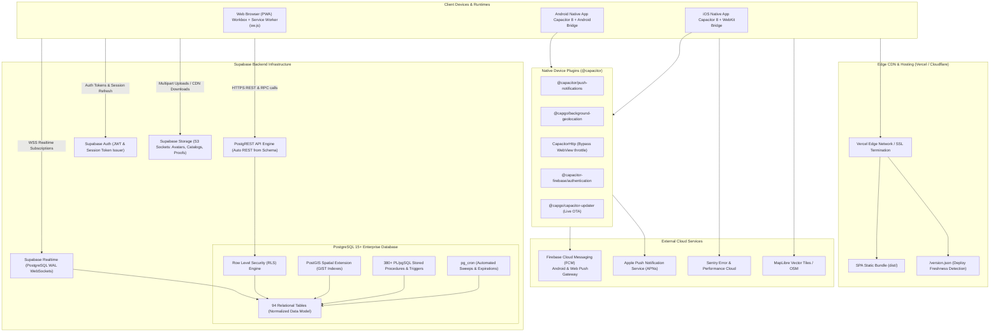
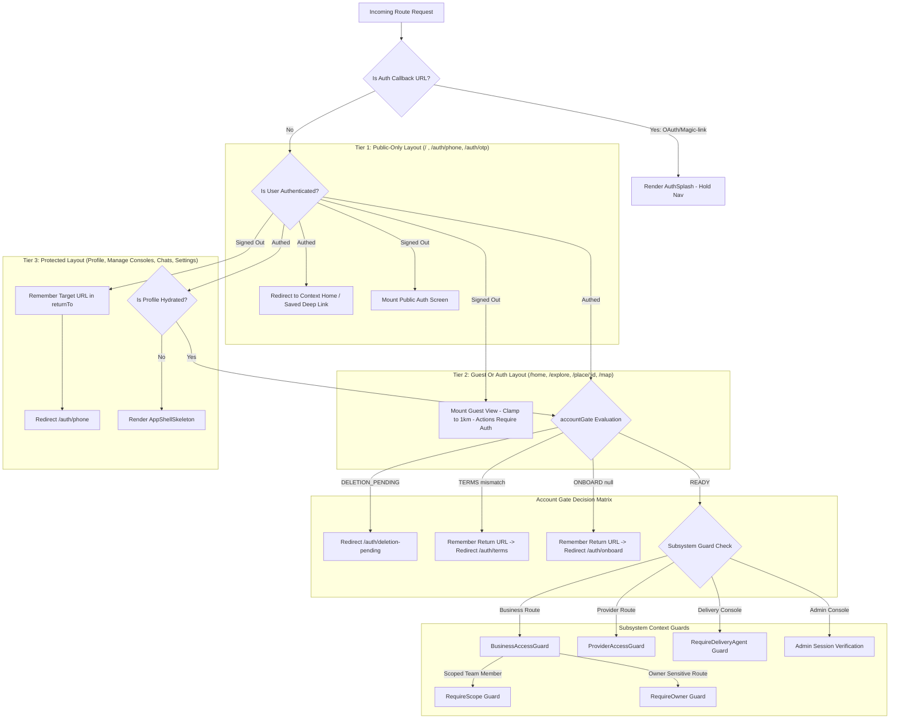
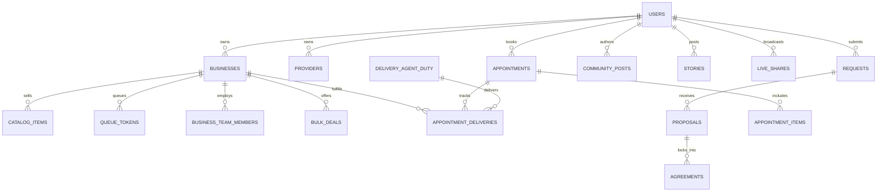
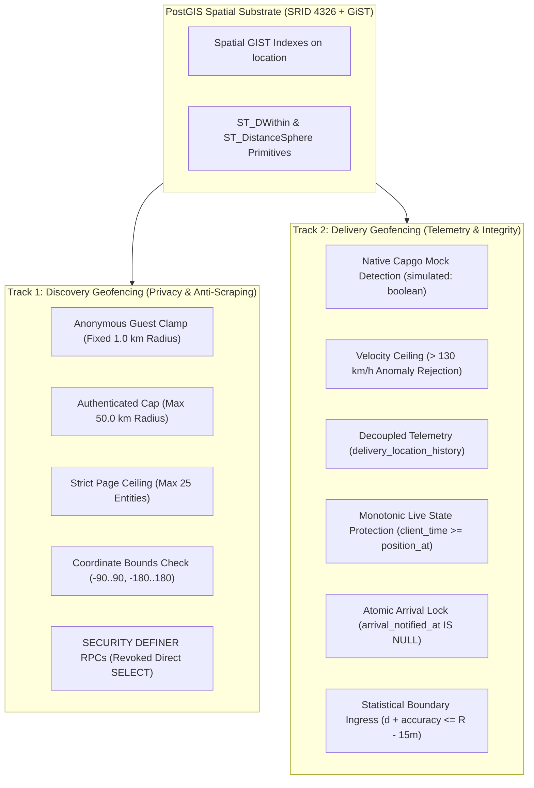
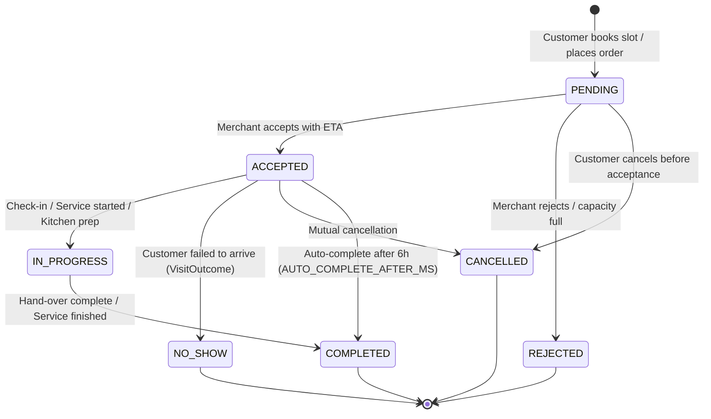
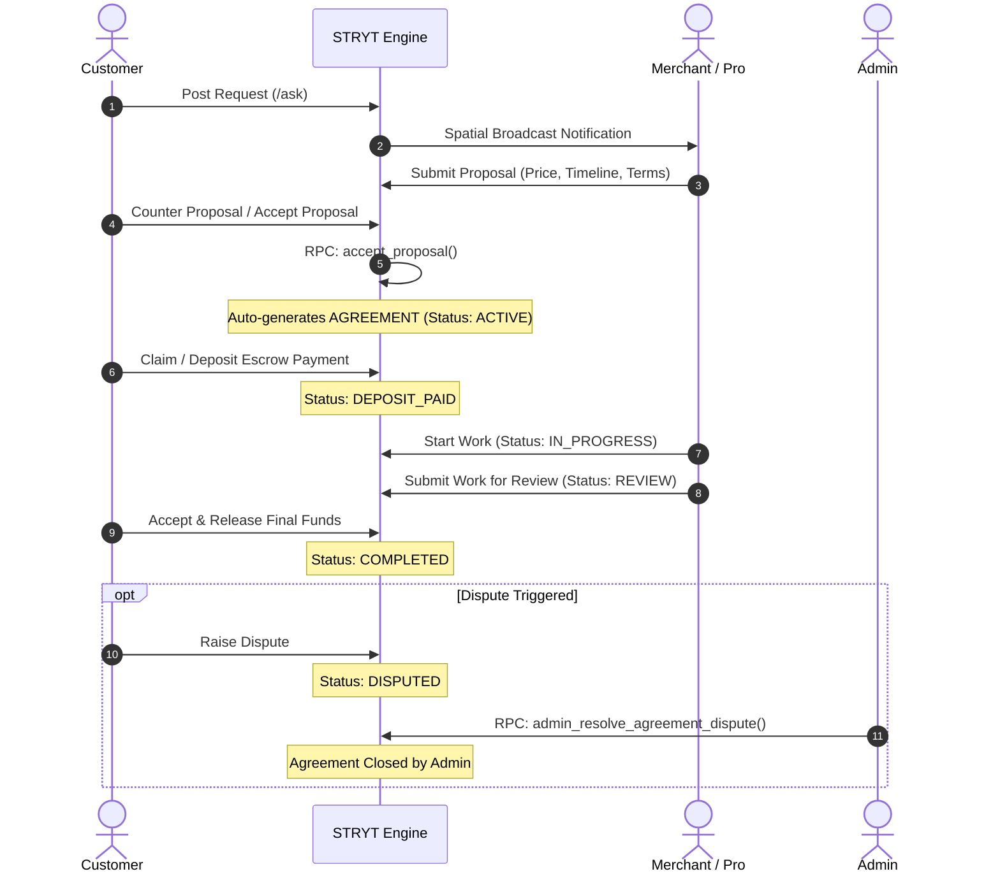
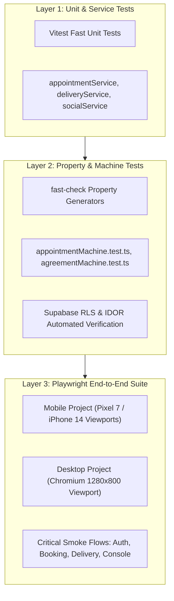
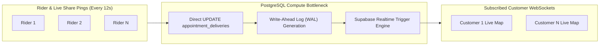
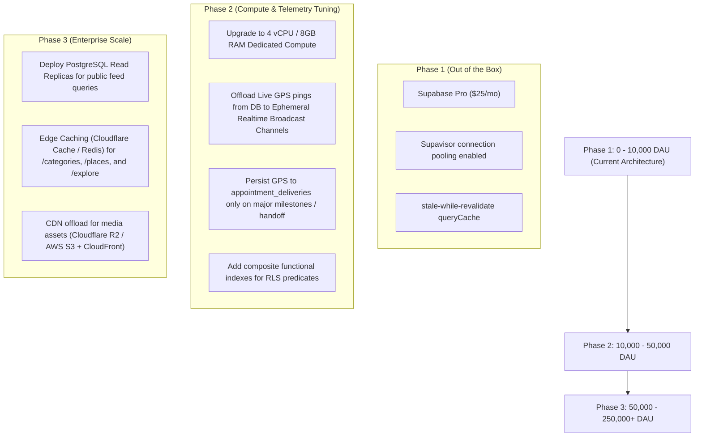

# STRYT — System Architecture & Technical Specification

> **Document Version:** 1.1.0  
> **Target Release:** v1.0.92+  
> **Source Base:** 100% verified against active codebase, components, store slices, services, Capacitor configurations, and PostgreSQL migrations.  
> **Last Updated:** November 2026

---

## Table of Contents

1. [Executive Summary & Platform Mission](#1-executive-summary--platform-mission)
2. [Technology Stack & System Matrix](#2-technology-stack--system-matrix)
3. [High-Level System Architecture](#3-high-level-system-architecture)
4. [Frontend Architecture & Patterns](#4-frontend-architecture--patterns)
   - [Application Shell & Layout Tiers](#41-application-shell--layout-tiers)
   - [Multi-Tier Route Guard Pipeline](#42-multi-tier-route-guard-pipeline)
   - [State Management, Multi-Persona Partitioning & Context Slices](#43-state-management-multi-persona-partitioning--context-slices)
   - [Responsive Design System & Token Architecture](#44-responsive-design-system--token-architecture)
   - [Offline Resiliency & Mutation Queuing](#45-offline-resiliency--mutation-queuing)
5. [Backend & Database Architecture](#5-backend--database-architecture)
   - [Data Modeling & Domain Partitioning (94 Tables)](#51-data-modeling--domain-partitioning-94-tables)
   - [PostGIS Geospatial Engine & Dual-Track Geofencing Architecture](#52-postgis-geospatial-engine--dual-track-geofencing-architecture)
     - [5.2.1 Discovery Geofencing Subsystem (Privacy & Anti-Enumeration)](#521-discovery-geofencing-subsystem-privacy--anti-enumeration)
     - [5.2.2 Delivery Geofencing Subsystem (High-Precision Telemetry & Anti-Spoofing)](#522-delivery-geofencing-subsystem-high-precision-telemetry--anti-spoofing)
     - [5.2.3 Statistical Uncertainty, Hysteresis & Debouncing Math](#523-statistical-uncertainty-hysteresis--debouncing-math)
     - [5.2.4 Three-Tier PostGIS Latency Benchmarking](#524-three-tier-postgis-latency-benchmarking)
   - [Stored Procedures (RPCs) & Transactional Integrity](#53-stored-procedures-rpcs--transactional-integrity)
   - [Row-Level Security (RLS) & Anti-IDOR Governance](#54-row-level-security-rls--anti-idor-governance)
6. [Security, Identity & Access Control](#6-security-identity--access-control)
   - [Authentication & Session Lifecycle](#61-authentication--session-lifecycle)
   - [Account Gate Finite State Machine](#62-account-gate-finite-state-machine)
   - [Dual-Mechanism Business Team Access](#63-dual-mechanism-business-team-access)
   - [Physical Terminal Authentication & PIN Protection](#64-physical-terminal-authentication--pin-protection)
7. [Core Business Workflows & Finite State Machines](#7-core-business-workflows--finite-state-machines)
   - [Appointment & Order Lifecycle Machine](#71-appointment--order-lifecycle-machine)
   - [Pillar C: Request-Proposal-Agreement Escrow Machine](#72-pillar-c-request-proposal-agreement-escrow-machine)
   - [Hyperlocal Delivery & Rider Dispatch Machine](#73-hyperlocal-delivery--rider-dispatch-machine)
   - [Bulk Deals & Neighborhood Group Buying](#74-bulk-deals--neighborhood-group-buying)
8. [Real-Time Telemetry & Background Processing](#8-real-time-telemetry--background-processing)
   - [Multiplexed Native Background Geolocation](#81-multiplexed-native-background-geolocation)
   - [Unified Push Notification Delivery Engine](#82-unified-push-notification-delivery-engine)
   - [Supabase Realtime WebSocket Subscriptions](#83-supabase-realtime-websocket-subscriptions)
   - [Google Play Store Background Location Policy & Evidence Standard](#84-google-play-store-background-location-policy--evidence-standard)
9. [Observability, Privacy & Telemetry](#9-observability-privacy--telemetry)
   - [Sentry Error Boundary with PII Stripping](#91-sentry-error-boundary-with-pii-stripping)
   - [Client-Side Crash Diagnostics](#92-client-side-crash-diagnostics)
   - [Audit Trails & View Logs](#93-audit-trails--view-logs)
10. [DevOps, Quality Gates & Deployment Pipeline](#10-devops-quality-gates--deployment-pipeline)
    - [Automated Static Quality & Security Linters](#101-automated-static-quality--security-linters)
    - [Testing Strategy (Unit, Property, E2E)](#102-testing-strategy-unit-property-e2e)
    - [Capgo Zero-Downtime Over-The-Air (OTA) Updates](#103-capgo-zero-downtime-over-the-air-ota-updates)
11. [Codebase Organization & Directory Map](#11-codebase-organization--directory-map)
12. [Scalability, Traffic Capacity & Performance Bottlenecks](#12-scalability-traffic-capacity--performance-bottlenecks)
    - [Realistic Capacity by Infrastructure Tier](#121-realistic-capacity-by-infrastructure-tier)
    - [Layer-by-Layer Throughput & Bottleneck Analysis](#122-layer-by-layer-throughput--bottleneck-analysis)
    - [High-Contention Paths & Telemetry Write Math](#123-high-contention-paths--telemetry-write-math)
    - [Scaling Roadmap & Performance Optimizations](#124-scaling-roadmap--performance-optimizations)
13. [Summary](#13-summary)

---

## 1. Executive Summary & Platform Mission

**STRYT** (`in.stryt.app`) is a hyper-local street-level marketplace, community social network, and on-demand fulfillment engine. Unlike traditional e-commerce or broad classifieds platforms that treat locations as static postal codes, STRYT operates on a **real-time spatial substrate** powered by PostGIS, high-precision GPS telemetry, and radius-based access constraints.

### Core Personas & Multi-Hat Architecture
Users transition fluidly across multiple roles without maintaining disjoint accounts:
1. **Customer / Resident:** Discovers nearby shops, books appointments, joins digital waitlists/queues, asks questions to the street ("Ask your Street"), joins neighborhood group buys, and shares live locations with emergency contacts ("My People").
2. **Local Business (Physical Retail / Salon / Restaurant):** Manages a verified storefront, inventory catalog, live queue tokens, appointment slots, customer Q&A, broadcast radii, bulk discount campaigns, and shared terminal staff access.
3. **Independent Service Provider (Solo Pro / Freelancer):** Operates without a physical commercial storefront; offers hourly/packaged services, manages dynamic service radii, accepts leads, submits milestone bids, and tracks earnings.
4. **Delivery Agent / Team Rider:** Operates on-duty fulfillment for local orders with turn-by-turn live location tracking, batched assignments, and secure PIN-verified customer handoffs.
5. **Platform Administrator:** Moderates user appeals, flags content, inspects marketplace health metrics, and resolves escrow disputes.

### Five Architectural Pillars
- **Pillar A — Storefront & Discovery Engine:** Real-time map with MapLibre GL, category hierarchies, dynamic search, live open/closed statuses, and inventory search.
- **Pillar B — Service Provider Ecosystem:** Portfolio showcase, verified badges, customizable rate cards, and direct customer dispatch.
- **Pillar C — Reverse Marketplace ("Ask your Street"):** Community-posted requests routed to nearby merchants and pros who bid competitive proposals, locked into legally binding, milestone-based digital agreements.
- **Pillar D — Hyperlocal Social & Neighborhood Feed:** Ephemeral 24-hour stories, neighborhood polls, recommendations, community discussion threads, and bulk group buying.
- **Pillar E — Autonomous Delivery & Real-Time Logistics:** Integrated dispatch, background telemetry tracking, live customer tracking links, and offline-tolerant handoff verification.

---

## 2. Technology Stack & System Matrix

| Tier / Subsystem | Technology | Architectural Purpose & Implementation Details |
| :--- | :--- | :--- |
| **Frontend Framework** | **React 18.3.1 (SPA)** | Single Page Application built on React Hooks, React Suspense, dynamic lazy chunking, and strict React 18 concurrency rules. |
| **Build & Tooling** | **Vite 5.4.11 + TypeScript 5.6** | Ultra-fast ESBuild/Rollup pipeline with strict type-safety (`tsconfig.json`), bundle asset hashing, and custom manifest injection. |
| **Mobile Runtime** | **Capacitor 8.4 (Android / iOS)** | Native bridge wrapping the web bundle into standalone native binaries with native HTTP, deep link interception, and edge-to-edge hardware controls. |
| **PWA & Caching** | **Vite-Plugin-PWA + Workbox 7.4** | Progressive Web App using `injectManifest` (`src/sw.js`) combining Workbox runtime caching with Web Push API listeners and `/version.json` cache-busting. |
| **Primary Database & BaaS** | **Supabase (PostgreSQL 15+)** | Primary datastore hosting 94 relational tables, 380+ stored procedures (RPCs), Row Level Security (RLS), and PostGIS spatial indexing. |
| **Realtime Engine** | **Supabase Realtime (WebSockets)** | Event-driven WebSocket layer broadcasting PostgreSQL WAL changes directly to subscribed client components (chat, delivery coords, queue tokens). |
| **Identity & Phone Auth** | **Firebase Auth 12.15 + Capacitor Firebase Auth 8.3** | Hardware-accelerated Phone OTP verification for mobile apps with fallback to Supabase Auth OTP on web. |
| **Mapping & GIS** | **MapLibre GL 6.10 & React-Leaflet 4.2** | High-performance vector tile rendering, custom map marker pins, interactive radius sliders, and device compass bearing support. |
| **Live Geolocation** | **@capgo/background-geolocation 8.3 + @capacitor/geolocation 8.2** | Foreground and background native Android Service / iOS Location Manager supporting persistent rider tracking and emergency live sharing. |
| **OTA Live Deployment** | **@capgo/capacitor-updater 8.50** | Enables instant web-bundle OTA hotfixes to mobile production builds without app store resubmission. |
| **Observability & Sentry** | **@sentry/react 8.55** | Client-side error tracking with custom PII scrubbing filters (`scrubPii.ts`) sanitizing phone numbers, tokens, and customer coordinates. |
| **Testing Harness** | **Vitest 2.1 + Playwright 1.60 + fast-check 3.23** | Tri-layer testing: fast property-based unit testing, automated migration drift verification, and multi-viewport E2E mobile/desktop automation. |

---

## 3. High-Level System Architecture



---

## 4. Frontend Architecture & Patterns

### 4.1 Application Shell & Layout Tiers

The user interface is structured around a resilient application shell (`src/App.tsx`) optimized for both mobile-first touch navigation and expansive desktop dashboards:
1. **Responsive Dual Navigation:**
   - **Mobile Viewport:** Bottom navigation bar (`BottomNav.tsx`) mounted strictly on primary tab routes (`/home`, `/explore`, `/map`, `/chats`, `/notifications`, `/community-hub`, `/profile`).
   - **Desktop Viewport:** Persistent responsive sidebar (`DesktopSidebar.tsx`) displayed across all screens except dedicated full-bleed layouts (Splash, Auth, and public Tracking links).
2. **Dual-Stage Suspense Boundaries:**
   - **Outer Boundary:** Renders `AuthSplash` during initial cold boot while Supabase auth tokens and native storage resolve.
   - **Inner Boundary:** Renders `RouteFallback` (a lightweight spinner) when navigating between code-split lazy chunks, eliminating full-screen flashes.
3. **App Shell Skeletoning:**
   - When transitioning between auth resolution and profile hydration, `AppShellSkeleton` renders a shimmering placeholder mirroring the header, stories, category chips, and content cards, preventing cumulative layout shift (CLS).
4. **Hardware Native Integration:**
   - Native hardware BACK button listener intercepts overlay sheets (`.overlay`, `[data-back-close]`) first before triggering standard browser history navigation or exiting the app.
   - Status bar contrast adapts dynamically: dark top screens (Splash, Home gradient) trigger `Style.Dark` (light icons), while white AppBar screens trigger `Style.Light` (dark icons).

### 4.2 Multi-Tier Route Guard Pipeline

Routing enforces strict security, clickwrap acceptance, and context separation through three main layout wrappers:



### 4.3 State Management, Multi-Persona Partitioning & Context Slices

State management is centralized in `src/store/AppProvider.tsx` using specialized React hooks composed into a unified `useApp()` hook. This modular separation avoids monolithic state bloat while preserving global access:

```
src/store/
├── AppProvider.tsx          # Master Context combining all modular state slices
├── sliceTypes.ts            # Core TypeScript interfaces for app-wide state
├── useAuthSession.ts        # Supabase session, CurrentUser profile, activeContext
├── useCommerceSlice.ts      # Active appointments, walk-ins, queues, order items
├── useGuestLocation.ts      # Geolocation resolution, accuracy metrics, guest fallback
├── useNotificationBadges.ts # Live badge counts for unread alerts and conversations
├── useSocialSlice.ts        # Community feed sync, story viewer state, reaction updates
└── useToast.ts              # Non-blocking global notification queue
```

#### Multi-Persona Partitioning & Role Switching
STRYT supports seamless multi-hat operational workflows where a single authenticated identity (`users.id`) can simultaneously hold multiple roles (`roles: string[]` such as `["customer", "business", "provider", "delivery"]`):
1. **Context Hat Isolation (`activeContext`):**
   - The user's active session role is managed via `activeContext` (`"CUSTOMER"`, `"BUSINESS"`, or `"PROVIDER"`), persisted in client storage to survive page refreshes and cold starts.
   - Headers, sidebars, bottom navigation, and action buttons dynamically reconfigure based on the active hat without requiring multiple user accounts.
2. **Conversation & Chat Persona Attribution:**
   - In `messages` and `conversations`, messages carry explicit metadata: `sender_role` (`"CUSTOMER" | "BUSINESS" | "PROVIDER"`), `entity_id` (the specific business or provider UUID), and `entity_name`.
   - This ensures that when a merchant replies to a customer query, the customer sees the verified business branding and storefront name, not the personal profile of the merchant owner or staff member typing the message.
3. **Community Post Partitioning:**
   - Hyperlocal feeds (`community_posts`) partition content authoring via `author_type` (`"user" | "business" | "provider"`) and `author_ref_id`.
   - Storefront promotions, flash sales, and business updates are attributed to the business entity, while personal discussions remain under the resident profile.
4. **Shared Terminal & Physical Till Protection:**
   - On shared shop tablets and POS counters, staff operate under the store's business session. Switching back to the owner's personal customer persona is locked behind a mandatory 4-digit Switch PIN (`switch_pin_attempts`), preventing floor staff from inspecting private orders, family chats, or personal location history.
5. **Real-Time Badge Synchronizer:**
   - Subscribes to Supabase Realtime changes across `notifications` and `messages`, updating navigation counters without manual polling.

### 4.4 Responsive Design System & Token Architecture

The design system is strictly tokenized via CSS variables defined in `src/index.css`:
- **Brand Tokens:** `var(--brand-500)`, `var(--brand-600)`, `var(--brand-900)` establishing the signature purple aesthetic.
- **Surface & Semantic Tokens:** `var(--bg)`, `var(--surface)`, `var(--text)`, `var(--text-muted)`, `var(--line)`, `var(--danger)`, `var(--success)`.
- **Safe-Area Padding:** Managed using native CSS `env(safe-area-inset-top)` and `env(safe-area-inset-bottom)` mapped to `--safe-area-top` and `--safe-area-bottom`.
- **Zero-Tolerance Static Linters:**
  - `scripts/check-hardcoded-colors.js`: Fails build if raw HEX/RGB/HSL values are found outside CSS root token definitions.
  - `scripts/check-undefined-tokens.js`: Ensures all referenced CSS variables exist in the design system dictionary.

### 4.5 Offline Resiliency & Mutation Queuing

STRYT includes dual offline synchronization queues:
1. **General Action Queue (`src/lib/actionQueue.ts`):** Serializes client operations (likes, post saves, bookmarks, message drafts) to `localStorage` when network connectivity fails (`navigator.onLine === false`). Automatically flushes with exponential backoff on reconnection.
2. **Rider Queue (`src/features/delivery-tracking/riderQueue.ts`):** Dedicated FIFO buffer for delivery riders navigating cellular dead zones. Caches GPS coordinate fixes and fulfillment transition events, flushing them to the database once connectivity returns.

---

## 5. Backend & Database Architecture

The backend is built entirely on Supabase's PostgreSQL engine, taking advantage of PostGIS spatial operations, transactional PL/pgSQL stored procedures, and declarative Row Level Security.

### 5.1 Data Modeling & Domain Partitioning (94 Tables)

The 94 tables are partitioned across twelve functional domains:



#### Domain Table Matrix

| Domain | Key Database Tables | Responsibilities |
| :--- | :--- | :--- |
| **1. Identity & Compliance** | `users`, `terms_acceptances`, `customer_onboarding_state`, `profile_deletion_requests`, `user_blocks`, `account_appeals` | User identities, verified badges, clickwrap audit trail, GDPR deletion schedules, and peer blocking. |
| **2. Physical Businesses** | `businesses`, `catalog_items`, `categories`, `queue_settings`, `queue_tokens`, `business_portfolio_items`, `business_packages`, `business_view_logs` | Merchant profiles, operating hours, geolocation coordinates, inventory stock, walk-in token counters, and analytics logs. |
| **3. Delegated Team Access** | `business_team_members`, `business_access_sessions`, `business_login_credentials`, `business_login_attempts`, `entity_password_attempts`, `switch_pin_attempts`, `entity_recovery_attempts` | Roster permissions, shared till sessions, approval workflows, PBKDF2/cryptographic password records, and brute-force throttling logs. |
| **4. Solo Service Pros** | `providers`, `provider_packages`, `portfolio_items`, `provider_view_logs`, `leads` | Freelancer profiles, hourly/fixed service packages, work radius geofencing, and direct customer lead inboxes. |
| **5. Pillar C Reverse Market** | `requests`, `request_me_toos`, `proposals`, `proposal_counters`, `agreements` | Customer asks, peer upvotes ("Me Too"), merchant bidding, counter-proposals, milestone agreements, and escrow dispute logs. |
| **6. Appointments & Commerce** | `appointments`, `appointment_items`, `blocked_slots`, `custom_payments` | Slot scheduling, walk-in reservations, itemized orders, merchant slot capacities, and direct UPI/custom payment logging. |
| **7. Logistics & Delivery** | `delivery_agent_duty`, `delivery_batches`, `appointment_deliveries`, `delivery_location_history`, `tracking_tokens`, `handoff_attempts` | Rider on-duty status, batched multi-drop delivery, live rider GPS positions, decoupled telemetry history (`delivery_location_history`), customer tracking tokens, and secure PIN handoff attempts. |
| **8. Hyperlocal Community** | `community_posts`, `post_comments`, `post_likes`, `post_saves`, `comment_reactions`, `poll_votes`, `societies`, `society_members` | Neighborhood feeds, threaded comments, upvotes, poll voting counters, residential society gating, and recommendation tagging. |
| **9. Ephemeral Stories** | `stories`, `story_views` | 24-hour visual stories, video/photo assets, viewer telemetry, and geo-targeted neighborhood story distribution. |
| **10. Real-time Messaging** | `conversations`, `messages` | Direct buyer-seller chat threads, proposal linking, attachment URLs, and unread counters. |
| **11. Safety & Live Location** | `live_shares`, `live_share_recipients`, `location_share_grants`, `emergency_contacts` | "My People" safety broadcasting, cryptographic live-share tokens, recipient permissions, and emergency dispatch links. |
| **12. Growth & Loyalty** | `bulk_deals`, `bulk_deal_pledges`, `bulk_deal_tokens`, `group_buy_tokens`, `loyalty_cards`, `user_stamps`, `leaderboard_points` | Group buying thresholds, digital stamp loyalty cards, redeemable QR coupons, and neighborhood leaderboards. |

> **Recent Geofencing & Telemetry Migrations:**  
> - `20261023_harden_delivery_geofencing.sql`: Establishes conservative geofence math, 15m hysteresis buffer, and debouncing standards.  
> - `20261024_harden_geofence_discovery.sql`: Implements server-side 1.0 km guest clamp, 25-item page ceiling, coordinate bounds checks, and `SECURITY DEFINER` privilege restriction across 7 spatial discovery RPCs.  
> - `20261025_teleportation_and_telemetry_hardening.sql`: Implements server-side velocity checks ($> 130\text{ km/h}$), creates `delivery_location_history`, enforces monotonic live position protection, and locks arrival notifications (`arrival_notified_at`).

### 5.2 PostGIS Geospatial Engine & Dual-Track Geofencing Architecture

STRYT's spatial infrastructure is built on PostgreSQL coordinates (`GEOGRAPHY(Point, 4326)`) indexed with GiST (`USING GIST(location)`). The platform enforces a strict architectural dichotomy between **Discovery Geofencing** and **Delivery Geofencing**. While both leverage shared PostGIS calculation primitives (`ST_DWithin`, `ST_DistanceSphere`), their security models, access privileges, and freshness requirements are completely decoupled:



#### 5.2.1 Discovery Geofencing Subsystem (Privacy & Anti-Enumeration)
Discovery powers buyer exploration across shops, offers, community discussions, and provider packages (`businesses_nearby`, `community_posts_nearby`, `categories_nearby`, `search_nearby_directory`, `leads_nearby`, `offers_nearby`, `explore_feed_nearby`):
1. **Coordinate Range Validation:**
   - Pre-execution validation verifies that latitude falls within $[-90.0, 90.0]$ and longitude within $[-180.0, 180.0]$, immediately raising `INVALID_COORDINATES` on malformed inputs.
2. **Database-Level Guest Clamp:**
   - Anonymous requests (`auth.role() = 'anon'`) are forcefully clamped to a **1.0 km radius** via `least(greatest(in_radius_km, 0.05), 1.0)`, preventing unauthenticated callers from harvesting merchant catalogs across regions.
   - Results are capped at a maximum of **25 items** per query, neutralizing brute-force radius walking.
3. **Authenticated Query Ceilings:**
   - Authenticated sessions are capped at a **50.0 km radius** (`least(greatest(in_radius_km, 0.05), 50.0)`), mitigating database-level Denial-of-Service scans and competitor scraping.
4. **Narrowly Scoped Execution Privileges:**
   - Direct `SELECT` on sensitive underlying tables is restricted; spatial queries execute exclusively via `SECURITY DEFINER` RPCs with `SET search_path = public`.
   - RPCs return narrow, projection-only field sets, omitting internal foreign keys, administrative metadata, and private user identifiers.

#### 5.2.2 Delivery Geofencing Subsystem (High-Precision Telemetry & Anti-Spoofing)
Delivery logistics require low-latency, fraud-resistant tracking between dispatch and doorstep handoff:
1. **Verified Native Mock-Location Detection:**
   - Telemetry integrates with `@capgo/background-geolocation` native bridge, inspecting the native hardware `simulated: boolean` flag (or Android mock location provider). Mock flags are streamed into telemetry payloads to inform backend risk scoring without brittle client-side logic.
2. **Server-Side Teleportation & Velocity Anomaly Ceiling:**
   - The `update_rider_position` RPC computes real-world velocity between the rider's consecutive position fixes:
     $$v = \frac{\Delta d}{\Delta t}$$
   - Any transit fix reflecting a speed exceeding **130 km/h** over a distance greater than **250 meters** is flagged as `IMPLAUSIBLE_SPEED_DETECTED`, rejected from live tracking, and recorded in `client_errors`.
3. **Decoupled Telemetry & Monotonic State Protection:**
   - Live delivery tracking (`appointment_deliveries`) is strictly monotonic: position updates are committed only when `v_client_time >= position_at`, preventing delayed network packets from rewinding the rider's displayed position.
   - Background batches flushed from offline buffers (`riderQueue.ts`) after cellular dead zones are preserved in `delivery_location_history` for route auditing without corrupting live customer-facing coordinates.
4. **Idempotent Arrival Notifications:**
   - Entry into the customer's 100-meter arrival geofence is protected by an atomic idempotency lock (`arrival_notified_at IS NULL`). The database sets `arrival_notified_at = now()` atomically with the arrival state change, guaranteeing that fluctuating GPS jitter near the perimeter never dispatches duplicate push notifications.

#### 5.2.3 Statistical Uncertainty, Hysteresis & Debouncing Math
To eliminate false boundary triggers caused by GPS drift in urban canyons, STRYT employs statistical uncertainty verification combined with hysteresis:
1. **Conservative Ingress Check (Geofence Entry):**
   - An entry event is recognized if and only if the rider's 68% confidence error circle is entirely enclosed within the geofence radius $R$ minus the hysteresis margin $\epsilon = 15\text{ m}$:
     $$(d + \text{accuracy}) \le (R - \epsilon)$$
2. **Confident Egress Check (Geofence Exit):**
   - An exit event is recognized only when the uncertainty circle is completely outside the geofence radius plus the hysteresis margin:
     $$(d - \text{accuracy}) \ge (R + \epsilon)$$
3. **Multi-Sample Temporal Debouncer (`GeofenceDebouncer`):**
   - State flips require $N \ge 2$ consecutive conforming GPS fixes before transitioning between `INSIDE` and `OUTSIDE`, preventing perimeter oscillation.

#### 5.2.4 Three-Tier PostGIS Latency Benchmarking
Spatial query scalability is verified using `scripts/db-tests/benchmark-postgis.mjs`, measuring performance across three isolated tiers:
1. **Tier 1 — SQL Engine Execution (GiST `EXPLAIN ANALYZE`):** Target p95 $< 10\text{ ms}$. Evaluates raw spatial index traversal speed under synthetic concurrent load.
2. **Tier 2 — PostgREST RPC Processing:** Target p95 $< 35\text{ ms}$. Evaluates PL/pgSQL function overhead, JSON serialization, and connection pool queuing.
3. **Tier 3 — Client Network Round-Trip Time (RTT):** Target p95 $< 120\text{ ms}$. Measures complete device-to-backend-to-device response latency over standard mobile 4G/5G connections.
- **Table Lock Avoidance:** Heavyweight `CLUSTER` commands on PostGIS GiST indexes are explicitly avoided in production migrations due to table-level exclusive read/write locks; spatial performance is maintained via standard GiST indexing and regular autovacuum maintenance.
- **Reference Plan:** Detailed implementation specifications, test cases, and penetration testing benchmarks are documented in [GEOFENCING_HARDENING_PLAN.md](file:///d:/zetax/name/STRYT/GEOFENCING_HARDENING_PLAN.md).

### 5.3 Stored Procedures (RPCs) & Transactional Integrity

High-concurrency, financially sensitive, and multi-table state changes are executed through **PL/pgSQL Stored Procedures**. Clients never perform multi-table orchestration directly:
- **`accept_proposal(p_proposal_id, ...)`**: Atomically marks the winning proposal as accepted, declines competing proposals, generates a binding `agreements` record, and issues system notifications.
- **`appointment_create(...)`**: Verifies available merchant slot capacity, creates the parent appointment, writes itemized `appointment_items`, creates placeholder delivery records if needed, and reserves catalog inventory.
- **`confirm_handoff(p_delivery_id, p_pin, ...)`**: Verifies customer PIN correctness, records the attempt in `handoff_attempts` (mitigating brute force), marks delivery completed, and frees the rider's active capacity.
- **`bulk_deal_pledge_join(...)`**: Records customer deposit pledges, recalculates the active discount tier, checks if the minimum threshold is met, and auto-closes the deal when full.

### 5.4 Row-Level Security (RLS) & Anti-IDOR Governance

All 94 tables have PostgreSQL Row Level Security enabled (`ALTER TABLE ... ENABLE ROW LEVEL SECURITY;`).
- **No Direct Table Mutation for Critical Flows:** Tables like `agreements`, `appointment_deliveries`, and `business_access_sessions` have **no permissive client UPDATE policies**. State changes must occur via authenticated RPCs containing embedded authorization checks.
- **Owner and Delegate Scoping:** RLS policies evaluate `auth.uid()` against ownership columns (`owner_user_id`), team rosters (`business_team_members`), or active session tokens (`business_access_sessions`).
- **IDOR Audit Automation:** The project pipeline includes `scripts/db-tests/idor-sweep.mjs` which validates that non-owners cannot mutate records by guessing surrogate UUIDs.

---

## 6. Security, Identity & Access Control

### 6.1 Authentication & Session Lifecycle

STRYT implements a resilient hybrid authentication architecture:
1. **Phone OTP Gateway:** Mobile native clients utilize `@capacitor-firebase/authentication` for carrier-verified hardware SMS verification. Web clients use Supabase Phone/Email OTP.
2. **Profile Self-Healing:** Upon successful login, the client evaluates whether a corresponding record exists in `public.users`. If absent (e.g., brand-new OAuth or phone sign-up), a database trigger or client self-heal RPC seeds a baseline profile, avoiding orphan session states.
3. **Session Persistence:** Supabase JWT tokens are securely stored in native device storage via Capacitor Preferences on mobile, and secure browser storage on web.

### 6.2 Account Gate Finite State Machine

Before granting access to standard app features, authenticated accounts are evaluated against `accountGate(user)` (`src/lib/machines/accountGate.ts`):

```mermaid
stateDiagram-v2
    [*] --> Evaluating

    Evaluating --> DELETION_PENDING : user.deletionScheduledAt != null
    Evaluating --> TERMS : user.termsAcceptedVersion != CURRENT_LEGAL_VERSION
    Evaluating --> ONBOARD : user.onboardingCompletedAt == null
    Evaluating --> READY : All checks pass

    DELETION_PENDING --> /auth/deletion-pending : Route Lockout
    TERMS --> /auth/terms : Clickwrap Acceptance Gate
    ONBOARD --> /auth/onboard : Profile Setup (Name, Location, Safety)
    READY --> ContextHome : Normal Navigation Unlocked
```

### 6.3 Dual-Mechanism Business Team Access

For complete architectural details, see `TEAM_ACCESS_ARCHITECTURE_AND_FLOW.md`. In summary:
1. **Named Team Member Grants:** The business owner invites a named user via phone, email, or `@username`. The user is granted granular permissions (`catalog`, `queue`, `appointments`, `leads`) or role presets (`Cashier`, `Manager`, `Rider`).
2. **Shop / Terminal Login (Shared Till):** For shared physical tablets/counters, the owner configures a single Business Login ID and Password. Employees sign in via `/business-login`, creating a time-bounded session (e.g., 8 hours) with optional real-time owner approval.
3. **Sub-Route Enforcement:** Route guards (`RequireScope.tsx`, `RequireOwner.tsx`, `RequireBusinessDeliveryMember.tsx`) mirror the backend RLS constraints on the UI level, preventing unauthorized access to financial settings or catalog edits.

### 6.4 Physical Terminal Authentication & PIN Protection

- **Switch PIN:** Owners operating on shared devices set a 4-digit numeric PIN. When switching from business management to personal customer browsing, the PIN locks the console to prevent staff from viewing private personal data.
- **Entity Password Service (`entityPasswordService.ts`):** Sensitive operations (resetting banking details, clearing customer databases) require secondary password verification backed by cryptographic salted hashes and security recovery questions.

---

## 7. Core Business Workflows & Finite State Machines

### 7.1 Appointment & Order Lifecycle Machine

The appointment lifecycle handles in-store appointments, walk-in services, and delivery orders (`src/lib/machines/appointment.ts`):



- **Fulfillment Distinction:** Slot bookings allow the merchant to mark "Done" or "No Show" via `visitOutcomeActions()`. Delivery orders cannot be marked completed by the merchant directly; they require rider delivery confirmation.

### 7.2 Pillar C: Request-Proposal-Agreement Escrow Machine

The reverse marketplace follows a strict finite state machine (`src/lib/machines/agreement.ts`):



- **Terminal Agreement Rule:** The states `COMPLETED`, `CANCELLED`, and `DISPUTED` are strictly terminal. No client mutation is permitted once reached.

### 7.3 Hyperlocal Delivery & Rider Dispatch Machine

Delivery logistics bridge orders with on-duty riders:
1. **Assignment:** Upon order acceptance, the system assigns a delivery to an available rider (`delivery_agent_duty.is_on_duty = true`) or allows the merchant to dispatch a designated team rider.
2. **Batching:** The engine supports multi-drop route batches (`delivery_batches`) grouped by spatial proximity.
3. **Telemetry Tracking:** Active deliveries engage `backgroundLocation.ts`, continuously streaming rider latitude/longitude to `appointment_deliveries.current_location` and notifying the customer via WebSockets.
4. **Secure Handoff:** The customer is issued a private 4-digit handoff PIN or dynamic QR token. The rider enters the PIN upon arrival; the database verifies it via `confirm_handoff()`, completing the delivery.

### 7.4 Bulk Deals & Neighborhood Group Buying

Neighborhood buying allows local businesses to unlock wholesale pricing when community demand crosses a set threshold:
1. **Deal Activation:** Merchant publishes a deal specifying target pledge count, end time, and tiered discount percentages.
2. **Community Pledging:** Customers join the pledge (`bulk_deal_pledge_join`).
3. **Target Threshold Reached:** When active pledges meet the target threshold, the database trigger auto-closes the deal and issues cryptographic QR vouchers (`bulk_deal_tokens`) to participants.
4. **In-Store Redemption:** Customers present the QR code at the physical counter; the merchant scans it via `HTML5-QRCode`, verifying and invalidating the token.

---

## 8. Real-Time Telemetry & Background Processing

### 8.1 Multiplexed Native Background Geolocation

Persistent location sharing is essential for both delivery tracking and family/friend safety ("My People"), but running multiple location listeners drains mobile batteries and triggers OS process killing.

STRYT solves this with a **Single Shared Multiplexer** (`src/lib/backgroundLocation.ts`):

```mermaid
flowchart TD
    subgraph LocationConsumers ["Consumers"]
        DeliveryRunner["DeliveryTrackingRunner <br/> (Active Rider Delivery)"]
        LiveShareProvider["LiveShareProvider <br/> (Family 'My People' Safety)"]
    end

    subgraph Multiplexer ["Unified Multiplexer (backgroundLocation.ts)"]
        RefCount{Active Subscriber Count}
        Throttler[Adaptive Distance & Frequency Filter]
    end

    subgraph NativeDriver ["Capacitor Background Geolocation"]
        CapgoPlugin["@capgo/background-geolocation <br/> Android Foreground Service / iOS LocationManager"]
    end

    DeliveryRunner -->|subscribe('delivery')| RefCount
    LiveShareProvider -->|subscribe('safety')| RefCount
    RefCount -->|count > 0: start| CapgoPlugin
    RefCount -->|count == 0: stop| CapgoPlugin

    CapgoPlugin -->|Native GPS Fix| Throttler
    Throttler -->|Filtered Fix| DeliveryRunner
    Throttler -->|Filtered Fix| LiveShareProvider
```

- **Google Play Compliance:** Background tracking presents a mandatory full-screen educational disclosure (`BackgroundLocationDisclosure.tsx`) before invoking system permission prompts, satisfying Google Play and iOS App Store location guidelines.

### 8.2 Unified Push Notification Delivery Engine

Notifications originate from database triggers and are delivered through dual channels:
- **Mobile Native:** Handled via `@capacitor/push-notifications` connecting directly to Firebase Cloud Messaging (FCM) and Apple Push Notification Service (APNs).
- **Web PWA:** Managed via custom service worker (`src/sw.js`) utilizing the Web Push API and VAPID keys.
- **Deep-Link Navigation Routing:** Push taps trigger the `push-nav` window event or service worker `NAVIGATE` message, gracefully routing the user into the target screen via `usePartNavigation()` without full app reloads.
- **OS Tray Auto-Clear:** Focusing the app automatically executes `clearDeliveredNotifications()`, clearing stale notifications from the system notification shade.

### 8.3 Supabase Realtime WebSocket Subscriptions

The app establishes reactive PostgreSQL WAL connections using the `useQueryWithRealtime` hook:
- Subscribes to table-level changes filtered by user or entity IDs (`agent_user_id=eq.${userId}`, `business_id=eq.${businessId}`).
- Updates client UI cache immediately upon database changes for chat messages, appointment statuses, queue movements, and delivery positions.

### 8.4 Google Play Store Background Location Policy & Evidence Standard

STRYT strictly restricts background geolocation execution to critical on-duty delivery courier workflows and opt-in user safety broadcasting ("My People"). To comply with Google Play's Location in the Background Policy, the application enforces the following architectural safeguards:

1. **Prominent In-App Educational Disclosure (`src/components/BackgroundLocationDisclosure.tsx`):**
   - Displayed *prior* to requesting Android runtime permissions (`ACCESS_BACKGROUND_LOCATION`).
   - Explicitly explains why background access is required (live route tracking for waiting customers), that tracking occurs continuously even when the app is minimized or the screen is off, and clarifies that tracking automatically terminates when the delivery completes or the rider goes off-duty.
2. **Persistent Native Foreground Service & Notification:**
   - Background location runs inside an Android Foreground Service powered by `@capgo/background-geolocation`.
   - Displays an ongoing, un-dismissible notification in the system shade with:
     - Notification Channel: `stryt_delivery_tracking` (High Priority).
     - Title: `"STRYT Live Tracking"`.
     - Subtext / Body: Dynamic status showing active order tracking.
3. **Two-Step Courier Dispatch Workflow:**
   - To prevent accidental background service starts before the courier is actually on the road, dispatch enforces a two-step progression:
     1. **"Picked up from shop"** (`PICKED_UP`): Marks that the rider has gathered items from the merchant counter.
     2. **"Start delivery"** (`IN_TRANSIT`): Mounts the background geolocation tracking service and initiates live telemetry broadcasting.
4. **Play Console Video Evidence Standard:**
   - Demonstrations submitted to Google Play Console adhere to the sub-30 second continuous review video standard:
     - Shows the in-app educational disclosure before permission escalation.
     - Captures Android 11–15 permission dialog navigation ("Allow all the time").
     - Shows courier tapping "Start delivery", backgrounding the app to the home screen, pulling down the Android notification tray to reveal the persistent `"STRYT Live Tracking"` notification, and reopening the app with active tracking intact.
   - Standard operating procedures and step-by-step recording blueprints are documented in [DELIVERY_VIDEO_ONE_PHONE_CHECKLIST.md](file:///d:/zetax/name/STRYT/archive/docs/launch/play-console/DELIVERY_VIDEO_ONE_PHONE_CHECKLIST.md), [DELIVERY_VIDEO_TWO_PHONE_CHECKLIST.md](file:///d:/zetax/name/STRYT/archive/docs/launch/play-console/DELIVERY_VIDEO_TWO_PHONE_CHECKLIST.md), and [DELIVERY_FLOW_GOOGLE_MAPS_PLAYSTORE_BLUEPRINT.md](file:///d:/zetax/name/STRYT/DELIVERY_FLOW_GOOGLE_MAPS_PLAYSTORE_BLUEPRINT.md).

---

## 9. Observability, Privacy & Telemetry

### 9.1 Sentry Error Boundary with PII Stripping

All unhandled errors, component boundary crashes, and network failures are captured by `@sentry/react` (`src/lib/sentry.ts`).
- **PII Scrubbing Pipeline (`src/lib/scrubPii.ts`):** Before any telemetry payload leaves the device, it passes through strict regex scrubbers that redact:
  - Phone numbers (Indian 10-digit and international E.164 formats).
  - Authentication tokens, passwords, and PIN codes.
  - Precise latitude/longitude coordinates from crash breadcrumbs.
  - Customer street names and delivery landmark notes.

### 9.2 Client-Side Crash Diagnostics

When a profile fails to hydrate or a corrupted local cache causes an app-level error, `src/components/ProfileLoadError.tsx` provides recovery options:
- Self-healing profile retry.
- Session invalidation and fresh sign-in.
- Local storage wipe without stranding the user on a blank screen.

### 9.3 Audit Trails & View Logs

To provide merchants with actionable traffic analytics without violating user privacy:
- Entity views (`business_view_logs`, `provider_view_logs`) are logged using anonymized user hash keys aggregated across daily intervals.
- Sensitive administrative events (moderation actions, dispute resolutions) are permanently recorded in `admin_actions`.

---

## 10. DevOps, Quality Gates & Deployment Pipeline

### 10.1 Automated Static Quality & Security Linters

STRYT enforces strict pre-commit and CI verification gates defined in `package.json`:

```bash
# Full Verification Suite
npm run verify
```

The verification command chains the following automated checks:
1. `check-colors`: Ensures no raw HEX/RGB values bypass design system variables (`scripts/check-hardcoded-colors.js`).
2. `check-tokens`: Validates all CSS token references (`scripts/check-undefined-tokens.js`).
3. `check-strings`: Detects untranslated user-facing strings against i18n dictionaries (`scripts/check-hardcoded-strings.mjs`).
4. `check-labels`: Verifies form accessibility and label-input association (`scripts/audit/label-association.mjs`).
5. `check-migrations`: Detects schema drift between TypeScript types and SQL migrations (`scripts/check-migration-drift.mjs`).
6. `check-policy-grants`: Scans PostgreSQL RLS policies for permissive security holes (`scripts/check-policy-grants.mjs`).
7. `check-idor`: Runs automated IDOR attack simulations (`scripts/db-tests/idor-sweep.mjs`).
8. `tsc --noEmit`: Strict TypeScript type-checking across the entire codebase.
9. `eslint . --max-warnings 0`: Zero-tolerance lint rules.
10. `vitest run`: Comprehensive unit and property tests.
11. `vite build`: Production asset compilation and minification.

### 10.2 Testing Strategy (Unit, Property, E2E)



- **Playwright Configuration:** Dual configurations (`playwright.config.ts` for fast audits, `playwright.e2e.config.ts` for full regression) supporting session reuse via `.auth/session.json`.

### 10.3 Capgo Zero-Downtime Over-The-Air (OTA) Updates

Mobile native applications feature integrated live OTA updating powered by `@capgo/capacitor-updater`:
- **Version Alignment:** `capacitor.config.ts` synchronizes the bundle version with `package.json` (`version: 1.0.91`), avoiding native build number downgrade conflicts.
- **Publish Pipeline (`scripts/publish-ota-update.mjs`):** Bundles and signs the `dist/` production folder into a compressed archive and publishes it to the Capgo release channel.
- **Client Application:** Upon launch, the app silently queries for newer bundles, downloads updates in the background, and applies them seamlessly on the next cold start.

---

## 11. Codebase Organization & Directory Map

```
STRYT/
├── .github/                     # CI/CD Workflows, verification actions
├── android/                     # Android Studio Native Project (Capacitor shell)
├── ios/                         # Xcode Native Project (Capacitor shell)
├── public/                      # Static assets, favicon, PWA icons, sw.js
├── scripts/                     # Architectural linters, audit tools, OTA publishers
│   ├── audit/                   # Accessibility and label association testers
│   ├── db-tests/                # IDOR security sweep & RLS validators
│   ├── check-hardcoded-colors.js
│   ├── check-undefined-tokens.js
│   ├── check-migration-drift.mjs
│   └── publish-ota-update.mjs
├── src/
│   ├── App.tsx                  # Root Routing, Suspense boundaries, Guard layouts
│   ├── main.tsx                 # React entry point, Sentry init, Service Worker reg
│   ├── index.css                # Global styles, Design tokens, animations, safe-areas
│   ├── components/              # Shared reusable UI component library
│   │   ├── appointments/        # Booking cards, calendar widgets, time slot pickers
│   │   ├── bulk/                # Group buy pledge cards, bulk deal progress bars
│   │   ├── cards/               # Business cards, provider cards, request cards
│   │   ├── chat/                # Conversation rows, message bubbles, proposal embeds
│   │   ├── community/           # Post feeds, poll cards, comment threads
│   │   ├── console/             # Management navigation bars, metric cards
│   │   ├── delivery/            # Delivery tracking maps, rider cards, handoff sheets
│   │   ├── discovery/           # Category chips, radius selectors, search bars
│   │   ├── identity/            # Verification badges, user avatars, profile sheets
│   │   ├── location/            # Geolocation permission sheets, map pins
│   │   ├── marketplace/         # Storefront action buttons, catalog items
│   │   ├── payments/            # UPI QR modal, payment status pill, deposit claims
│   │   ├── proposals/           # Proposal submission modals, counter-offer forms
│   │   ├── settings/            # Settings rows, toggle switches, section groups
│   │   ├── stories/             # Story tray, full-screen story viewer, camera modal
│   │   ├── trust/               # Endorsement chips, vouch modals, report dialogs
│   │   └── ui/                  # Primitives: Button, Modal, Sheet, Toast, Badge
│   ├── features/                # Self-contained domain feature modules
│   │   ├── ambient/             # Ambient sky gradient, dynamic weather themes
│   │   ├── business-home/       # Business dashboard quick actions, shop status toggle
│   │   ├── delivery-tracking/   # Persistent rider tracking runner, rider offline queue
│   │   ├── live-share/          # Family & friend 'My People' safety location sharing
│   │   ├── moderation/          # Review status notices, appeal modals
│   │   └── neighborhood-today/  # Hyperlocal daily highlights card
│   ├── hooks/                   # Custom React hooks (useApi, useDebounce, etc.)
│   ├── lib/                     # System utilities, native bridges, helpers
│   │   ├── geo/                 # Haversine math, bounding box calculation
│   │   ├── i18n/                # Multi-language translation dictionaries
│   │   ├── machines/            # Finite State Machines (accountGate, appointment, agreement)
│   │   ├── backgroundLocation.ts# Single shared native background location multiplexer
│   │   ├── pushNotifications.ts # Push notification initialization and listener bridge
│   │   ├── sentry.ts            # Sentry telemetry config with PII scrubbers
│   │   ├── supabaseClient.ts    # Initialized Supabase client instance
│   │   └── actionQueue.ts       # Offline optimistic mutation queue
│   ├── screens/                 # Top-level screen views (Code-split lazy chunks)
│   │   ├── admin/               # Administrative moderation, user search, appeals
│   │   ├── auth/                # Phone entry, OTP verify, onboarding, terms
│   │   ├── business/            # Business details, onboarding, and management console
│   │   ├── chat/                # Conversation list, chat thread screen
│   │   ├── community/           # Community activity, post detail, post compose
│   │   ├── delivery/            # Delivery agent console
│   │   ├── guide/               # User help guides, documentation
│   │   ├── legal/               # Public legal documents (Terms, Privacy)
│   │   ├── MapView/             # Interactive MapLibre street discovery map
│   │   ├── notifications/       # Notifications center screen
│   │   ├── places/              # Unclaimed places, community-added locations
│   │   ├── provider/            # Service provider profile, catalog, jobs console
│   │   ├── requests/            # Pillar C asks, proposals, agreements, ratings
│   │   ├── safety/              # Safety hub, emergency contacts management
│   │   └── settings/            # Granular settings screens (Privacy, Security, etc.)
│   ├── services/                # Backend API abstraction layer (PostgREST / RPCs)
│   │   ├── core/                # Auth, user, admin, upload, password services
│   │   ├── engagement/          # Chat, community, social, delivery, appointments
│   │   ├── marketplace/         # Business, provider, catalog, discovery, bulk deals
│   │   └── index.ts             # Barrel export for all application services
│   ├── store/                   # Modular state management context and slices
│   └── types/                   # TypeScript interfaces, database schema types
├── supabase/                    # Backend database migrations and schemas
│   ├── migrations/              # 270+ sequential SQL migration files
│   └── rollbacks/               # Reversible rollback migration scripts
├── tests/                       # Automated test suites
│   ├── e2e/                     # Playwright multi-viewport end-to-end tests
│   └── push-delivery/           # Push notification delivery exploration tests
├── capacitor.config.ts          # Native Capacitor mobile bridge configuration
├── vite.config.ts               # Vite build configuration and PWA manifest
└── package.json                 # Project dependencies, scripts, and build targets
```

---

## 12. Scalability, Traffic Capacity & Performance Bottlenecks

A realistic traffic evaluation of STRYT must distinguish between **frontend static delivery** (which scales effortlessly via global edge CDNs) and **stateful database / real-time operations** (which are bounded by PostgreSQL CPU, PostGIS GiST index traversal, connection pools, and WebSocket message propagation).

### 12.1 Realistic Capacity by Infrastructure Tier

The table below outlines concurrent user load, daily active users (DAU), and throughput ceilings based on standard deployment configurations:

| Infrastructure Tier | Concurrent Active Users (Peak Minute) | Daily Active Users (DAU) | Monthly Active Users (MAU) | Primary Bottlenecks & Failure Modes |
| :--- | :--- | :--- | :--- | :--- |
| **Tier 1: Supabase Free Tier**<br/>*(Shared Micro, 500MB RAM, 2 shared vCPUs)* | **50 – 150** | **1,000 – 3,000** | **10,000 – 25,000** | Exhaustion of 60 direct connection slots; 200 Realtime WebSocket cap; CPU throttling on concurrent `ST_DWithin` spatial searches. |
| **Tier 2: Supabase Pro (Default)**<br/>*($25/mo, 1GB RAM, 2 vCPUs, Supavisor pooler)* | **500 – 1,500** | **10,000 – 30,000** | **100,000 – 250,000** | 500 Realtime concurrent connections limit; disk IOPS burst limits under heavy live-share/rider writes; CPU spikes during dense map clustering. |
| **Tier 3: Pro + Compute Add-on**<br/>*(4–8 vCPUs, 8–16GB RAM, ~$100–$250/mo)* | **3,000 – 8,000** | **50,000 – 150,000** | **500,000 – 1,000,000** | WAL (Write-Ahead Logging) write saturation from continuous GPS tracking pings; complex multi-table RLS evaluation overhead at peak hours. |
| **Tier 4: Enterprise Scaled Architecture**<br/>*(Dedicated Cluster + Read Replicas + Redis)* | **15,000 – 50,000+** | **250,000 – 1,000,000+** | **3,000,000+** | Network bandwidth saturation on video/story uploads; requires offloading ephemeral GPS telemetry to a lightweight PubSub broker. |

---

### 12.2 Layer-by-Layer Throughput & Bottleneck Analysis

#### A. Frontend & Edge Distribution (Vercel / Cloudflare Pages + CDN)
- **Ceiling:** **100,000+ concurrent requests / Multi-million MAU.**
- **Implementation:** Single-Page Application (SPA) architecture with hashed static chunks, Brotli/Gzip compression, and aggressive HTTP cache headers.
- **Client Cache Resiliency:** The Progressive Web App service worker (`src/sw.js`) precaches core assets via Workbox. In-app navigation re-uses cached data via `useQuery`'s stale-while-revalidate map (`queryCache`), preventing redundant network roundtrips when bouncing between screens.

#### B. Spatial Geospatial Discovery Engine (PostGIS)
- **The Load:** Browsing `/map`, `/explore`, or searching categories triggers `businesses_nearby()`, `providers_nearby()`, or `community_posts_nearby()`.
- **Query Execution Profile:**
  - With GiST spatial indexing on `GEOGRAPHY(Point, 4326)` columns, a standard radius search takes **5 ms – 20 ms**.
  - A 2 vCPU database safely executes **150 – 350 spatial searches per second**.
- **Guardrails Implemented in Code:**
  - **Guest Radius Clamp:** `clampRadiusForViewer()` enforces a hard 1.0 km maximum radius for unauthenticated guests, preventing wide-radius geospatial bounding box scans that could spike database CPU.
  - **Coalesced Requests:** In-flight GET requests for businesses and providers are coalesced (`bustBusinessGetCache`, `bustProviderGetCache`) to avoid stampeding the database when multiple components mount simultaneously.

#### C. Real-Time Telemetry & Background Location Writes (Highest Contention Path)
- **The Load:** Active delivery agents and users sharing live safety locations push coordinates every **12 seconds** (`MIN_INTERVAL_MS = 12000` in `src/lib/backgroundLocation.ts`).
- **Telemetry Write Math:**
  $$\text{Writes per Second (WPS)} = \frac{\text{Active Tracking Sessions}}{12\text{ seconds}}$$
  - **10 Active Riders / Shares:** $\approx 0.83\text{ writes/sec}$ (Negligible load).
  - **100 Active Riders / Shares:** $\approx 8.3\text{ writes/sec}$ (Easily handled on Pro tier).
  - **1,000 Active Riders / Shares:** $\approx 83.3\text{ writes/sec}$ directly into `appointment_deliveries` / `live_shares`.
- **The Bottleneck:** At 80+ writes/second, each row update writes to the PostgreSQL WAL and triggers a Supabase Realtime broadcast to subscribed customers. On a 2 vCPU database, more than **250 simultaneous active riders** will cause WAL contention and high CPU.

#### D. Row-Level Security (RLS) Execution Overhead
- **The Load:** Every PostgREST request executes PostgreSQL RLS policies before returning data.
- **Evaluation Cost:** Simple `auth.uid() = user_id` policies execute in $< 1\text{ ms}$. However, policies requiring relational lookups (such as `has_business_scope()`, `user_blocks`, or `business_team_members`) add **5 ms – 25 ms** of CPU evaluation time per request.
- **Capacity Impact:** At 1,500+ API requests/sec, RLS CPU consumption requires vertical compute scaling (4+ vCPUs).

#### E. Phone Authentication & Carrier SMS Quotas
- **Firebase Auth Free Tier:** 10,000 SMS verifications/month.
- **Paid Tier:** $0.015 – $0.06 per verification depending on destination carrier (e.g. India vs. International).
- **Failure Mode:** Sudden viral spikes without active payment methods on Google Cloud/Firebase will lead to carrier SMS throttling, stranding new users at `/auth/phone`.

---

### 12.3 High-Contention Paths & Telemetry Write Math



---

### 12.4 Scaling Roadmap & Performance Optimizations

To scale STRYT from **1,000 DAU to 100,000+ DAU**, follow this architectural roadmap:



---

## 13. Summary

STRYT's architecture unites high-concurrency commerce with spatial awareness, real-time safety, and multi-tenant delegation. By enforcing strict security invariants at the database layer (Row-Level Security and stored procedures), maintaining finite state machines on the client, and employing battery-conscious background telemetry, STRYT delivers a native-grade, offline-resilient street marketplace across web, Android, and iOS.
