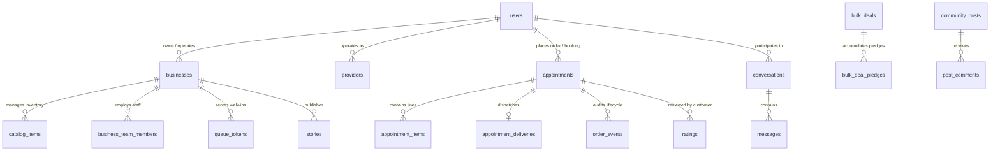

# STRYT Database Architecture & Complete Schema Reference

> **Authoritative Technical Documentation** for STRYT -- Hyperlocal Commerce, Dynamic Storefronts, On-Demand Delivery & Multi-Persona Service Platform.

## 1. Executive Summary & Architecture Overview

STRYT is backed by **PostgreSQL 15+** deployed on **Supabase**, utilizing **PostgREST 14.5**, **PostGIS** geospatial extensions, **pgcrypto**, and **Row Level Security (RLS)**. The database is designed for hyper-local low-latency queries, offline-first mobile synchronization (Capacitor/React), real-time WebSockets, and strict multi-tenant boundary isolation.

### High-Level Metrics

| Metric | Count | Details |
| :--- | :--- | :--- |
| **Total Registered Tables** | **103** | 100 public application tables, 1 private compliance table, 2 PostGIS views/tables |
| **Database Schemas** | **4** | `public` (application domain), `private` (IT Rules retention), `analytics` (user & seller traits), `extensions` (PostGIS, pgcrypto) |
| **Custom Enumerations** | **7** | `business_operating_model`, `agreement_status`, `entity_status`, `request_status`, `proposal_status`, `stock_status`, `category_kind` |
| **Database Views** | **4** | `customer_unified_activity`, `analytics.user_traits`, `analytics.seller_traits`, PostGIS catalogs |
| **Security Definer RPCs & Functions** | **250+** | Atomic state transitions, exponential lockouts, door handoff verification, stock deltas |
| **Security Model** | **100% RLS** | Deny-by-default with targeted authenticated policies & SECURITY DEFINER transactional gates |

### Core Architectural Principles

1. **Multi-Persona Storefront & Attribution Architecture**:
   - The platform treats the user as an actor holding different personas: **Customer**, **Business Owner**, **Staff Agent**, **Service Provider**, or **Delivery Rider**.
   - Chat messaging and orders maintain explicit persona attribution via columns like `sender_role`, `entity_id`, `staff_alias`, and `team_entity_id`.
2. **Dual-Swimlane Transaction Engine**:
   - The `appointments` table acts as the unified transactional backbone for both **Service Appointments** and **Retail/Food Delivery Orders**.
   - The `customer_unified_activity` security invoker view separates activities cleanly between `ORDER` and `APPOINTMENT` swimlanes.
3. **Zero-Trust Doorstep Verification & Delivery Tracking**:
   - Deliveries managed via `appointment_deliveries` require a 6-digit `handoff_code` verified exclusively through the atomic `confirm_handoff()` RPC.
   - Rate-limiting table `handoff_attempts` enforces a maximum of 5 attempts within 15 minutes before an exponential cooldown lock is triggered.
4. **Hyperlocal PostGIS Spatial Engine**:
   - Hyperlocal discovery relies on PostGIS spherical computations (`ST_DWithin`, `ST_MakePoint`) to match customers with storefronts and service pros within configurable delivery and service radii.
5. **Statutory Compliance & Data Retention**:
   - Conforms to **India Information Technology Rules 2021 r.3(1)(h)** via `private.deleted_account_registrations`, which retains minimal registration data for exactly 180 days after user deletion before automated purge routines scrub it.

## 2. High-Level Entity Relationship Diagram

## 3. Comprehensive Domain Catalog

### 1. Identity, Authentication & Profile Management

Manages user accounts, customer onboarding states, authentication rate-limiting, society/community memberships, emergency contacts, push tokens, and GDPR/compliance retention.

#### `users`

**Purpose**: Core profile record for all platform users across customer, merchant, and provider personas. Contains contact info, verification status, geo-location, and preference flags.

**Foreign Key Relationships**:
- `society_id` -> `societies(id)` *(users_society_id_fkey)*

| Column | Data Type | Nullable | Details / Business Description |
| :--- | :--- | :---: | :--- |
| `admin_login_id` | `string` | Yes | Entity relation ID references `admin_logins` |
| `alias` | `string` | Yes | Field storing `alias` |
| `area` | `string` | Yes | Field storing `area` |
| `avatar` | `string` | Yes | Field storing `avatar` |
| `business_password_hash` | `string` | Yes | Field storing `business password hash` |
| `business_recovery_answer_hash` | `string` | Yes | Field storing `business recovery answer hash` |
| `business_recovery_question_id` | `string` | Yes | Entity relation ID references `business_recovery_questions` |
| `business_recovery_question_text` | `string` | Yes | Field storing `business recovery question text` |
| `city` | `string` | Yes | Field storing `city` |
| `created_at` | `string` | Yes | Record creation timestamptz (default now()) |
| `customer_deleted_at` | `string` | Yes | Timestamp when user requested account deletion (triggers retention lifecycle) |
| `customer_enabled` | `boolean` | No | Field storing `customer enabled` |
| `email` | `string` | Yes | Field storing `email` |
| `id` | `string` | No | Primary key, mirrors Supabase Auth auth.users.id |
| `interest_category_ids` | `string[]` | Yes | Field storing `interest category ids` |
| `language` | `string` | Yes | Field storing `language` |
| `lat` | `number` | Yes | Field storing `lat` |
| `lng` | `number` | Yes | Field storing `lng` |
| `location_public` | `boolean` | Yes | Field storing `location public` |
| `name` | `string` | No | Field storing `name` |
| `notif_nearby_alerts` | `boolean` | No | Field storing `notif nearby alerts` |
| `notif_nearby_requests` | `boolean` | No | Field storing `notif nearby requests` |
| `notif_new_business` | `boolean` | No | Field storing `notif new business` |
| `notif_offers` | `boolean` | No | Field storing `notif offers` |
| `notif_quiet_hours` | `boolean` | No | Field storing `notif quiet hours` |
| `notif_silent` | `boolean` | No | Field storing `notif silent` |
| `notification_radius_km` | `number` | Yes | Field storing `notification radius km` |
| `onboarding_completed_at` | `string` | Yes | Field storing `onboarding completed at` |
| `phone` | `string` | Yes | E.164 normalized phone number used for primary authentication |
| `provider_password_hash` | `string` | Yes | Field storing `provider password hash` |
| `provider_recovery_answer_hash` | `string` | Yes | Field storing `provider recovery answer hash` |
| `provider_recovery_question_id` | `string` | Yes | Entity relation ID references `provider_recovery_questions` |
| `provider_recovery_question_text` | `string` | Yes | Field storing `provider recovery question text` |
| `rating_avg` | `number` | Yes | Field storing `rating avg` |
| `rating_count` | `number` | Yes | Field storing `rating count` |
| `roles` | `string[]` | No | Field storing `roles` |
| `show_asks_publicly` | `boolean` | Yes | Field storing `show asks publicly` |
| `show_badges_publicly` | `boolean` | Yes | Field storing `show badges publicly` |
| `show_city_publicly` | `boolean` | Yes | Field storing `show city publicly` |
| `show_email_publicly` | `boolean` | Yes | Field storing `show email publicly` |
| `show_name_publicly` | `boolean` | Yes | Field storing `show name publicly` |
| `show_phone_publicly` | `boolean` | Yes | Field storing `show phone publicly` |
| `show_posts_publicly` | `boolean` | Yes | Field storing `show posts publicly` |
| `show_rating_publicly` | `boolean` | Yes | Field storing `show rating publicly` |
| `society_id` | `string` | Yes | Entity relation ID references `societys` |
| `switch_pin_hash` | `string` | Yes | Field storing `switch pin hash` |
| `terms_accepted_at` | `string` | Yes | Field storing `terms accepted at` |
| `terms_accepted_version` | `string` | Yes | Field storing `terms accepted version` |
| `timezone` | `string` | Yes | Field storing `timezone` |
| `unit_number` | `string` | Yes | Field storing `unit number` |

---

#### `customer_onboarding_state`

**Purpose**: Tracks progression through multi-step customer onboarding wizard (profile setup, location, preferences).

**Foreign Key Relationships**:
- `user_id` -> `users(id)` *(customer_onboarding_state_user_id_fkey)*

| Column | Data Type | Nullable | Details / Business Description |
| :--- | :--- | :---: | :--- |
| `age_confirmed_at` | `string` | Yes | Field storing `age confirmed at` |
| `step` | `number` | No | Current wizard step identifier |
| `updated_at` | `string` | No | Last update timestamptz (auto-updated by trigger) |
| `user_id` | `string` | No | References users(id) |

---

#### `phone_login_lease`

**Purpose**: Distributed concurrency lock preventing simultaneous OTP/phone login race conditions for the same user.

| Column | Data Type | Nullable | Details / Business Description |
| :--- | :--- | :---: | :--- |
| `leased_until` | `string` | No | Expiry timestamptz of current login lease (defaults to 15s timeout) |
| `user_id` | `string (PK)` | No | User ID undergoing login lease acquisition |

---

#### `auth_bridge_attempts`

**Purpose**: Security rate-limiting ledger recording IP and phone authentication bridge attempts using SHA-256 hashed keys.

| Column | Data Type | Nullable | Details / Business Description |
| :--- | :--- | :---: | :--- |
| `at` | `string` | No | Timestamp of the authentication attempt |
| `bucket` | `'ip' | 'phone'` | No | Rate limit bucket: 'ip' or 'phone' |
| `id` | `number (identity)` | No | Identity primary key |
| `key_hash` | `string` | No | SHA-256 hash prefix of the IP address or phone number (never raw PII) |

---

#### `deleted_account_registrations`

**Purpose**: Private schema table (private.deleted_account_registrations) adhering to IT Rules 2021 r.3(1)(h). Preserves minimal registration history for 180 days post-deletion before automated purge.

| Column | Data Type | Nullable | Details / Business Description |
| :--- | :--- | :---: | :--- |
| `alias` | `string` | Yes | Field storing `alias` |
| `delete_after` | `string (180 days)` | No | Timestamp after which row is permanently scrubbed (created_at + 180 days) |
| `deleted_at` | `string` | No | Field storing `deleted at` |
| `email` | `string` | Yes | Field storing `email` |
| `name` | `string` | Yes | Field storing `name` |
| `phone` | `string` | Yes | Field storing `phone` |
| `registered_at` | `string` | Yes | Field storing `registered at` |
| `user_id` | `string (PK, private schema)` | No | Primary key of deleted user |

---

#### `societies`

**Purpose**: Residential societies, apartment complexes, and gated neighborhoods for hyperlocal group buying and gate passes.

**Foreign Key Relationships**:
- `admin_user_id` -> `users(id)` *(societies_admin_user_id_fkey)*

| Column | Data Type | Nullable | Details / Business Description |
| :--- | :--- | :---: | :--- |
| `address` | `string` | No | Field storing `address` |
| `admin_user_id` | `string` | Yes | User account foreign key references public.users(id) |
| `city` | `string` | No | Field storing `city` |
| `created_at` | `string` | Yes | Record creation timestamptz (default now()) |
| `id` | `string` | No | Unique society identifier |
| `join_code` | `string` | No | Field storing `join code` |
| `lat` | `number` | Yes | Geographic latitude coordinate |
| `lng` | `number` | Yes | Geographic longitude coordinate |
| `name` | `string` | No | Registered name of apartment complex or residential society |
| `pincode` | `string` | No | Field storing `pincode` |
| `unit_count` | `number` | Yes | Field storing `unit count` |
| `verified` | `boolean` | Yes | Field storing `verified` |

---

#### `society_members`

**Purpose**: Maps users to residential societies with flat/unit designations and verification badges.

**Foreign Key Relationships**:
- `society_id` -> `societies(id)` *(society_members_society_id_fkey)*
- `user_id` -> `users(id)` *(society_members_user_id_fkey)*

| Column | Data Type | Nullable | Details / Business Description |
| :--- | :--- | :---: | :--- |
| `approved` | `boolean` | Yes | Field storing `approved` |
| `id` | `string` | No | Unique primary key identifier |
| `joined_at` | `string` | Yes | Field storing `joined at` |
| `role` | `string` | No | Field storing `role` |
| `society_id` | `string` | No | References societies(id) |
| `unit_number` | `string` | No | Flat, villa, or door number within the society |
| `user_id` | `string` | No | References users(id) |

---

#### `emergency_contacts`

**Purpose**: Designated trusted contacts for safety broadcasts, ride tracking alerts, and emergency notifications.

**Foreign Key Relationships**:
- `contact_user_id` -> `users(id)` *(emergency_contacts_contact_user_id_fkey)*
- `owner_user_id` -> `users(id)` *(emergency_contacts_owner_user_id_fkey)*

| Column | Data Type | Nullable | Details / Business Description |
| :--- | :--- | :---: | :--- |
| `contact_user_id` | `string` | No | User account foreign key references public.users(id) |
| `created_at` | `string` | Yes | Record creation timestamptz (default now()) |
| `id` | `string` | No | Unique primary key identifier |
| `owner_user_id` | `string` | No | User account foreign key references public.users(id) |

---

#### `fcm_tokens`

**Purpose**: Firebase Cloud Messaging push tokens for native Android/iOS mobile devices.

**Foreign Key Relationships**:
- `user_id` -> `users(id)` *(fcm_tokens_user_id_fkey)*

| Column | Data Type | Nullable | Details / Business Description |
| :--- | :--- | :---: | :--- |
| `created_at` | `string` | Yes | Record creation timestamptz (default now()) |
| `platform` | `string` | No | Field storing `platform` |
| `token` | `string` | No | Unique FCM device registration token |
| `user_id` | `string` | No | User who registered the device token |

---

#### `push_subscriptions`

**Purpose**: W3C Web Push notification subscription payloads for progressive web app (PWA) push alerts.

**Foreign Key Relationships**:
- `user_id` -> `users(id)` *(push_subscriptions_user_id_fkey)*

| Column | Data Type | Nullable | Details / Business Description |
| :--- | :--- | :---: | :--- |
| `auth` | `string` | No | Field storing `auth` |
| `created_at` | `string` | Yes | Record creation timestamptz (default now()) |
| `endpoint` | `string` | No | Push service endpoint URL |
| `id` | `string` | No | Unique primary key identifier |
| `p256dh` | `string` | No | Field storing `p256dh` |
| `user_id` | `string` | No | User account associated with the web browser subscription |

---

#### `terms_acceptances`

**Purpose**: Legal audit trail recording user consent to Terms of Service, Privacy Policies, and EULA revisions.

**Foreign Key Relationships**:
- `user_id` -> `users(id)` *(terms_acceptances_user_id_fkey)*

| Column | Data Type | Nullable | Details / Business Description |
| :--- | :--- | :---: | :--- |
| `acceptance_method` | `string` | Yes | Method of consent (e.g. checkbox, otp_verify) |
| `accepted_at` | `string` | No | Field storing `accepted at` |
| `id` | `string` | No | Unique primary key identifier |
| `login_attempt_id` | `string` | Yes | Entity relation ID references `login_attempts` |
| `user_agent` | `string` | Yes | Field storing `user agent` |
| `user_id` | `string` | No | User who accepted terms |
| `version` | `string` | No | Field storing `version` |

---

#### `user_blocks`

**Purpose**: Mutual block relationships between users for safety, harassment prevention, and feed filtering.

**Foreign Key Relationships**:
- `blocked_user_id` -> `users(id)` *(user_blocks_blocked_user_id_fkey)*
- `blocker_user_id` -> `users(id)` *(user_blocks_blocker_user_id_fkey)*

| Column | Data Type | Nullable | Details / Business Description |
| :--- | :--- | :---: | :--- |
| `blocked_user_id` | `string` | No | User account foreign key references public.users(id) |
| `blocker_user_id` | `string` | No | User account foreign key references public.users(id) |
| `created_at` | `string` | No | Record creation timestamptz (default now()) |

---

#### `profile_deletion_requests`

**Purpose**: Pending user-initiated account deletion requests undergoing cool-off verification.

**Foreign Key Relationships**:
- `user_id` -> `users(id)` *(profile_deletion_requests_user_id_fkey)*

| Column | Data Type | Nullable | Details / Business Description |
| :--- | :--- | :---: | :--- |
| `created_at` | `string` | No | Record creation timestamptz (default now()) |
| `id` | `string` | No | Unique primary key identifier |
| `prev_visibility` | `Json` | Yes | Field storing `prev visibility` |
| `reason` | `string` | Yes | Field storing `reason` |
| `status` | `string` | No | Deletion lifecycle status (PENDING, PROCESSED, CANCELLED) |
| `target_id` | `string` | Yes | Entity relation ID references `targets` |
| `target_type` | `string` | No | Field storing `target type` |
| `updated_at` | `string` | No | Last update timestamptz (auto-updated by trigger) |
| `user_id` | `string` | No | User requesting account erasure |

---

### 2. Businesses, Storefronts & Multi-Persona Architecture

Powers merchant storefronts, operating models (retail, food, salon, clinic), staff access levels, secure console credentials, Q&A, and place taxonomy.

#### `businesses`

**Purpose**: Core storefront entity. Stores operating models, dynamic fulfillment capabilities, business hours, delivery radius, fees, and location coordinates.

**Foreign Key Relationships**:
- `category_id` -> `categories(id)` *(businesses_category_id_fkey)*
- `owner_user_id` -> `users(id)` *(businesses_owner_user_id_fkey)*

| Column | Data Type | Nullable | Details / Business Description |
| :--- | :--- | :---: | :--- |
| `aadhaar_doc_url` | `string` | Yes | Field storing `aadhaar doc url` |
| `address_line1` | `string` | Yes | Field storing `address line1` |
| `available_until` | `string` | Yes | Field storing `available until` |
| `bookings_enabled` | `boolean` | Yes | Field storing `bookings enabled` |
| `boost_reminder_sent` | `boolean` | No | Field storing `boost reminder sent` |
| `boosted_until` | `string` | Yes | Field storing `boosted until` |
| `broadcast_radius` | `number` | No | Field storing `broadcast radius` |
| `broadcast_radius_km` | `number` | Yes | Field storing `broadcast radius km` |
| `call_count` | `number` | Yes | Field storing `call count` |
| `category_id` | `string` | Yes | Entity relation ID references `categorys` |
| `category_name` | `string` | Yes | Field storing `category name` |
| `city` | `string` | Yes | Field storing `city` |
| `cover_image` | `string` | Yes | Field storing `cover image` |
| `created_at` | `string` | Yes | Record creation timestamptz (default now()) |
| `default_slot_capacity` | `number` | No | Field storing `default slot capacity` |
| `deleted_at` | `string` | Yes | Field storing `deleted at` |
| `delivery_enabled` | `boolean` | No | Field storing `delivery enabled` |
| `delivery_fee` | `number` | No | Base flat delivery charge (in minor currency units) |
| `delivery_prep_min` | `number` | No | Estimated prep time in minutes before handoff to rider |
| `delivery_proof_allowed` | `boolean` | No | Whether doorstep photo delivery proof is accepted |
| `delivery_radius_km` | `number` | Yes | Maximum delivery radius in kilometers for local order fulfillment |
| `delivery_time` | `string` | Yes | Field storing `delivery time` |
| `deposit_percent` | `number` | No | Field storing `deposit percent` |
| `description` | `string` | Yes | Field storing `description` |
| `directions_count` | `number` | Yes | Field storing `directions count` |
| `disabled_at` | `string` | Yes | Field storing `disabled at` |
| `email` | `string` | Yes | Field storing `email` |
| `free_delivery_above` | `number` | Yes | Cart total threshold for waived delivery fee |
| `fulfillment_capabilities` | `Json` | Yes | JSONB flags: { delivery: boolean, pickup: boolean, appointments: boolean, queue: boolean } |
| `gallery` | `string[]` | Yes | Field storing `gallery` |
| `geom` | `unknown` | No | Field storing `geom` |
| `hours` | `string` | Yes | Field storing `hours` |
| `id` | `string` | No | Unique primary key identifier |
| `is_available_now` | `boolean` | Yes | Field storing `is available now` |
| `is_boosted` | `boolean` | Yes | Field storing `is boosted` |
| `is_featured` | `boolean` | Yes | Field storing `is featured` |
| `is_new` | `boolean` | Yes | Field storing `is new` |
| `is_open_now` | `boolean` | Yes | Field storing `is open now` |
| `is_verified` | `boolean` | Yes | Field storing `is verified` |
| `lat` | `number` | Yes | Field storing `lat` |
| `lead_credits` | `number` | No | Field storing `lead credits` |
| `lng` | `number` | Yes | Field storing `lng` |
| `location_public` | `boolean` | Yes | Field storing `location public` |
| `location_review_status` | `string` | No | Field storing `location review status` |
| `max_concurrent_bookings` | `number` | Yes | Field storing `max concurrent bookings` |
| `min_order_amount` | `number` | No | Minimum cart value required to place an order |
| `name` | `string` | No | Field storing `name` |
| `offer_text` | `string` | Yes | Field storing `offer text` |
| `opening_date` | `string` | Yes | Field storing `opening date` |
| `operating_model` | `'RETAIL_COMMERCE' | 'FOOD_DINING_TAKEAWAY' | 'SERVICE_APPOINTMENT' | 'HEALTHCARE_CONSULT' | 'FIELD_SERVICE_DISPATCH' | 'BATCH_OR_SESSION' | 'PROFESSIONAL_QUOTE' | 'RETAIL_SHOWROOM'` | Yes | Operating model enum: 'RETAIL_COMMERCE' | 'FOOD_DINING_TAKEAWAY' | 'SERVICE_APPOINTMENT' | 'HEALTHCARE_CONSULT' | 'FIELD_SERVICE_DISPATCH' | 'BATCH_OR_SESSION' | 'PROFESSIONAL_QUOTE' | 'RETAIL_SHOWROOM' |
| `owner_enabled` | `boolean` | No | Field storing `owner enabled` |
| `owner_user_id` | `string` | Yes | User account foreign key references public.users(id) |
| `package_key` | `string` | Yes | Field storing `package key` |
| `pan_doc_url` | `string` | Yes | Field storing `pan doc url` |
| `payment_timing` | `string` | No | Field storing `payment timing` |
| `pending_lat` | `number` | Yes | Field storing `pending lat` |
| `pending_lng` | `number` | Yes | Field storing `pending lng` |
| `pending_location_requested_at` | `string` | Yes | Field storing `pending location requested at` |
| `phone` | `string` | Yes | Field storing `phone` |
| `pincode` | `string` | Yes | Field storing `pincode` |
| `price_for_two` | `number` | Yes | Field storing `price for two` |
| `pro_until` | `string` | Yes | Field storing `pro until` |
| `rating_avg` | `number` | Yes | Field storing `rating avg` |
| `rating_count` | `number` | Yes | Field storing `rating count` |
| `rejection_reason` | `string` | Yes | Field storing `rejection reason` |
| `show_email_publicly` | `boolean` | Yes | Field storing `show email publicly` |
| `show_phone_publicly` | `boolean` | Yes | Field storing `show phone publicly` |
| `slug` | `string` | Yes | Field storing `slug` |
| `special_hours` | `Json` | Yes | Field storing `special hours` |
| `status` | `Database["public"]["Enums"]["entity_status"]` | Yes | Field storing `status` |
| `sub_category` | `string` | Yes | Field storing `sub category` |
| `tags` | `string[]` | Yes | Field storing `tags` |
| `upi_id` | `string` | Yes | Entity relation ID references `upis` |
| `verification_document_url` | `string` | Yes | Field storing `verification document url` |
| `verification_documents` | `string[]` | No | Field storing `verification documents` |
| `verification_reason` | `string` | Yes | Field storing `verification reason` |
| `verification_reviewed_at` | `string` | Yes | Field storing `verification reviewed at` |
| `verification_reviewed_by` | `string` | Yes | Field storing `verification reviewed by` |
| `verification_status` | `string` | Yes | Field storing `verification status` |
| `view_count` | `number` | Yes | Field storing `view count` |
| `whatsapp` | `string` | Yes | Field storing `whatsapp` |

---

#### `business_team_members`

**Purpose**: Staff association table mapping auxiliary user accounts to businesses with granular role assignments (admin, manager, staff, cashier).

**Foreign Key Relationships**:
- `business_id` -> `businesses(id)` *(business_team_members_business_id_fkey)*

| Column | Data Type | Nullable | Details / Business Description |
| :--- | :--- | :---: | :--- |
| `avatar` | `string` | No | Field storing `avatar` |
| `business_id` | `string` | No | References businesses(id) |
| `created_at` | `string` | No | Record creation timestamptz (default now()) |
| `id` | `string` | No | Unique primary key identifier |
| `name` | `string` | No | Field storing `name` |
| `phone` | `string` | No | Field storing `phone` |
| `role` | `string` | No | Team role: 'ADMIN', 'MANAGER', 'STAFF', 'CASHIER' |

---

#### `business_access_sessions`

**Purpose**: Active authenticated sessions for store console terminals, POS tablets, and staff devices.

**Foreign Key Relationships**:
- `business_id` -> `businesses(id)` *(business_access_sessions_business_id_fkey)*
- `grantee_user_id` -> `users(id)` *(business_access_sessions_grantee_user_id_fkey)*

| Column | Data Type | Nullable | Details / Business Description |
| :--- | :--- | :---: | :--- |
| `access_level` | `string` | No | Field storing `access level` |
| `business_id` | `string` | No | Storefront being accessed |
| `created_ip` | `string` | Yes | Field storing `created ip` |
| `decided_at` | `string` | Yes | Field storing `decided at` |
| `expires_at` | `string` | Yes | Field storing `expires at` |
| `grantee_user_id` | `string` | No | User account foreign key references public.users(id) |
| `id` | `string` | No | Unique primary key identifier |
| `requested_at` | `string` | No | Field storing `requested at` |
| `scopes` | `string[]` | No | Field storing `scopes` |
| `source` | `string` | No | Session grant source: 'GRANT', 'SHARED_LOGIN', 'OWNER_CONSOLE' |
| `status` | `string` | No | Field storing `status` |

---

#### `business_login_credentials`

**Purpose**: Encrypted storefront credentials, hashed PINs, salts, and permission scopes for merchant staff console access.

**Foreign Key Relationships**:
- `business_id` -> `businesses(id)` *(business_login_credentials_business_id_fkey)*

| Column | Data Type | Nullable | Details / Business Description |
| :--- | :--- | :---: | :--- |
| `access_level` | `'FULL' | 'SCOPED'` | No | 'FULL' or 'SCOPED' access mode |
| `business_id` | `string` | No | Target business profile |
| `created_at` | `string` | No | Record creation timestamptz (default now()) |
| `is_enabled` | `boolean` | No | Field storing `is enabled` |
| `login_id` | `string` | No | Entity relation ID references `logins` |
| `password_hash` | `string` | No | Field storing `password hash` |
| `require_approval` | `boolean` | No | Field storing `require approval` |
| `scopes` | `string[]` | No | Permitted modules: ['appointments','queue','catalog','leads'] |
| `session_hours` | `number` | No | Field storing `session hours` |
| `updated_at` | `string` | No | Last update timestamptz (auto-updated by trigger) |

---

#### `business_login_attempts`

**Purpose**: Security rate-limiting audit log for console PIN and password verification attempts to block brute-force attacks.

**Foreign Key Relationships**:
- `attempted_by` -> `users(id)` *(business_login_attempts_attempted_by_fkey)*

| Column | Data Type | Nullable | Details / Business Description |
| :--- | :--- | :---: | :--- |
| `attempted_by` | `string` | No | Field storing `attempted by` |
| `fail_count` | `number` | No | Consecutive failed login attempts |
| `last_attempt_at` | `string` | No | Field storing `last attempt at` |
| `locked_until` | `string` | Yes | Exponential backoff lock expiration timestamp |
| `login_id` | `string` | No | Entity relation ID references `logins` |

---

#### `business_packages`

**Purpose**: Service packages, menu combos, or bundled offerings offered by a business at fixed rates.

**Foreign Key Relationships**:
- `business_id` -> `businesses(id)` *(business_packages_business_id_fkey)*

| Column | Data Type | Nullable | Details / Business Description |
| :--- | :--- | :---: | :--- |
| `business_id` | `string` | No | References businesses(id) |
| `created_at` | `string` | No | Record creation timestamptz (default now()) |
| `desc` | `string` | No | Field storing `desc` |
| `duration` | `string` | No | Field storing `duration` |
| `id` | `string` | No | Unique primary key identifier |
| `instant_book` | `boolean` | No | Field storing `instant book` |
| `name` | `string` | No | Field storing `name` |
| `price` | `number` | No | Fixed price amount |

---

#### `business_portfolio_items`

**Purpose**: Visual media showcases, storefront galleries, facility photos, and past work samples.

**Foreign Key Relationships**:
- `business_id` -> `businesses(id)` *(business_portfolio_items_business_id_fkey)*

| Column | Data Type | Nullable | Details / Business Description |
| :--- | :--- | :---: | :--- |
| `business_id` | `string` | No | Storefront owning the media portfolio |
| `caption` | `string` | Yes | Field storing `caption` |
| `created_at` | `string` | Yes | Record creation timestamptz (default now()) |
| `id` | `string` | No | Unique primary key identifier |
| `url` | `string` | No | Field storing `url` |

---

#### `business_qna`

**Purpose**: Public community questions and merchant answers published on storefront profile pages.

**Foreign Key Relationships**:
- `asker_user_id` -> `users(id)` *(business_qna_asker_user_id_fkey)*
- `business_id` -> `businesses(id)` *(business_qna_business_id_fkey)*

| Column | Data Type | Nullable | Details / Business Description |
| :--- | :--- | :---: | :--- |
| `answer` | `string` | Yes | Official merchant reply text |
| `answered_at` | `string` | Yes | Field storing `answered at` |
| `asker_user_id` | `string` | No | User account foreign key references public.users(id) |
| `business_id` | `string` | No | Target business profile |
| `created_at` | `string` | Yes | Record creation timestamptz (default now()) |
| `id` | `string` | No | Unique primary key identifier |
| `question` | `string` | No | Question text submitted by customer |
| `upvotes` | `number` | No | Field storing `upvotes` |

---

#### `qna_upvotes`

**Purpose**: Community helpfulness upvotes on answered storefront questions.

**Foreign Key Relationships**:
- `qna_id` -> `business_qna(id)` *(qna_upvotes_qna_id_fkey)*
- `user_id` -> `users(id)` *(qna_upvotes_user_id_fkey)*

| Column | Data Type | Nullable | Details / Business Description |
| :--- | :--- | :---: | :--- |
| `created_at` | `string` | Yes | Record creation timestamptz (default now()) |
| `id` | `string` | No | Unique primary key identifier |
| `qna_id` | `string` | No | References business_qna(id) |
| `user_id` | `string` | No | User casting the upvote |

---

#### `business_view_logs`

**Purpose**: Storefront impression telemetry recording daily views, unique visitors, and referral sources.

**Foreign Key Relationships**:
- `business_id` -> `businesses(id)` *(business_view_logs_business_id_fkey)*

| Column | Data Type | Nullable | Details / Business Description |
| :--- | :--- | :---: | :--- |
| `business_id` | `string` | No | Storefront viewed |
| `id` | `string` | No | Unique primary key identifier |
| `viewed_at` | `string` | No | Field storing `viewed at` |

---

#### `categories`

**Purpose**: Hierarchical marketplace category taxonomy classifying retail goods, food dining, personal services, and trades.

**Foreign Key Relationships**:
- `parent_id` -> `categories(id)` *(categories_parent_id_fkey)*

| Column | Data Type | Nullable | Details / Business Description |
| :--- | :--- | :---: | :--- |
| `color` | `string` | Yes | Field storing `color` |
| `icon` | `string` | Yes | Field storing `icon` |
| `id` | `string` | No | Category slug/identifier |
| `kind` | `Database["public"]["Enums"]["category_kind"]` | No | Category domain: 'BUSINESS', 'SERVICE', or 'BOTH' |
| `name` | `string` | No | Field storing `name` |
| `package_key` | `string` | Yes | Field storing `package key` |
| `parent_id` | `string` | Yes | Entity relation ID references `parents` |
| `rejection_reason` | `string` | Yes | Field storing `rejection reason` |
| `slug` | `string` | No | Field storing `slug` |
| `status` | `Database["public"]["Enums"]["entity_status"]` | Yes | Field storing `status` |

---

#### `places`

**Purpose**: Geographic boundaries, cities, neighborhood polygons, and localities for location-based search filtering.

**Foreign Key Relationships**:
- `submitted_by_user_id` -> `users(id)` *(places_submitted_by_user_id_fkey)*

| Column | Data Type | Nullable | Details / Business Description |
| :--- | :--- | :---: | :--- |
| `address_line1` | `string` | Yes | Field storing `address line1` |
| `best_time_to_visit` | `string` | Yes | Field storing `best time to visit` |
| `category` | `string` | No | Field storing `category` |
| `city` | `string` | Yes | Field storing `city` |
| `cover_image` | `string` | Yes | Field storing `cover image` |
| `created_at` | `string` | No | Record creation timestamptz (default now()) |
| `description` | `string` | Yes | Field storing `description` |
| `difficulty` | `string` | Yes | Field storing `difficulty` |
| `distance_from_city_km` | `number` | Yes | Field storing `distance from city km` |
| `entry_fee` | `string` | Yes | Field storing `entry fee` |
| `gallery` | `string[]` | No | Field storing `gallery` |
| `geom` | `unknown` | No | Field storing `geom` |
| `how_to_reach` | `string` | Yes | Field storing `how to reach` |
| `id` | `string` | No | Place code or slug |
| `lat` | `number` | Yes | Field storing `lat` |
| `lng` | `number` | Yes | Field storing `lng` |
| `name` | `string` | No | Locality or sector name |
| `opening_hours` | `string` | Yes | Field storing `opening hours` |
| `parking_info` | `string` | Yes | Field storing `parking info` |
| `rejection_reason` | `string` | Yes | Field storing `rejection reason` |
| `safety_tips` | `string` | Yes | Field storing `safety tips` |
| `status` | `Database["public"]["Enums"]["entity_status"]` | No | Field storing `status` |
| `submitted_by_user_id` | `string` | No | User account foreign key references public.users(id) |
| `visit_duration` | `string` | Yes | Field storing `visit duration` |
| `weather_note` | `string` | Yes | Field storing `weather note` |

---

### 3. Service Providers & Freelancers

Manages individual service professionals, verified tradespeople, certifications, portfolio work, and trust verification.

#### `providers`

**Purpose**: Specialist profile record for independent contractors, doctors, tutors, technicians, and artisans.

**Foreign Key Relationships**:
- `category_id` -> `categories(id)` *(providers_category_id_fkey)*
- `user_id` -> `users(id)` *(providers_user_id_fkey)*

| Column | Data Type | Nullable | Details / Business Description |
| :--- | :--- | :---: | :--- |
| `availability_note` | `string` | Yes | Field storing `availability note` |
| `available_until` | `string` | Yes | Field storing `available until` |
| `avatar` | `string` | Yes | Field storing `avatar` |
| `bio` | `string` | Yes | Field storing `bio` |
| `bookings_enabled` | `boolean` | Yes | Field storing `bookings enabled` |
| `boost_reminder_sent` | `boolean` | No | Field storing `boost reminder sent` |
| `category_id` | `string` | Yes | Entity relation ID references `categorys` |
| `category_name` | `string` | Yes | Field storing `category name` |
| `created_at` | `string` | Yes | Record creation timestamptz (default now()) |
| `deleted_at` | `string` | Yes | Field storing `deleted at` |
| `deposit_percent` | `number` | No | Field storing `deposit percent` |
| `disabled_at` | `string` | Yes | Field storing `disabled at` |
| `display_name` | `string` | No | Field storing `display name` |
| `email` | `string` | Yes | Field storing `email` |
| `geom` | `unknown` | No | Field storing `geom` |
| `id` | `string` | No | Unique primary key identifier |
| `is_available_now` | `boolean` | Yes | Field storing `is available now` |
| `is_new` | `boolean` | Yes | Field storing `is new` |
| `is_open_now` | `boolean` | Yes | Field storing `is open now` |
| `is_verified` | `boolean` | Yes | Field storing `is verified` |
| `jobs_done` | `number` | Yes | Field storing `jobs done` |
| `lat` | `number` | Yes | Field storing `lat` |
| `lead_credits` | `number` | No | Field storing `lead credits` |
| `lng` | `number` | Yes | Field storing `lng` |
| `location_public` | `boolean` | Yes | Field storing `location public` |
| `owner_enabled` | `boolean` | No | Field storing `owner enabled` |
| `package_key` | `string` | Yes | Field storing `package key` |
| `payment_timing` | `string` | No | Field storing `payment timing` |
| `phone` | `string` | Yes | Field storing `phone` |
| `rating_avg` | `number` | Yes | Field storing `rating avg` |
| `rating_count` | `number` | Yes | Field storing `rating count` |
| `rejection_reason` | `string` | Yes | Field storing `rejection reason` |
| `response_time` | `string` | Yes | Field storing `response time` |
| `service_radius_km` | `number` | Yes | Operational service coverage radius |
| `show_email_publicly` | `boolean` | Yes | Field storing `show email publicly` |
| `show_phone_publicly` | `boolean` | Yes | Field storing `show phone publicly` |
| `skills` | `string[]` | Yes | Field storing `skills` |
| `starting_price` | `number` | Yes | Field storing `starting price` |
| `status` | `Database["public"]["Enums"]["entity_status"]` | Yes | Field storing `status` |
| `sub_category` | `string` | Yes | Field storing `sub category` |
| `upi_id` | `string` | Yes | Entity relation ID references `upis` |
| `upi_qr_url` | `string` | Yes | Field storing `upi qr url` |
| `user_id` | `string` | Yes | Owning user account references users(id) |
| `verification_document_url` | `string` | Yes | Field storing `verification document url` |
| `verification_documents` | `string[]` | No | Field storing `verification documents` |
| `verification_reason` | `string` | Yes | Field storing `verification reason` |
| `verification_reviewed_at` | `string` | Yes | Field storing `verification reviewed at` |
| `verification_reviewed_by` | `string` | Yes | Field storing `verification reviewed by` |
| `verification_status` | `string` | Yes | Field storing `verification status` |
| `view_count` | `number` | Yes | Field storing `view count` |

---

#### `provider_packages`

**Purpose**: Predefined fixed-fee service packages published by individual freelancers and service pros.

**Foreign Key Relationships**:
- `provider_id` -> `providers(id)` *(provider_packages_provider_id_fkey)*

| Column | Data Type | Nullable | Details / Business Description |
| :--- | :--- | :---: | :--- |
| `created_at` | `string` | Yes | Record creation timestamptz (default now()) |
| `description` | `string` | No | Field storing `description` |
| `duration` | `string` | No | Field storing `duration` |
| `id` | `string` | No | Unique primary key identifier |
| `instant_book` | `boolean` | Yes | Field storing `instant book` |
| `name` | `string` | No | Field storing `name` |
| `price` | `number` | No | Package price amount |
| `provider_id` | `string` | No | References providers(id) |

---

#### `portfolio_items`

**Purpose**: Work credentials, before-after photos, and project showcases for individual service professionals.

**Foreign Key Relationships**:
- `provider_id` -> `providers(id)` *(portfolio_items_provider_id_fkey)*

| Column | Data Type | Nullable | Details / Business Description |
| :--- | :--- | :---: | :--- |
| `caption` | `string` | Yes | Field storing `caption` |
| `id` | `string` | No | Unique primary key identifier |
| `provider_id` | `string` | Yes | References providers(id) |
| `sort_order` | `number` | Yes | Field storing `sort order` |
| `url` | `string` | No | Field storing `url` |

---

#### `provider_view_logs`

**Purpose**: Impression and discovery log tracking engagement on service provider profiles.

| Column | Data Type | Nullable | Details / Business Description |
| :--- | :--- | :---: | :--- |
| `id` | `string` | No | Unique primary key identifier |
| `provider_id` | `string` | No | Provider profile viewed |
| `viewed_at` | `string` | No | Field storing `viewed at` |

---

#### `provider_verifications`

**Purpose**: Official government identity and background verification records (PAN, Aadhaar, criminal record check).

**Foreign Key Relationships**:
- `provider_id` -> `providers(id)` *(provider_verifications_provider_id_fkey)*

| Column | Data Type | Nullable | Details / Business Description |
| :--- | :--- | :---: | :--- |
| `api_response` | `Json` | Yes | Field storing `api response` |
| `created_at` | `string` | No | Record creation timestamptz (default now()) |
| `doc_url` | `string` | Yes | Secure document URL for compliance audit |
| `id` | `string (UUID PK)` | No | Unique primary key identifier |
| `provider_id` | `string (FK -> providers.id)` | No | References providers(id) |
| `reviewed_at` | `string` | Yes | Field storing `reviewed at` |
| `reviewed_by` | `string` | Yes | Field storing `reviewed by` |
| `status` | `'PENDING' | 'VERIFIED' | 'REJECTED'` | No | 'PENDING', 'VERIFIED', or 'REJECTED' |
| `type` | `'PAN' | 'AADHAAR' | 'BACKGROUND'` | No | 'PAN', 'AADHAAR', or 'BACKGROUND' |
| `verified_dob` | `string` | Yes | Field storing `verified dob` |
| `verified_name` | `string` | Yes | Field storing `verified name` |

---

### 4. Catalogs, Inventory & Hyperlocal Deals

Handles product inventory, SKUs, atomic stock reservation, community bulk deals, discount pledges, flash sales, and customer wishlists.

#### `catalog_items`

**Purpose**: Products and items sold by businesses. Features atomic delta stock adjustments, SKU identifiers, barcodes, and pricing.

**Foreign Key Relationships**:
- `business_id` -> `businesses(id)` *(catalog_items_business_id_fkey)*
- `provider_id` -> `providers(id)` *(catalog_items_provider_id_fkey)*

| Column | Data Type | Nullable | Details / Business Description |
| :--- | :--- | :---: | :--- |
| `best_seller` | `boolean` | Yes | Field storing `best seller` |
| `business_id` | `string` | Yes | Storefront owning the product |
| `description` | `string` | Yes | Field storing `description` |
| `id` | `string` | No | Unique primary key identifier |
| `image` | `string` | Yes | Field storing `image` |
| `inventory_type` | `string` | No | Field storing `inventory type` |
| `is_food` | `boolean` | No | Field storing `is food` |
| `is_veg` | `boolean` | Yes | Field storing `is veg` |
| `max_party_size` | `number` | No | Field storing `max party size` |
| `name` | `string` | No | Product title / name |
| `price` | `number` | No | Base retail price |
| `provider_id` | `string` | Yes | Entity relation ID references `providers` |
| `quantity` | `number` | Yes | Field storing `quantity` |
| `sale_price` | `number` | Yes | Field storing `sale price` |
| `slot_capacity` | `number` | Yes | Field storing `slot capacity` |
| `sort_order` | `number` | Yes | Field storing `sort order` |
| `stock_status` | `Database["public"]["Enums"]["stock_status"]` | Yes | 'IN_STOCK', 'OUT_OF_STOCK', 'LIMITED' |

---

#### `bulk_deals`

**Purpose**: Hyperlocal group-buying deals aggregating community demand for wholesale manufacturer discounts.

**Foreign Key Relationships**:
- `business_id` -> `businesses(id)` *(bulk_deals_business_id_fkey)*
- `owner_user_id` -> `users(id)` *(bulk_deals_owner_user_id_fkey)*

| Column | Data Type | Nullable | Details / Business Description |
| :--- | :--- | :---: | :--- |
| `available_quota` | `number` | Yes | Field storing `available quota` |
| `business_id` | `string` | No | Entity relation ID references `businesss` |
| `catalog_item_id` | `string` | Yes | Entity relation ID references `catalog_items` |
| `close_outcome` | `string` | Yes | Field storing `close outcome` |
| `closed_at` | `string` | Yes | Field storing `closed at` |
| `closes_at` | `string` | Yes | Field storing `closes at` |
| `created_at` | `string` | No | Record creation timestamptz (default now()) |
| `deposit_amount` | `number` | Yes | Field storing `deposit amount` |
| `description` | `string` | Yes | Field storing `description` |
| `fulfillment_type` | `string` | Yes | Field storing `fulfillment type` |
| `hidden_at` | `string` | Yes | Field storing `hidden at` |
| `hidden_reason` | `string` | Yes | Field storing `hidden reason` |
| `id` | `string` | No | Unique primary key identifier |
| `image` | `string` | Yes | Field storing `image` |
| `moq` | `number` | No | Field storing `moq` |
| `owner_user_id` | `string` | No | Deal creator / organizer references users(id) |
| `pledged_quantity` | `number` | No | Current aggregated pledged units |
| `regular_price` | `number` | No | Field storing `regular price` |
| `status` | `Database["public"]["Enums"]["entity_status"]` | No | Field storing `status` |
| `tiers` | `Json` | No | Field storing `tiers` |
| `title` | `string` | No | Deal headline and product description |

---

#### `bulk_deal_pledges`

**Purpose**: Individual customer pledges to a bulk deal. Records quantity pledged, deposit status, and delivery address.

**Foreign Key Relationships**:
- `deal_id` -> `bulk_deals(id)` *(bulk_deal_pledges_deal_id_fkey)*
- `user_id` -> `users(id)` *(bulk_deal_pledges_user_id_fkey)*

| Column | Data Type | Nullable | Details / Business Description |
| :--- | :--- | :---: | :--- |
| `created_at` | `string` | No | Record creation timestamptz (default now()) |
| `deal_id` | `string` | No | References bulk_deals(id) |
| `delivery_address` | `string` | Yes | Field storing `delivery address` |
| `deposit_amount` | `number` | Yes | Field storing `deposit amount` |
| `deposit_method` | `string` | Yes | Field storing `deposit method` |
| `deposit_reference` | `string` | Yes | Field storing `deposit reference` |
| `deposit_status` | `string` | No | Deposit state: 'PENDING', 'PAID', 'REFUNDED' |
| `id` | `string` | No | Unique primary key identifier |
| `notes` | `string` | Yes | Field storing `notes` |
| `quantity` | `number` | No | Number of units pledged |
| `user_id` | `string` | No | Pledging customer references users(id) |

---

#### `bulk_deal_tokens`

**Purpose**: Cryptographically verified redemption QR tokens used by customers to collect goods upon bulk deal fulfillment.

**Foreign Key Relationships**:
- `business_id` -> `businesses(id)` *(bulk_deal_tokens_business_id_fkey)*
- `deal_id` -> `bulk_deals(id)` *(bulk_deal_tokens_deal_id_fkey)*
- `holder_user_id` -> `users(id)` *(bulk_deal_tokens_holder_user_id_fkey)*
- `issuer_user_id` -> `users(id)` *(bulk_deal_tokens_issuer_user_id_fkey)*

| Column | Data Type | Nullable | Details / Business Description |
| :--- | :--- | :---: | :--- |
| `balance_due` | `number` | Yes | Field storing `balance due` |
| `business_id` | `string` | Yes | Entity relation ID references `businesss` |
| `created_at` | `string` | No | Record creation timestamptz (default now()) |
| `deal_id` | `string` | No | References bulk_deals(id) |
| `deposit_paid` | `number` | Yes | Field storing `deposit paid` |
| `holder_user_id` | `string` | No | User account foreign key references public.users(id) |
| `id` | `string` | No | Unique primary key identifier |
| `issuer_user_id` | `string` | No | User account foreign key references public.users(id) |
| `item_label` | `string` | Yes | Field storing `item label` |
| `pickup_pin` | `string` | Yes | Field storing `pickup pin` |
| `quantity` | `number` | No | Field storing `quantity` |
| `redeemed_at` | `string` | Yes | Field storing `redeemed at` |
| `redeemed_by` | `string` | Yes | Field storing `redeemed by` |
| `status` | `string` | No | Field storing `status` |
| `token_code` | `string` | No | Alphanumeric verification code |
| `unit_price` | `number` | Yes | Field storing `unit price` |
| `valid_until` | `string` | Yes | Field storing `valid until` |

---

#### `group_buy_tokens`

**Purpose**: Redemption tokens for neighborhood group buy promotions.

**Foreign Key Relationships**:
- `holder_user_id` -> `users(id)` *(group_buy_tokens_holder_user_id_fkey)*
- `issuer_user_id` -> `users(id)` *(group_buy_tokens_issuer_user_id_fkey)*

| Column | Data Type | Nullable | Details / Business Description |
| :--- | :--- | :---: | :--- |
| `agreement_id` | `string` | No | Entity relation ID references `agreements` |
| `business_id` | `string` | Yes | Entity relation ID references `businesss` |
| `created_at` | `string` | No | Record creation timestamptz (default now()) |
| `holder_user_id` | `string` | No | User account foreign key references public.users(id) |
| `id` | `string` | No | Unique primary key identifier |
| `issuer_user_id` | `string` | No | User account foreign key references public.users(id) |
| `item_label` | `string` | Yes | Field storing `item label` |
| `pickup_pin` | `string` | Yes | Field storing `pickup pin` |
| `quantity` | `number` | No | Field storing `quantity` |
| `redeemed_at` | `string` | Yes | Field storing `redeemed at` |
| `redeemed_by` | `string` | Yes | Field storing `redeemed by` |
| `request_id` | `string` | No | Entity relation ID references `requests` |
| `status` | `string` | No | Field storing `status` |
| `token_code` | `string` | No | Field storing `token code` |
| `unit_price` | `number` | Yes | Field storing `unit price` |
| `valid_until` | `string` | Yes | Field storing `valid until` |

---

#### `offers`

**Purpose**: Flash promotions, percentage discounts, BOGO vouchers, and coupons created by merchants.

**Foreign Key Relationships**:
- `business_id` -> `businesses(id)` *(offers_business_id_fkey)*

| Column | Data Type | Nullable | Details / Business Description |
| :--- | :--- | :---: | :--- |
| `business_id` | `string` | Yes | Store offering the promotion |
| `code` | `string` | Yes | Voucher promotional code |
| `description` | `string` | Yes | Field storing `description` |
| `id` | `string` | No | Unique primary key identifier |
| `is_active` | `boolean` | Yes | Field storing `is active` |
| `title` | `string` | No | Field storing `title` |
| `valid_until` | `string` | Yes | Field storing `valid until` |

---

#### `user_saved_coupons`

**Purpose**: Customer digital wallet storing collected coupons and merchant vouchers for checkout redemption.

**Foreign Key Relationships**:
- `offer_id` -> `offers(id)` *(user_saved_coupons_offer_id_fkey)*
- `user_id` -> `users(id)` *(user_saved_coupons_user_id_fkey)*

| Column | Data Type | Nullable | Details / Business Description |
| :--- | :--- | :---: | :--- |
| `created_at` | `string` | Yes | Record creation timestamptz (default now()) |
| `id` | `string` | No | Unique primary key identifier |
| `offer_id` | `string` | No | References offers(id) |
| `user_id` | `string` | No | Customer account |

---

#### `bookmarks`

**Purpose**: Customer saved listings, preferred storefronts, and favorite providers.

**Foreign Key Relationships**:
- `user_id` -> `users(id)` *(bookmarks_user_id_fkey)*

| Column | Data Type | Nullable | Details / Business Description |
| :--- | :--- | :---: | :--- |
| `created_at` | `string` | Yes | Record creation timestamptz (default now()) |
| `id` | `string` | No | Unique primary key identifier |
| `target_id` | `string` | No | Identifier of bookmarked entity |
| `target_type` | `string` | No | 'BUSINESS', 'PROVIDER', 'ITEM' |
| `user_id` | `string` | No | Owner of the bookmark |

---

#### `user_lists`

**Purpose**: User-created custom curation collections (e.g. "Best Cafes Nearby", "Saved Plumbers").

**Foreign Key Relationships**:
- `user_id` -> `users(id)` *(user_lists_user_id_fkey)*

| Column | Data Type | Nullable | Details / Business Description |
| :--- | :--- | :---: | :--- |
| `created_at` | `string` | Yes | Record creation timestamptz (default now()) |
| `emoji` | `string` | No | Field storing `emoji` |
| `id` | `string` | No | Unique primary key identifier |
| `name` | `string` | No | Field storing `name` |
| `shared` | `boolean` | Yes | Field storing `shared` |
| `user_id` | `string` | No | Author of the collection |

---

#### `user_list_items`

**Purpose**: Items and places cataloged within a user curation list.

**Foreign Key Relationships**:
- `list_id` -> `user_lists(id)` *(user_list_items_list_id_fkey)*

| Column | Data Type | Nullable | Details / Business Description |
| :--- | :--- | :---: | :--- |
| `created_at` | `string` | Yes | Record creation timestamptz (default now()) |
| `id` | `string` | No | Unique primary key identifier |
| `list_id` | `string` | No | References user_lists(id) |
| `target_id` | `string` | No | Entity relation ID references `targets` |
| `target_type` | `string` | No | Field storing `target type` |

---

### 5. Appointments, Orders & Hyperlocal Delivery Fulfillment

Core commerce transaction engine supporting scheduled appointments, retail delivery orders, live rider GPS tracking, handoff PIN codes, and order audit events.

#### `appointments`

**Purpose**: Master transaction entity for both service bookings and retail/food delivery orders. Supports dual swimlanes via customer_unified_activity view.

**Foreign Key Relationships**:
- `customer_user_id` -> `users(id)` *(appointments_customer_user_id_fkey)*
- `rescheduled_from` -> `appointments(id)` *(appointments_rescheduled_from_fkey)*
- `target_owner_user_id` -> `users(id)` *(appointments_target_owner_user_id_fkey)*

| Column | Data Type | Nullable | Details / Business Description |
| :--- | :--- | :---: | :--- |
| `cancelled_by` | `string` | Yes | Field storing `cancelled by` |
| `cash_collected_amount` | `number` | Yes | Cash collected by rider upon delivery handoff |
| `cash_collected_at` | `string` | Yes | Field storing `cash collected at` |
| `cash_outstanding_amount` | `number` | Yes | Outstanding cash balance pending settlement |
| `cash_settled_at` | `string` | Yes | Field storing `cash settled at` |
| `created_at` | `string` | Yes | Record creation timestamptz (default now()) |
| `customer_avatar` | `string` | Yes | Field storing `customer avatar` |
| `customer_name` | `string` | Yes | Field storing `customer name` |
| `customer_user_id` | `string` | No | Customer placing the booking or order |
| `date_label` | `string` | Yes | Field storing `date label` |
| `delivery_address_line` | `string` | Yes | Field storing `delivery address line` |
| `delivery_eta_text` | `string` | Yes | Field storing `delivery eta text` |
| `delivery_fee` | `number` | No | Calculated delivery fee charged to customer |
| `delivery_lat` | `number` | Yes | Field storing `delivery lat` |
| `delivery_lng` | `number` | Yes | Field storing `delivery lng` |
| `fulfillment_type` | `string` | No | 'DELIVERY', 'IN_STORE', 'HOME_SERVICE', 'CONSULTATION' |
| `id` | `string` | No | Unique primary key identifier |
| `is_asap` | `boolean` | No | Flag indicating express on-demand fulfillment requirement |
| `is_out_of_range` | `boolean` | Yes | Field storing `is out of range` |
| `is_walk_in` | `boolean` | No | Field storing `is walk in` |
| `items` | `Json` | Yes | JSONB snapshot of ordered items with quantities and prices |
| `notes` | `string` | Yes | Field storing `notes` |
| `nudged_at` | `string` | Yes | Field storing `nudged at` |
| `overdue_nudged_at` | `string` | Yes | Field storing `overdue nudged at` |
| `package_id` | `string` | Yes | Entity relation ID references `packages` |
| `package_name` | `string` | Yes | Field storing `package name` |
| `package_price` | `number` | Yes | Field storing `package price` |
| `party_size` | `number` | No | Field storing `party size` |
| `payment_amount` | `number` | Yes | Field storing `payment amount` |
| `payment_method` | `string` | Yes | Field storing `payment method` |
| `payment_reference` | `string` | Yes | Field storing `payment reference` |
| `payment_status` | `string` | No | 'PENDING', 'PAID', 'CASH_ON_DELIVERY', 'REFUNDED' |
| `photo_url` | `string` | Yes | Field storing `photo url` |
| `ready_at` | `string` | Yes | Field storing `ready at` |
| `requested_delivery_window` | `string` | Yes | Field storing `requested delivery window` |
| `rescheduled_from` | `string` | Yes | Field storing `rescheduled from` |
| `response_note` | `string` | Yes | Field storing `response note` |
| `scheduled_for` | `string` | No | Field storing `scheduled for` |
| `status` | `string` | No | 'PENDING', 'CONFIRMED', 'IN_PROGRESS', 'READY', 'DELIVERED', 'COMPLETED', 'CANCELLED' |
| `target_avatar` | `string` | Yes | Field storing `target avatar` |
| `target_id` | `string` | No | ID of merchant store or provider |
| `target_name` | `string` | Yes | Field storing `target name` |
| `target_owner_user_id` | `string` | No | Store/provider owner user account |
| `target_package_key` | `string` | Yes | Field storing `target package key` |
| `target_type` | `string` | No | 'BUSINESS' or 'PROVIDER' |
| `time_label` | `string` | Yes | Field storing `time label` |
| `total_amount` | `number` | Yes | Total monetary value including items and delivery fee |

---

#### `appointment_items`

**Purpose**: Normalized line items for orders and appointments referencing catalog SKUs, item options, and quantities.

**Foreign Key Relationships**:
- `appointment_id` -> `appointments(id)` *(appointment_items_appointment_id_fkey)*

| Column | Data Type | Nullable | Details / Business Description |
| :--- | :--- | :---: | :--- |
| `appointment_id` | `string` | No | References appointments(id) |
| `catalog_item_id` | `string` | Yes | References catalog_items(id) |
| `created_at` | `string` | No | Record creation timestamptz (default now()) |
| `id` | `string` | No | Unique primary key identifier |
| `item_name` | `string` | No | Field storing `item name` |
| `quantity` | `number` | No | Ordered unit count |
| `unit_price` | `number` | No | Price per unit at order confirmation |

---

#### `appointment_deliveries`

**Purpose**: Delivery fulfillment dispatch record. Connects orders to riders, manages live coordinates, pickup/drop times, and handoff verification.

**Foreign Key Relationships**:
- `agent_user_id` -> `users(id)` *(appointment_deliveries_agent_user_id_fkey)*
- `appointment_id` -> `appointments(id)` *(appointment_deliveries_appointment_id_fkey)*
- `batch_id` -> `delivery_batches(id)` *(appointment_deliveries_batch_id_fkey)*
- `business_id` -> `businesses(id)` *(appointment_deliveries_business_id_fkey)*

| Column | Data Type | Nullable | Details / Business Description |
| :--- | :--- | :---: | :--- |
| `agent_user_id` | `string` | Yes | Assigned delivery rider account |
| `appointment_id` | `string` | No | References appointments(id) |
| `arrived_at` | `string` | Yes | Field storing `arrived at` |
| `batch_id` | `string` | Yes | Entity relation ID references `batchs` |
| `business_id` | `string` | No | Entity relation ID references `businesss` |
| `cancel_note` | `string` | Yes | Field storing `cancel note` |
| `cancel_reason` | `string` | Yes | Field storing `cancel reason` |
| `cancelled_at` | `string` | Yes | Field storing `cancelled at` |
| `cancelled_by` | `string` | Yes | Field storing `cancelled by` |
| `created_at` | `string` | No | Record creation timestamptz (default now()) |
| `delivered_at` | `string` | Yes | Field storing `delivered at` |
| `handoff_code` | `string` | Yes | 6-digit secure PIN verified at doorstep handoff |
| `handoff_verified` | `boolean` | No | Boolean set true only by confirm_handoff RPC |
| `heading` | `number` | Yes | Field storing `heading` |
| `id` | `string` | No | Unique primary key identifier |
| `lat` | `number` | Yes | Field storing `lat` |
| `live_status` | `string` | Yes | Field storing `live status` |
| `lng` | `number` | Yes | Field storing `lng` |
| `picked_up_at` | `string` | Yes | Field storing `picked up at` |
| `position_at` | `string` | Yes | Field storing `position at` |
| `proof_at` | `string` | Yes | Field storing `proof at` |
| `proof_note` | `string` | Yes | Field storing `proof note` |
| `proof_photo_url` | `string` | Yes | Doorstep contactless delivery proof image |
| `started_at` | `string` | Yes | Field storing `started at` |
| `status` | `string` | No | 'PENDING_ACCEPTANCE', 'ASSIGNED', 'PICKING_UP', 'EN_ROUTE', 'ARRIVED', 'DELIVERED', 'FAILED' |
| `stop_order` | `number` | Yes | Field storing `stop order` |

---

#### `order_events`

**Purpose**: Immutable lifecycle audit ledger recording every state change, rider nudge, cancellation, and payment event.

**Foreign Key Relationships**:
- `appointment_id` -> `appointments(id)` *(order_events_appointment_id_fkey)*

| Column | Data Type | Nullable | Details / Business Description |
| :--- | :--- | :---: | :--- |
| `actor` | `string` | Yes | User ID or system process executing the transition |
| `appointment_id` | `string (FK -> appointments.id)` | No | References appointments(id) |
| `created_at` | `string` | No | Record creation timestamptz (default now()) |
| `delivery_id` | `string` | Yes | References appointment_deliveries(id) |
| `detail` | `Json` | No | JSONB payload capturing state snapshots and metadata |
| `event` | `string` | No | Event code (e.g., CREATED, CONFIRMED, DISPATCHED, HANDOFF_VERIFIED) |
| `id` | `number (identity)` | No | Identity primary key |

---

#### `delivery_agent_duty`

**Purpose**: Delivery rider shift and duty roster tracking active online/offline status, vehicle type, and current battery/connectivity.

**Foreign Key Relationships**:
- `user_id` -> `users(id)` *(delivery_agent_duty_user_id_fkey)*

| Column | Data Type | Nullable | Details / Business Description |
| :--- | :--- | :---: | :--- |
| `on_duty` | `boolean` | No | Field storing `on duty` |
| `updated_at` | `string` | No | Last update timestamptz (auto-updated by trigger) |
| `user_id` | `string` | No | Rider user ID references users(id) |

---

#### `delivery_batches`

**Purpose**: Grouped dispatch runs clustering nearby orders for multi-drop delivery optimization.

**Foreign Key Relationships**:
- `agent_user_id` -> `users(id)` *(delivery_batches_agent_user_id_fkey)*
- `business_id` -> `businesses(id)` *(delivery_batches_business_id_fkey)*

| Column | Data Type | Nullable | Details / Business Description |
| :--- | :--- | :---: | :--- |
| `accepted_at` | `string` | Yes | Field storing `accepted at` |
| `accuracy` | `number` | Yes | Field storing `accuracy` |
| `agent_user_id` | `string` | No | Assigned rider for the delivery run |
| `business_id` | `string` | No | Entity relation ID references `businesss` |
| `completed_at` | `string` | Yes | Field storing `completed at` |
| `created_at` | `string` | No | Record creation timestamptz (default now()) |
| `heading` | `number` | Yes | Field storing `heading` |
| `id` | `string` | No | Unique primary key identifier |
| `lat` | `number` | Yes | Field storing `lat` |
| `lng` | `number` | Yes | Field storing `lng` |
| `position_at` | `string` | Yes | Field storing `position at` |
| `status` | `string` | No | Batch status (FORMING, ASSIGNED, COMPLETED) |

---

#### `handoff_attempts`

**Purpose**: Doorstep handoff PIN verification rate-limiting table preventing brute-force code guessing.

**Foreign Key Relationships**:
- `delivery_id` -> `appointment_deliveries(id)` *(handoff_attempts_delivery_id_fkey)*

| Column | Data Type | Nullable | Details / Business Description |
| :--- | :--- | :---: | :--- |
| `delivery_id` | `string` | No | Delivery order being verified |
| `fail_count` | `number` | No | Number of incorrect attempts |
| `last_attempt_at` | `string` | No | Field storing `last attempt at` |
| `locked_until` | `string` | Yes | Lockout expiry after 5 consecutive failures |

---

#### `tracking_tokens`

**Purpose**: Short-lived cryptographic tokens granting live recipient delivery tracking without requiring user login.

**Foreign Key Relationships**:
- `agreement_id` -> `agreements(id)` *(tracking_tokens_agreement_id_fkey)*
- `appointment_id` -> `appointments(id)` *(tracking_tokens_appointment_id_fkey)*

| Column | Data Type | Nullable | Details / Business Description |
| :--- | :--- | :---: | :--- |
| `agreement_id` | `string` | Yes | Entity relation ID references `agreements` |
| `appointment_id` | `string` | Yes | Order tracked |
| `created_at` | `string` | Yes | Record creation timestamptz (default now()) |
| `expires_at` | `string` | No | Token expiration timestamp |
| `id` | `string` | No | Unique primary key identifier |

---

#### `gate_passes`

**Purpose**: Digital visitor/delivery gate pass tokens generated for residential society security entry.

**Foreign Key Relationships**:
- `issued_by_user_id` -> `users(id)` *(gate_passes_issued_by_user_id_fkey)*
- `provider_user_id` -> `users(id)` *(gate_passes_provider_user_id_fkey)*
- `society_id` -> `societies(id)` *(gate_passes_society_id_fkey)*

| Column | Data Type | Nullable | Details / Business Description |
| :--- | :--- | :---: | :--- |
| `created_at` | `string` | Yes | Record creation timestamptz (default now()) |
| `id` | `string` | No | Unique primary key identifier |
| `issued_by_user_id` | `string` | No | User account foreign key references public.users(id) |
| `provider_user_id` | `string` | No | User account foreign key references public.users(id) |
| `purpose` | `string` | No | Field storing `purpose` |
| `society_id` | `string` | No | Residential complex |
| `status` | `string` | No | Field storing `status` |
| `valid_from` | `string` | No | Field storing `valid from` |
| `valid_until` | `string` | No | Gate pass expiration timestamptz |

---

#### `blocked_slots`

**Purpose**: Calendar unavailability slots blocked by businesses or service providers for leaves, maintenance, or breaks.

**Foreign Key Relationships**:
- `target_owner_user_id` -> `users(id)` *(blocked_slots_target_owner_user_id_fkey)*

| Column | Data Type | Nullable | Details / Business Description |
| :--- | :--- | :---: | :--- |
| `created_at` | `string` | Yes | Record creation timestamptz (default now()) |
| `date` | `string` | Yes | Field storing `date` |
| `id` | `string` | No | Unique primary key identifier |
| `reason` | `string` | Yes | Field storing `reason` |
| `recurring` | `boolean` | No | Field storing `recurring` |
| `target_id` | `string` | No | Entity identifier |
| `target_owner_user_id` | `string` | No | User account foreign key references public.users(id) |
| `target_type` | `string` | No | 'BUSINESS' or 'PROVIDER' |
| `time_label` | `string` | Yes | Field storing `time label` |
| `weekday` | `number` | Yes | Field storing `weekday` |

---

### 6. Real-Time Virtual Queues & Walk-In Visits

Manages walk-in customer queues, digital line tokens, average service wait times, counter calling, and attendance outcomes.

#### `queue_settings`

**Purpose**: Configuration for store or clinic virtual queues: max capacity, estimated mins per customer, and active queue hours.

**Foreign Key Relationships**:
- `business_id` -> `businesses(id)` *(queue_settings_business_id_fkey)*

| Column | Data Type | Nullable | Details / Business Description |
| :--- | :--- | :---: | :--- |
| `avg_service_min` | `number` | No | Field storing `avg service min` |
| `business_id` | `string` | No | Store or clinic operating the queue |
| `is_open` | `boolean` | No | Field storing `is open` |
| `last_activity_at` | `string` | Yes | Field storing `last activity at` |
| `line_changed_at` | `string` | Yes | Field storing `line changed at` |
| `updated_at` | `string` | No | Last update timestamptz (auto-updated by trigger) |

---

#### `queue_tokens`

**Purpose**: Live issued customer queue tokens. Tracks token sequence numbers, wait statuses, calls, cancellations, and visit outcomes.

**Foreign Key Relationships**:
- `business_id` -> `businesses(id)` *(queue_tokens_business_id_fkey)*
- `customer_user_id` -> `users(id)` *(queue_tokens_customer_user_id_fkey)*

| Column | Data Type | Nullable | Details / Business Description |
| :--- | :--- | :---: | :--- |
| `arrived_at` | `string` | Yes | Field storing `arrived at` |
| `business_id` | `string` | No | References businesses(id) |
| `closed_reason` | `string` | Yes | Field storing `closed reason` |
| `created_at` | `string` | No | Record creation timestamptz (default now()) |
| `customer_name` | `string` | No | Field storing `customer name` |
| `customer_user_id` | `string` | Yes | User account foreign key references public.users(id) |
| `id` | `string` | No | Unique primary key identifier |
| `party_size` | `string` | No | Field storing `party size` |
| `payment_amount` | `number` | Yes | Field storing `payment amount` |
| `payment_method` | `string` | Yes | Field storing `payment method` |
| `payment_reference` | `string` | Yes | Field storing `payment reference` |
| `payment_status` | `string` | No | Field storing `payment status` |
| `status` | `string` | No | 'WAITING', 'CALLED', 'SERVING', 'COMPLETED', 'CANCELLED', 'NO_SHOW' |

---

### 7. Custom Demands, Bids & Service Agreements

Community request board ("I need..."), neighborhood me-too aggregations, vendor quotation proposals, and formal escrow agreements.

#### `requests`

**Purpose**: Public broadcast requests posted by customers seeking goods, services, or specialized repairs.

**Foreign Key Relationships**:
- `category_id` -> `categories(id)` *(requests_category_id_fkey)*
- `requester_user_id` -> `users(id)` *(requests_requester_user_id_fkey)*

| Column | Data Type | Nullable | Details / Business Description |
| :--- | :--- | :---: | :--- |
| `area` | `string` | Yes | Field storing `area` |
| `budget_max` | `number` | Yes | Field storing `budget max` |
| `budget_min` | `number` | Yes | Field storing `budget min` |
| `bulk_price_per_unit` | `number` | Yes | Field storing `bulk price per unit` |
| `category_id` | `string` | Yes | Entity relation ID references `categorys` |
| `category_name` | `string` | Yes | Field storing `category name` |
| `created_at` | `string` | Yes | Record creation timestamptz (default now()) |
| `deadline` | `string` | Yes | Field storing `deadline` |
| `description` | `string` | Yes | Field storing `description` |
| `expires_at` | `string` | Yes | Field storing `expires at` |
| `expires_in_hrs` | `number` | Yes | Field storing `expires in hrs` |
| `fulfillment_type` | `string` | Yes | Field storing `fulfillment type` |
| `geom` | `unknown` | No | Field storing `geom` |
| `group_agreement_id` | `string` | Yes | Entity relation ID references `group_agreements` |
| `group_buy_target` | `number` | Yes | Field storing `group buy target` |
| `hidden_at` | `string` | Yes | Field storing `hidden at` |
| `hidden_reason` | `string` | Yes | Field storing `hidden reason` |
| `id` | `string` | No | Unique primary key identifier |
| `is_anonymous` | `boolean` | Yes | Field storing `is anonymous` |
| `is_boosted` | `boolean` | Yes | Field storing `is boosted` |
| `is_group_buy` | `boolean` | Yes | Field storing `is group buy` |
| `is_recurring` | `boolean` | Yes | Field storing `is recurring` |
| `is_urgent` | `boolean` | Yes | Field storing `is urgent` |
| `lat` | `number` | Yes | Field storing `lat` |
| `lng` | `number` | Yes | Field storing `lng` |
| `me_too_count` | `number` | Yes | Field storing `me too count` |
| `photos` | `string[]` | Yes | Field storing `photos` |
| `proposal_count` | `number` | No | Field storing `proposal count` |
| `radius_km` | `number` | Yes | Field storing `radius km` |
| `requester_user_id` | `string` | Yes | User account foreign key references public.users(id) |
| `status` | `Database["public"]["Enums"]["request_status"]` | Yes | 'OPEN', 'IN_PROGRESS', 'AGREED', 'COMPLETED', 'CANCELLED', 'EXPIRED' |
| `sub_category` | `string` | Yes | Field storing `sub category` |
| `title` | `string` | No | Summary of required service or product |
| `view_count` | `number` | Yes | Field storing `view count` |

---

#### `request_me_toos`

**Purpose**: Community social backing ("I also need this") consolidating multi-buyer neighborhood demand.

**Foreign Key Relationships**:
- `request_id` -> `requests(id)` *(request_me_toos_request_id_fkey)*
- `user_id` -> `users(id)` *(request_me_toos_user_id_fkey)*

| Column | Data Type | Nullable | Details / Business Description |
| :--- | :--- | :---: | :--- |
| `created_at` | `string` | Yes | Record creation timestamptz (default now()) |
| `delivery_address` | `string` | Yes | Field storing `delivery address` |
| `notes` | `string` | Yes | Field storing `notes` |
| `quantity` | `number` | No | Field storing `quantity` |
| `request_id` | `string` | No | References requests(id) |
| `user_id` | `string` | No | Co-signing neighbor |

---

#### `proposals`

**Purpose**: Merchant and provider quotes submitted to fulfill customer broadcast requests.

**Foreign Key Relationships**:
- `request_id` -> `requests(id)` *(proposals_request_id_fkey)*
- `responder_user_id` -> `users(id)` *(proposals_responder_user_id_fkey)*

| Column | Data Type | Nullable | Details / Business Description |
| :--- | :--- | :---: | :--- |
| `broadcast_to_metoo` | `boolean` | No | Field storing `broadcast to metoo` |
| `created_at` | `string` | Yes | Record creation timestamptz (default now()) |
| `eta` | `string` | Yes | Field storing `eta` |
| `id` | `string` | No | Unique primary key identifier |
| `is_boosted` | `boolean` | Yes | Field storing `is boosted` |
| `message` | `string` | Yes | Field storing `message` |
| `price` | `number` | No | Proposed quotation amount |
| `request_id` | `string` | Yes | Target customer request |
| `responder_avatar` | `string` | Yes | Field storing `responder avatar` |
| `responder_entity_id` | `string` | Yes | Entity relation ID references `responder_entitys` |
| `responder_name` | `string` | Yes | Field storing `responder name` |
| `responder_tagline` | `string` | Yes | Field storing `responder tagline` |
| `responder_type` | `string` | Yes | Field storing `responder type` |
| `responder_user_id` | `string` | Yes | User account foreign key references public.users(id) |
| `status` | `Database["public"]["Enums"]["proposal_status"]` | Yes | 'SUBMITTED', 'ACCEPTED', 'REJECTED', 'WITHDRAWN' |

---

#### `proposal_counters`

**Purpose**: Price and scope counter-offers negotiated between customer and vendor before contract signing.

**Foreign Key Relationships**:
- `proposal_id` -> `proposals(id)` *(proposal_counters_proposal_id_fkey)*

| Column | Data Type | Nullable | Details / Business Description |
| :--- | :--- | :---: | :--- |
| `amount` | `number` | No | Field storing `amount` |
| `by_user_id` | `string` | No | User account foreign key references public.users(id) |
| `created_at` | `string` | No | Record creation timestamptz (default now()) |
| `id` | `string` | No | Unique primary key identifier |
| `message` | `string` | No | Field storing `message` |
| `proposal_id` | `string` | No | Parent proposal |

---

#### `agreements`

**Purpose**: Binding service contracts and agreed terms between customer and service provider with escrow state rules.

**Foreign Key Relationships**:
- `request_id` -> `requests(id)` *(agreements_request_id_fkey)*
- `requester_user_id` -> `users(id)` *(agreements_requester_user_id_fkey)*
- `responder_user_id` -> `users(id)` *(agreements_responder_user_id_fkey)*
- `tracking_token` -> `tracking_tokens(id)` *(agreements_tracking_token_fkey)*

| Column | Data Type | Nullable | Details / Business Description |
| :--- | :--- | :---: | :--- |
| `agreed_price` | `number` | No | Field storing `agreed price` |
| `created_at` | `string` | Yes | Record creation timestamptz (default now()) |
| `dispute_reason` | `string` | Yes | Field storing `dispute reason` |
| `id` | `string` | No | Unique primary key identifier |
| `live_status` | `string` | Yes | Field storing `live status` |
| `payment_amount` | `number` | Yes | Field storing `payment amount` |
| `payment_method` | `string` | Yes | Field storing `payment method` |
| `payment_mode` | `string` | Yes | Field storing `payment mode` |
| `payment_reference` | `string` | Yes | Field storing `payment reference` |
| `payment_status` | `string` | No | Field storing `payment status` |
| `proposal_id` | `string` | Yes | Entity relation ID references `proposals` |
| `provider_lat` | `number` | Yes | Field storing `provider lat` |
| `provider_lng` | `number` | Yes | Field storing `provider lng` |
| `request_id` | `string` | Yes | Originating request |
| `request_title` | `string` | Yes | Field storing `request title` |
| `requester_confirmed` | `boolean` | Yes | Field storing `requester confirmed` |
| `requester_user_id` | `string` | Yes | User account foreign key references public.users(id) |
| `responder_confirmed` | `boolean` | Yes | Field storing `responder confirmed` |
| `responder_entity_id` | `string` | Yes | Entity relation ID references `responder_entitys` |
| `responder_type` | `string` | Yes | Field storing `responder type` |
| `responder_user_id` | `string` | Yes | User account foreign key references public.users(id) |
| `scheduled_for` | `string` | Yes | Field storing `scheduled for` |
| `status` | `Database["public"]["Enums"]["agreement_status"]` | Yes | 'PENDING', 'ACTIVE', 'COMPLETED', 'CANCELLED', 'DISPUTED', 'DEPOSIT_PAID', 'IN_PROGRESS', 'REVIEW' |
| `terms` | `string` | Yes | Field storing `terms` |
| `tracking_token` | `string` | Yes | Field storing `tracking token` |

---

### 8. Real-Time Messaging & Omnichannel Notifications

In-app real-time messaging, multi-persona sender attribution (customer, store owner, staff agent, rider), shared team store inboxes, and notification alerts.

#### `conversations`

**Purpose**: Chat channels connecting two or more participants. Supports customer-to-merchant chats, shared team inboxes, and order support channels.

**Foreign Key Relationships**:
- `participant_a` -> `users(id)` *(conversations_participant_a_fkey)*
- `participant_b` -> `users(id)` *(conversations_participant_b_fkey)*

| Column | Data Type | Nullable | Details / Business Description |
| :--- | :--- | :---: | :--- |
| `created_at` | `string` | Yes | Record creation timestamptz (default now()) |
| `has_unread_a` | `boolean` | Yes | Field storing `has unread a` |
| `has_unread_b` | `boolean` | Yes | Field storing `has unread b` |
| `id` | `string` | No | Unique primary key identifier |
| `last_message_at` | `string` | Yes | Field storing `last message at` |
| `last_message_preview` | `string` | Yes | Field storing `last message preview` |
| `last_read_at_a` | `string` | Yes | Field storing `last read at a` |
| `last_read_at_b` | `string` | Yes | Field storing `last read at b` |
| `last_replied_at` | `string` | Yes | Timestamp of latest interaction for inbox sorting |
| `last_replier_id` | `string` | Yes | User ID of latest message author |
| `participant_a` | `string` | No | Field storing `participant a` |
| `participant_b` | `string` | No | Field storing `participant b` |
| `subject_avatar` | `string` | Yes | Field storing `subject avatar` |
| `subject_id` | `string` | Yes | Entity relation ID references `subjects` |
| `subject_name` | `string` | Yes | Field storing `subject name` |
| `subject_owner_id` | `string` | Yes | Entity relation ID references `subject_owners` |
| `subject_type` | `string` | Yes | Field storing `subject type` |
| `team_entity_id` | `string` | Yes | Business ID if conversation routes to a shared store team inbox |

---

#### `messages`

**Purpose**: Individual chat messages with persona attribution, attachments, system events, and read receipts.

**Foreign Key Relationships**:
- `conversation_id` -> `conversations(id)` *(messages_conversation_id_fkey)*
- `sender_id` -> `users(id)` *(messages_sender_id_fkey)*

| Column | Data Type | Nullable | Details / Business Description |
| :--- | :--- | :---: | :--- |
| `body` | `string` | No | Field storing `body` |
| `conversation_id` | `string` | No | References conversations(id) |
| `created_at` | `string` | Yes | Record creation timestamptz (default now()) |
| `entity_avatar` | `string` | Yes | Field storing `entity avatar` |
| `entity_id` | `string` | Yes | ID of the business or provider persona being represented |
| `entity_name` | `string` | Yes | Display name snapshot of the entity |
| `id` | `string` | No | Unique primary key identifier |
| `image_url` | `string` | Yes | Field storing `image url` |
| `kind` | `string` | Yes | Field storing `kind` |
| `meta` | `Json` | Yes | Field storing `meta` |
| `sender_id` | `string` | No | Authentication user ID of the sender |
| `sender_role` | `'customer' | 'business_owner' | 'business_agent' | 'provider' | 'rider'` | Yes | 'customer' | 'business_owner' | 'business_agent' | 'provider' | 'rider' |
| `staff_alias` | `string` | Yes | Optional staff operator alias (e.g., "Agent Priya") |

---

#### `notifications`

**Purpose**: User notification inbox for push and in-app alerts, order updates, and deep links.

**Foreign Key Relationships**:
- `user_id` -> `users(id)` *(notifications_user_id_fkey)*

| Column | Data Type | Nullable | Details / Business Description |
| :--- | :--- | :---: | :--- |
| `body` | `string` | No | Alert text body |
| `created_at` | `string` | Yes | Record creation timestamptz (default now()) |
| `deep_link` | `string` | No | Target route inside app (e.g. /orders/ord_123) |
| `entity_id` | `string` | Yes | Entity relation ID references `entitys` |
| `entity_type` | `string` | Yes | Field storing `entity type` |
| `id` | `string` | No | Unique primary key identifier |
| `is_read` | `boolean` | Yes | Boolean read receipt flag |
| `metadata` | `Json` | Yes | Field storing `metadata` |
| `title` | `string` | No | Alert title |
| `type` | `string` | No | Notification category code (e.g., ORDER_UPDATE, CHAT_MESSAGE) |
| `user_id` | `string` | No | Recipient user ID |

---

### 9. Hyperlocal Community Feed, Stories & Social Engagement

Neighborhood social feed, 24-hour ephemeral stories, comments, reactions, following graph, and lead capture.

#### `community_posts`

**Purpose**: Hyperlocal neighborhood posts, local news, merchant recommendations, and discussions.

**Foreign Key Relationships**:
- `author_user_id` -> `users(id)` *(community_posts_author_user_id_fkey)*

| Column | Data Type | Nullable | Details / Business Description |
| :--- | :--- | :---: | :--- |
| `allow_comments` | `boolean` | No | Field storing `allow comments` |
| `area` | `string` | Yes | Field storing `area` |
| `author_avatar` | `string` | Yes | Field storing `author avatar` |
| `author_name` | `string` | No | Field storing `author name` |
| `author_ref_id` | `string` | Yes | Entity relation ID references `author_refs` |
| `author_type` | `string` | No | Field storing `author type` |
| `author_user_id` | `string` | Yes | User account foreign key references public.users(id) |
| `body` | `string` | Yes | Field storing `body` |
| `comment_policy` | `string` | No | Field storing `comment policy` |
| `comments_count` | `number` | Yes | Field storing `comments count` |
| `created_at` | `string` | Yes | Record creation timestamptz (default now()) |
| `expires_at` | `string` | Yes | Field storing `expires at` |
| `geom` | `unknown` | No | Field storing `geom` |
| `hidden_at` | `string` | Yes | Field storing `hidden at` |
| `hidden_reason` | `string` | Yes | Field storing `hidden reason` |
| `hide_like_count` | `boolean` | No | Field storing `hide like count` |
| `id` | `string` | No | Unique primary key identifier |
| `image` | `string` | Yes | Field storing `image` |
| `image_alt` | `string` | Yes | Field storing `image alt` |
| `last_seen` | `string` | Yes | Field storing `last seen` |
| `lat` | `number` | Yes | Field storing `lat` |
| `likes_count` | `number` | Yes | Field storing `likes count` |
| `lng` | `number` | Yes | Field storing `lng` |
| `media` | `string[]` | No | Field storing `media` |
| `pickup_note` | `string` | Yes | Field storing `pickup note` |
| `poll_ended_notified_at` | `string` | Yes | Field storing `poll ended notified at` |
| `poll_ends_at` | `string` | Yes | Field storing `poll ends at` |
| `poll_options` | `Json` | Yes | Field storing `poll options` |
| `recommendations` | `Json` | Yes | Field storing `recommendations` |
| `resolved` | `boolean` | Yes | Field storing `resolved` |
| `reward` | `string` | Yes | Field storing `reward` |
| `severity` | `string` | Yes | Field storing `severity` |
| `show_on_profile` | `boolean` | No | Field storing `show on profile` |
| `tagged_listing` | `Json` | Yes | Field storing `tagged listing` |
| `title` | `string` | No | Field storing `title` |
| `type` | `string` | No | Field storing `type` |

---

#### `post_comments`

**Purpose**: Threaded commentary on community posts.

**Foreign Key Relationships**:
- `author_user_id` -> `users(id)` *(post_comments_author_user_id_fkey)*
- `parent_id` -> `post_comments(id)` *(post_comments_parent_id_fkey)*
- `post_id` -> `community_posts(id)` *(post_comments_post_id_fkey)*

| Column | Data Type | Nullable | Details / Business Description |
| :--- | :--- | :---: | :--- |
| `author_avatar` | `string` | Yes | Field storing `author avatar` |
| `author_name` | `string` | No | Field storing `author name` |
| `author_user_id` | `string` | Yes | User account foreign key references public.users(id) |
| `body` | `string` | No | Field storing `body` |
| `created_at` | `string` | Yes | Record creation timestamptz (default now()) |
| `edited_at` | `string` | Yes | Field storing `edited at` |
| `hidden_at` | `string` | Yes | Field storing `hidden at` |
| `hidden_reason` | `string` | Yes | Field storing `hidden reason` |
| `id` | `string` | No | Unique primary key identifier |
| `listing_id` | `string` | Yes | Entity relation ID references `listings` |
| `listing_type` | `string` | Yes | Field storing `listing type` |
| `mentions` | `Json` | No | Field storing `mentions` |
| `parent_id` | `string` | Yes | Entity relation ID references `parents` |
| `phone_visibility` | `string` | Yes | Field storing `phone visibility` |
| `pinned_at` | `string` | Yes | Field storing `pinned at` |
| `post_id` | `string` | No | References community_posts(id) |
| `shared_phone` | `string` | Yes | Field storing `shared phone` |

---

#### `comment_reactions`

**Purpose**: Emoji reaction stamps (like, heart, laugh) placed on specific post comments.

**Foreign Key Relationships**:
- `comment_id` -> `post_comments(id)` *(comment_reactions_comment_id_fkey)*
- `user_id` -> `users(id)` *(comment_reactions_user_id_fkey)*

| Column | Data Type | Nullable | Details / Business Description |
| :--- | :--- | :---: | :--- |
| `comment_id` | `string` | No | References post_comments(id) |
| `created_at` | `string` | No | Record creation timestamptz (default now()) |
| `emoji` | `string` | No | Field storing `emoji` |
| `user_id` | `string` | No | Reactor user ID |

---

#### `post_likes`

**Purpose**: Upvotes / likes on community posts.

**Foreign Key Relationships**:
- `post_id` -> `community_posts(id)` *(post_likes_post_id_fkey)*
- `user_id` -> `users(id)` *(post_likes_user_id_fkey)*

| Column | Data Type | Nullable | Details / Business Description |
| :--- | :--- | :---: | :--- |
| `created_at` | `string` | Yes | Record creation timestamptz (default now()) |
| `post_id` | `string` | No | References community_posts(id) |
| `user_id` | `string` | No | User who liked the post |

---

#### `post_saves`

**Purpose**: Bookmarked social posts saved to customer profile for later review.

**Foreign Key Relationships**:
- `post_id` -> `community_posts(id)` *(post_saves_post_id_fkey)*
- `user_id` -> `users(id)` *(post_saves_user_id_fkey)*

| Column | Data Type | Nullable | Details / Business Description |
| :--- | :--- | :---: | :--- |
| `created_at` | `string` | No | Record creation timestamptz (default now()) |
| `post_id` | `string` | No | References community_posts(id) |
| `user_id` | `string` | No | User bookmarking the post |

---

#### `follows`

**Purpose**: Social graph links between customers and businesses or verified providers.

**Foreign Key Relationships**:
- `follower_user_id` -> `users(id)` *(follows_follower_user_id_fkey)*

| Column | Data Type | Nullable | Details / Business Description |
| :--- | :--- | :---: | :--- |
| `created_at` | `string` | Yes | Record creation timestamptz (default now()) |
| `follower_user_id` | `string` | No | User account foreign key references public.users(id) |
| `id` | `string` | No | Unique primary key identifier |
| `target_id` | `string` | No | Target entity followed |
| `target_type` | `string` | No | 'BUSINESS' or 'PROVIDER' |

---

#### `stories`

**Purpose**: Ephemeral 24-hour video and photo stories published by businesses and community members.

| Column | Data Type | Nullable | Details / Business Description |
| :--- | :--- | :---: | :--- |
| `allowed_user_ids` | `string[]` | Yes | Field storing `allowed user ids` |
| `author_avatar` | `string` | No | Field storing `author avatar` |
| `author_name` | `string` | No | Field storing `author name` |
| `caption` | `string` | No | Field storing `caption` |
| `created_at` | `string` | Yes | Record creation timestamptz (default now()) |
| `cta` | `string` | No | Field storing `cta` |
| `expires_at` | `string` | No | Auto-expiration timestamptz (24h from creation) |
| `geom` | `unknown` | No | Field storing `geom` |
| `hidden_at` | `string` | Yes | Field storing `hidden at` |
| `hidden_reason` | `string` | Yes | Field storing `hidden reason` |
| `hidden_user_ids` | `string[]` | Yes | Field storing `hidden user ids` |
| `id` | `string` | No | Unique primary key identifier |
| `image_url` | `string` | No | Field storing `image url` |
| `is_highlighted` | `boolean` | No | Field storing `is highlighted` |
| `lat` | `number` | Yes | Field storing `lat` |
| `lng` | `number` | Yes | Field storing `lng` |
| `owner_id` | `string` | No | ID of story creator |
| `owner_type` | `string` | No | 'business' | 'provider' | 'user' |
| `user_id` | `string` | Yes | User account foreign key references public.users(id) |
| `visibility` | `string` | No | Field storing `visibility` |

---

#### `story_views`

**Purpose**: Impression tracking table logging unique views on active stories.

**Foreign Key Relationships**:
- `story_id` -> `stories(id)` *(story_views_story_id_fkey)*
- `viewer_user_id` -> `users(id)` *(story_views_viewer_user_id_fkey)*

| Column | Data Type | Nullable | Details / Business Description |
| :--- | :--- | :---: | :--- |
| `created_at` | `string` | No | Record creation timestamptz (default now()) |
| `id` | `string` | No | Unique primary key identifier |
| `reaction` | `string` | Yes | Field storing `reaction` |
| `story_id` | `string` | No | References stories(id) |
| `viewer_user_id` | `string` | No | User account foreign key references public.users(id) |

---

#### `story_mutes`

**Purpose**: User preference overrides to hide stories from specific creators or businesses.

**Foreign Key Relationships**:
- `user_id` -> `users(id)` *(story_mutes_user_id_fkey)*

| Column | Data Type | Nullable | Details / Business Description |
| :--- | :--- | :---: | :--- |
| `created_at` | `string` | No | Record creation timestamptz (default now()) |
| `owner_id` | `string (PK)` | No | Target entity muted |
| `owner_type` | `'user' | 'business' | 'provider' (PK)` | No | 'user' | 'business' | 'provider' |
| `user_id` | `string (PK, FK -> users.id)` | No | User muting the creator |

---

#### `poll_votes`

**Purpose**: Customer voting records for polls embedded in community posts or neighborhood surveys.

**Foreign Key Relationships**:
- `post_id` -> `community_posts(id)` *(poll_votes_post_id_fkey)*
- `user_id` -> `users(id)` *(poll_votes_user_id_fkey)*

| Column | Data Type | Nullable | Details / Business Description |
| :--- | :--- | :---: | :--- |
| `created_at` | `string` | Yes | Record creation timestamptz (default now()) |
| `option_id` | `string` | No | Entity relation ID references `options` |
| `post_id` | `string` | No | Parent community post containing poll |
| `user_id` | `string` | No | Voter user ID |

---

#### `leads`

**Purpose**: Inbound customer inquiries and interest leads captured from social stories and storefront taps.

**Foreign Key Relationships**:
- `business_id` -> `businesses(id)` *(leads_business_id_fkey)*
- `from_user_id` -> `users(id)` *(leads_from_user_id_fkey)*
- `provider_id` -> `providers(id)` *(leads_provider_id_fkey)*

| Column | Data Type | Nullable | Details / Business Description |
| :--- | :--- | :---: | :--- |
| `business_id` | `string` | Yes | Target store |
| `created_at` | `string` | Yes | Record creation timestamptz (default now()) |
| `from_user_id` | `string` | Yes | User account foreign key references public.users(id) |
| `handled` | `boolean` | Yes | Field storing `handled` |
| `id` | `string` | No | Unique primary key identifier |
| `kind` | `string` | No | Field storing `kind` |
| `note` | `string` | Yes | Field storing `note` |
| `provider_id` | `string` | Yes | Entity relation ID references `providers` |

---

### 10. Financials, Subscriptions, Payouts & Loyalty

Handles peer-to-peer / merchant custom payments, payout settlements, merchant pro tier subscriptions, search visibility boosts, and loyalty reward stamps.

#### `custom_payments`

**Purpose**: Direct customer-to-merchant payment transactions for bespoke quotes, tips, or ad-hoc services.

**Foreign Key Relationships**:
- `payer_user_id` -> `users(id)` *(custom_payments_payer_user_id_fkey)*
- `target_owner_user_id` -> `users(id)` *(custom_payments_target_owner_user_id_fkey)*

| Column | Data Type | Nullable | Details / Business Description |
| :--- | :--- | :---: | :--- |
| `amount` | `number` | No | Monetary amount |
| `confirmed_at` | `string` | Yes | Field storing `confirmed at` |
| `created_at` | `string` | No | Record creation timestamptz (default now()) |
| `id` | `string` | No | Unique primary key identifier |
| `method` | `string` | No | Field storing `method` |
| `note` | `string` | Yes | Field storing `note` |
| `payer_avatar` | `string` | Yes | Field storing `payer avatar` |
| `payer_name` | `string` | Yes | Field storing `payer name` |
| `payer_user_id` | `string` | No | Customer initiating payment |
| `reference` | `string` | Yes | Field storing `reference` |
| `status` | `string` | No | 'PENDING', 'SUCCESS', 'FAILED' |
| `target_id` | `string` | No | Entity relation ID references `targets` |
| `target_name` | `string` | Yes | Field storing `target name` |
| `target_owner_user_id` | `string` | No | User account foreign key references public.users(id) |
| `target_type` | `string` | No | Field storing `target type` |

---

#### `pro_payments`

**Purpose**: Dormant table (client writes revoked per migration 20261017). Legacy ledger for platform Pro subscription fees.

**Foreign Key Relationships**:
- `user_id` -> `users(id)` *(pro_payments_user_id_fkey)*

| Column | Data Type | Nullable | Details / Business Description |
| :--- | :--- | :---: | :--- |
| `amount` | `number` | No | Payment amount |
| `created_at` | `string` | Yes | Record creation timestamptz (default now()) |
| `entity_id` | `string` | No | Entity relation ID references `entitys` |
| `entity_type` | `string` | No | Field storing `entity type` |
| `id` | `string` | No | Unique primary key identifier |
| `plan` | `string` | No | Field storing `plan` |
| `razorpay_order_id` | `string` | Yes | Entity relation ID references `razorpay_orders` |
| `razorpay_payment_id` | `string` | Yes | Entity relation ID references `razorpay_payments` |
| `status` | `string` | No | Field storing `status` |
| `user_id` | `string` | No | Payer account |
| `valid_until` | `string` | Yes | Field storing `valid until` |

---

#### `settlements`

**Purpose**: Bank payout reconciliation records for merchant earnings and rider delivery payouts.

**Foreign Key Relationships**:
- `agreement_id` -> `agreements(id)` *(settlements_agreement_id_fkey)*
- `user_id` -> `users(id)` *(settlements_user_id_fkey)*
- `with_user_id` -> `users(id)` *(settlements_with_user_id_fkey)*

| Column | Data Type | Nullable | Details / Business Description |
| :--- | :--- | :---: | :--- |
| `agreement_id` | `string` | No | Entity relation ID references `agreements` |
| `amount` | `number` | No | Settlement sum |
| `created_at` | `string` | Yes | Record creation timestamptz (default now()) |
| `id` | `string` | No | Unique primary key identifier |
| `mode` | `string` | No | Field storing `mode` |
| `note` | `string` | No | Field storing `note` |
| `tip` | `number` | Yes | Field storing `tip` |
| `user_id` | `string` | No | User account foreign key references public.users(id) |
| `with_user_id` | `string` | No | User account foreign key references public.users(id) |

---

#### `subscriptions`

**Purpose**: Dormant table (client writes revoked per migration 20261017). Merchant platform SaaS tier subscriptions.

**Foreign Key Relationships**:
- `provider_user_id` -> `users(id)` *(subscriptions_provider_user_id_fkey)*
- `requester_user_id` -> `users(id)` *(subscriptions_requester_user_id_fkey)*

| Column | Data Type | Nullable | Details / Business Description |
| :--- | :--- | :---: | :--- |
| `created_at` | `string` | Yes | Record creation timestamptz (default now()) |
| `description` | `string` | No | Field storing `description` |
| `frequency` | `string` | No | Field storing `frequency` |
| `id` | `string` | No | Unique primary key identifier |
| `next_due` | `string` | Yes | Field storing `next due` |
| `price_per_period` | `number` | No | Field storing `price per period` |
| `provider_avatar` | `string` | No | Field storing `provider avatar` |
| `provider_name` | `string` | No | Field storing `provider name` |
| `provider_user_id` | `string` | No | User account foreign key references public.users(id) |
| `requester_user_id` | `string` | No | User account foreign key references public.users(id) |
| `start_date` | `string` | No | Field storing `start date` |
| `status` | `string` | No | Field storing `status` |
| `title` | `string` | No | Field storing `title` |

---

#### `subscription_logs`

**Purpose**: Dormant table (client writes revoked per migration 20261017). Audit log of subscription renewals and plan changes.

**Foreign Key Relationships**:
- `subscription_id` -> `subscriptions(id)` *(subscription_logs_subscription_id_fkey)*

| Column | Data Type | Nullable | Details / Business Description |
| :--- | :--- | :---: | :--- |
| `created_at` | `string` | Yes | Record creation timestamptz (default now()) |
| `id` | `string` | No | Unique primary key identifier |
| `log_date` | `string` | No | Field storing `log date` |
| `note` | `string` | Yes | Field storing `note` |
| `status` | `string` | No | Field storing `status` |
| `subscription_id` | `string` | No | References subscriptions(id) |

---

#### `boosts`

**Purpose**: Paid visibility boosts amplifying storefront or listing rank in local search results.

| Column | Data Type | Nullable | Details / Business Description |
| :--- | :--- | :---: | :--- |
| `boost_type` | `string` | No | Field storing `boost type` |
| `created_at` | `string` | Yes | Record creation timestamptz (default now()) |
| `ends_at` | `string` | Yes | Boost expiration time |
| `id` | `string` | No | Unique primary key identifier |
| `starts_at` | `string` | Yes | Boost activation time |
| `target_id` | `string` | No | Boosted entity |
| `target_type` | `string` | No | 'BUSINESS' or 'LISTING' |

---

#### `loyalty_cards`

**Purpose**: Digital stamp punch card programs defined by merchants (e.g., "10th Coffee Free").

**Foreign Key Relationships**:
- `business_id` -> `businesses(id)` *(loyalty_cards_business_id_fkey)*

| Column | Data Type | Nullable | Details / Business Description |
| :--- | :--- | :---: | :--- |
| `business_id` | `string` | No | Store offering the loyalty card |
| `created_at` | `string` | Yes | Record creation timestamptz (default now()) |
| `id` | `string` | No | Unique primary key identifier |
| `is_active` | `boolean` | Yes | Field storing `is active` |
| `reward` | `string` | No | Field storing `reward` |
| `target` | `number` | No | Field storing `target` |

---

#### `user_stamps`

**Purpose**: Customer accumulated punch stamps earned per verified purchase.

**Foreign Key Relationships**:
- `card_id` -> `loyalty_cards(id)` *(user_stamps_card_id_fkey)*
- `user_id` -> `users(id)` *(user_stamps_user_id_fkey)*

| Column | Data Type | Nullable | Details / Business Description |
| :--- | :--- | :---: | :--- |
| `card_id` | `string` | No | References loyalty_cards(id) |
| `id` | `string` | No | Unique primary key identifier |
| `stamps` | `number` | No | Field storing `stamps` |
| `updated_at` | `string` | Yes | Last update timestamptz (auto-updated by trigger) |
| `user_id` | `string` | No | Customer account |

---

### 11. Trust, Safety, Moderation & Emergency Response

Enforces platform safety through multi-criteria ratings, peer endorsements, community vouches, reports, moderation appeals, SOS alerts, and live location sharing.

#### `ratings`

**Purpose**: Verified reviews and ratings left by customers post-appointment or delivery. Supports hiding via moderation flags.

**Foreign Key Relationships**:
- `rater_user_id` -> `users(id)` *(ratings_rater_user_id_fkey)*

| Column | Data Type | Nullable | Details / Business Description |
| :--- | :--- | :---: | :--- |
| `agreement_id` | `string` | Yes | Entity relation ID references `agreements` |
| `comment` | `string` | Yes | Field storing `comment` |
| `created_at` | `string` | Yes | Record creation timestamptz (default now()) |
| `hidden_at` | `string` | Yes | Timestamp if hidden by automated or admin moderation |
| `hidden_reason` | `string` | Yes | Field storing `hidden reason` |
| `id` | `string` | No | Unique primary key identifier |
| `is_verified_booking` | `boolean` | No | Field storing `is verified booking` |
| `owner_reply` | `string` | Yes | Field storing `owner reply` |
| `owner_reply_at` | `string` | Yes | Field storing `owner reply at` |
| `ratee_id` | `string` | No | Entity relation ID references `ratees` |
| `ratee_type` | `string` | No | Field storing `ratee type` |
| `rater_user_id` | `string` | Yes | User account foreign key references public.users(id) |
| `rating` | `number` | No | Numeric score (1 to 5) |
| `tip` | `number` | Yes | Field storing `tip` |

---

#### `endorsements`

**Purpose**: Professional skill endorsements and testimonials given between verified providers.

**Foreign Key Relationships**:
- `from_user_id` -> `users(id)` *(endorsements_from_user_id_fkey)*
- `provider_id` -> `providers(id)` *(endorsements_provider_id_fkey)*

| Column | Data Type | Nullable | Details / Business Description |
| :--- | :--- | :---: | :--- |
| `created_at` | `string` | Yes | Record creation timestamptz (default now()) |
| `from_user_id` | `string` | No | User account foreign key references public.users(id) |
| `id` | `string` | No | Unique primary key identifier |
| `provider_id` | `string` | No | Provider receiving endorsement |
| `skill` | `string` | No | Field storing `skill` |

---

#### `vouches`

**Purpose**: Hyperlocal community trust vouching network where neighbors vouch for local merchants.

**Foreign Key Relationships**:
- `from_user_id` -> `users(id)` *(vouches_from_user_id_fkey)*
- `provider_id` -> `providers(id)` *(vouches_provider_id_fkey)*

| Column | Data Type | Nullable | Details / Business Description |
| :--- | :--- | :---: | :--- |
| `created_at` | `string` | Yes | Record creation timestamptz (default now()) |
| `from_user_id` | `string` | No | User account foreign key references public.users(id) |
| `id` | `string` | No | Unique primary key identifier |
| `provider_id` | `string` | No | Entity relation ID references `providers` |

---

#### `reports`

**Purpose**: Incident and abuse reports filed by users against listings, reviews, posts, or profiles.

**Foreign Key Relationships**:
- `reporter_user_id` -> `users(id)` *(reports_reporter_user_id_fkey)*

| Column | Data Type | Nullable | Details / Business Description |
| :--- | :--- | :---: | :--- |
| `created_at` | `string` | Yes | Record creation timestamptz (default now()) |
| `details` | `string` | Yes | Field storing `details` |
| `id` | `string` | No | Unique primary key identifier |
| `reason` | `string` | No | Field storing `reason` |
| `reporter_user_id` | `string` | Yes | Filing user account |
| `status` | `string` | No | 'OPEN', 'INVESTIGATING', 'RESOLVED', 'DISMISSED' |
| `target_id` | `string` | No | Entity reported |
| `target_name` | `string` | No | Field storing `target name` |
| `target_type` | `string` | No | 'POST', 'COMMENT', 'BUSINESS', 'USER', 'MESSAGE' |

---

#### `account_appeals`

**Purpose**: Formal appeals submitted by suspended merchants or blocked users for review by platform admins.

**Foreign Key Relationships**:
- `owner_user_id` -> `users(id)` *(account_appeals_owner_user_id_fkey)*

| Column | Data Type | Nullable | Details / Business Description |
| :--- | :--- | :---: | :--- |
| `admin_note` | `string` | Yes | Field storing `admin note` |
| `created_at` | `string` | No | Record creation timestamptz (default now()) |
| `entity_id` | `string` | No | Entity relation ID references `entitys` |
| `entity_type` | `string` | No | Field storing `entity type` |
| `id` | `string` | No | Unique primary key identifier |
| `owner_user_id` | `string` | No | User filing appeal |
| `reason` | `string` | No | Justification submitted for suspension reversal |
| `resolved_at` | `string` | Yes | Field storing `resolved at` |
| `status` | `string` | No | 'PENDING', 'ACCEPTED', 'REJECTED' |

---

#### `moderation_settings`

**Purpose**: Platform automated text moderation rules, forbidden keyword regexes, and toxicity filters.

| Column | Data Type | Nullable | Details / Business Description |
| :--- | :--- | :---: | :--- |
| `content_check_enabled` | `boolean` | No | Field storing `content check enabled` |
| `id` | `boolean` | No | Unique primary key identifier |
| `report_hide_threshold` | `number` | No | Field storing `report hide threshold` |
| `updated_at` | `string` | No | Last update timestamptz (auto-updated by trigger) |

---

#### `live_shares`

**Purpose**: Real-time GPS location sharing sessions (e.g. while walking home or tracking a delivery).

**Foreign Key Relationships**:
- `sharer_user_id` -> `users(id)` *(live_shares_sharer_user_id_fkey)*

| Column | Data Type | Nullable | Details / Business Description |
| :--- | :--- | :---: | :--- |
| `accuracy` | `number` | Yes | Field storing `accuracy` |
| `ended_at` | `string` | Yes | Field storing `ended at` |
| `expires_at` | `string` | No | Field storing `expires at` |
| `heading` | `number` | Yes | Field storing `heading` |
| `id` | `string` | No | Unique primary key identifier |
| `lat` | `number` | Yes | Field storing `lat` |
| `lng` | `number` | Yes | Field storing `lng` |
| `sharer_user_id` | `string` | No | User account foreign key references public.users(id) |
| `started_at` | `string` | Yes | Field storing `started at` |
| `status` | `string` | No | 'ACTIVE', 'ENDED', 'EXPIRED' |
| `updated_at` | `string` | Yes | Last update timestamptz (auto-updated by trigger) |

---

#### `live_share_recipients`

**Purpose**: Authorized recipients permitted to view an active live location sharing session.

**Foreign Key Relationships**:
- `recipient_user_id` -> `users(id)` *(live_share_recipients_recipient_user_id_fkey)*
- `share_id` -> `live_shares(id)` *(live_share_recipients_share_id_fkey)*

| Column | Data Type | Nullable | Details / Business Description |
| :--- | :--- | :---: | :--- |
| `conversation_id` | `string` | Yes | Entity relation ID references `conversations` |
| `message_id` | `string` | Yes | Entity relation ID references `messages` |
| `recipient_user_id` | `string` | No | Authorized viewer |
| `share_id` | `string` | No | References live_shares(id) |

---

#### `location_share_grants`

**Purpose**: Persistent location sharing permissions granted to family members or trusted circles.

**Foreign Key Relationships**:
- `owner_user_id` -> `users(id)` *(location_share_grants_owner_user_id_fkey)*
- `requester_user_id` -> `users(id)` *(location_share_grants_requester_user_id_fkey)*

| Column | Data Type | Nullable | Details / Business Description |
| :--- | :--- | :---: | :--- |
| `created_at` | `string` | Yes | Record creation timestamptz (default now()) |
| `expires_at` | `string` | Yes | Field storing `expires at` |
| `id` | `string` | No | Unique primary key identifier |
| `owner_user_id` | `string` | No | User account foreign key references public.users(id) |
| `requester_user_id` | `string` | No | User account foreign key references public.users(id) |
| `status` | `string` | No | Field storing `status` |
| `updated_at` | `string` | Yes | Last update timestamptz (auto-updated by trigger) |

---

#### `sos_alerts`

**Purpose**: Critical safety SOS alert broadcasts with instant GPS coordinates, SMS dispatches, and emergency contact alerts.

**Foreign Key Relationships**:
- `triggered_by_user_id` -> `users(id)` *(sos_alerts_triggered_by_user_id_fkey)*

| Column | Data Type | Nullable | Details / Business Description |
| :--- | :--- | :---: | :--- |
| `admin_notified` | `boolean` | No | Field storing `admin notified` |
| `agreement_id` | `string (FK -> agreements.id)` | Yes | Entity relation ID references `agreements` |
| `created_at` | `string` | No | Record creation timestamptz (default now()) |
| `emergency_contact` | `string` | Yes | Phone number dispatched via SMS |
| `emergency_contact_name` | `string` | Yes | Field storing `emergency contact name` |
| `id` | `string (UUID PK)` | No | UUID primary key |
| `lat` | `number` | Yes | Latitude at moment of distress |
| `lng` | `number` | Yes | Longitude at moment of distress |
| `provider_user_id` | `string (FK -> users.id)` | Yes | User account foreign key references public.users(id) |
| `resolved` | `boolean` | No | Whether emergency alert has been addressed |
| `sms_sent` | `boolean` | No | Field storing `sms sent` |
| `triggered_by_user_id` | `string (FK -> users.id)` | No | User who triggered the panic button |

---

#### `entity_password_attempts`

**Purpose**: Brute-force security mitigation tracking failed password attempts on business and provider console accounts with exponential lockout.

**Foreign Key Relationships**:
- `owner_user_id` -> `users(id)` *(entity_password_attempts_owner_user_id_fkey)*

| Column | Data Type | Nullable | Details / Business Description |
| :--- | :--- | :---: | :--- |
| `attempted_by` | `string` | No | Field storing `attempted by` |
| `fail_count` | `number` | No | Count of failed attempts |
| `kind` | `string` | No | Field storing `kind` |
| `last_attempt_at` | `string` | No | Field storing `last attempt at` |
| `locked_until` | `string` | Yes | Exponential backoff lock timestamp |
| `lockout_count` | `number` | No | Field storing `lockout count` |
| `owner_user_id` | `string` | No | User account foreign key references public.users(id) |

---

#### `entity_recovery_attempts`

**Purpose**: Security question verification tracker protecting account recovery workflows.

**Foreign Key Relationships**:
- `owner_user_id` -> `users(id)` *(entity_recovery_attempts_owner_user_id_fkey)*

| Column | Data Type | Nullable | Details / Business Description |
| :--- | :--- | :---: | :--- |
| `fail_count` | `number` | No | Failed recovery answer attempts |
| `kind` | `string` | No | Field storing `kind` |
| `last_attempt_at` | `string` | No | Field storing `last attempt at` |
| `locked_until` | `string` | Yes | Field storing `locked until` |
| `owner_user_id` | `string` | No | User account foreign key references public.users(id) |

---

#### `switch_pin_attempts`

**Purpose**: Rate limiting for PIN checks when quickly toggling between customer, merchant, and rider modes.

**Foreign Key Relationships**:
- `user_id` -> `users(id)` *(switch_pin_attempts_user_id_fkey)*

| Column | Data Type | Nullable | Details / Business Description |
| :--- | :--- | :---: | :--- |
| `fail_count` | `number` | No | Failed PIN verification attempts |
| `last_attempt_at` | `string` | No | Field storing `last attempt at` |
| `locked_until` | `string` | Yes | Field storing `locked until` |
| `user_id` | `string` | No | User account |

---

### 12. Analytics, Diagnostics, Support & Platform Governance

Product telemetry, event tracking, frontend error monitoring, customer support tickets, gamified leaderboard points, and admin audit logs.

#### `events`

**Purpose**: Append-only product analytics event stream tracking UI clicks, funnel conversions, searches, and impressions.

| Column | Data Type | Nullable | Details / Business Description |
| :--- | :--- | :---: | :--- |
| `actor_role` | `string` | Yes | Active persona role during event |
| `app_version` | `string` | Yes | Field storing `app version` |
| `created_at` | `string` | No | Record creation timestamptz (default now()) |
| `id` | `string` | No | Unique primary key identifier |
| `name` | `string` | No | Field storing `name` |
| `platform` | `string` | Yes | 'android', 'ios', 'web' |
| `props` | `Json` | No | Field storing `props` |
| `seller_id` | `string` | Yes | Entity relation ID references `sellers` |
| `seller_type` | `string` | Yes | 'business' or 'provider' |
| `session_id` | `string` | Yes | Entity relation ID references `sessions` |
| `source` | `string` | No | Event origin: 'client', 'server', 'edge' |
| `user_id` | `string` | Yes | Actor user ID |

---

#### `client_errors`

**Purpose**: Client-side crash reporting logging unhandled exceptions, stack traces, and device OS versions.

| Column | Data Type | Nullable | Details / Business Description |
| :--- | :--- | :---: | :--- |
| `app_version` | `string` | Yes | Field storing `app version` |
| `context` | `Json` | Yes | Field storing `context` |
| `created_at` | `string` | Yes | Record creation timestamptz (default now()) |
| `id` | `string` | No | Unique primary key identifier |
| `kind` | `string` | No | Field storing `kind` |
| `message` | `string` | Yes | Field storing `message` |
| `stack` | `string` | Yes | Field storing `stack` |
| `url` | `string` | Yes | Field storing `url` |
| `user_agent` | `string` | Yes | Field storing `user agent` |
| `user_id` | `string` | Yes | User encountering error |

---

#### `bug_reports`

**Purpose**: User-submitted bug tickets with screenshots and reproduction steps.

**Foreign Key Relationships**:
- `user_id` -> `users(id)` *(bug_reports_user_id_fkey)*

| Column | Data Type | Nullable | Details / Business Description |
| :--- | :--- | :---: | :--- |
| `created_at` | `string` | Yes | Record creation timestamptz (default now()) |
| `description` | `string` | No | Detailed issue description |
| `id` | `string` | No | Unique primary key identifier |
| `reporter_role` | `string` | Yes | Field storing `reporter role` |
| `status` | `string` | No | Field storing `status` |
| `user_id` | `string` | Yes | Reporting user |

---

#### `support_tickets`

**Purpose**: Customer and merchant helpdesk support cases.

**Foreign Key Relationships**:
- `user_id` -> `users(id)` *(support_tickets_user_id_fkey)*

| Column | Data Type | Nullable | Details / Business Description |
| :--- | :--- | :---: | :--- |
| `category` | `string` | No | Field storing `category` |
| `created_at` | `string` | Yes | Record creation timestamptz (default now()) |
| `email` | `string` | No | Field storing `email` |
| `id` | `string` | No | Unique primary key identifier |
| `message` | `string` | No | Field storing `message` |
| `status` | `string` | No | 'OPEN', 'PENDING', 'RESOLVED', 'CLOSED' |
| `subject` | `string` | No | Case topic |
| `user_id` | `string` | Yes | Ticket creator |

---

#### `admin_actions`

**Purpose**: Immutable security audit trail recording all administrative overrides, bans, refunds, and verifications.

| Column | Data Type | Nullable | Details / Business Description |
| :--- | :--- | :---: | :--- |
| `action` | `string` | No | Action name (e.g. SUSPEND_BUSINESS, APPROVE_KYC) |
| `admin_user_id` | `string` | No | Administrator executing the action |
| `created_at` | `string` | No | Record creation timestamptz (default now()) |
| `details` | `Json` | No | JSONB payload capturing before/after states |
| `id` | `string` | No | Unique primary key identifier |
| `target_id` | `string` | No | Target record ID |
| `target_type` | `string` | No | Entity affected |

---

#### `admin_login_resolve_attempts`

**Purpose**: Audit log tracking staff authentication attempts against the administrative portal.

| Column | Data Type | Nullable | Details / Business Description |
| :--- | :--- | :---: | :--- |
| `fail_count` | `number` | No | Field storing `fail count` |
| `last_attempt_at` | `string` | No | Field storing `last attempt at` |
| `locked_until` | `string` | Yes | Field storing `locked until` |
| `login_id` | `string` | No | Entity relation ID references `logins` |

---

#### `leaderboard_points`

**Purpose**: Gamification engine points awarded to community members for reviews, local answers, and verified bookings.

| Column | Data Type | Nullable | Details / Business Description |
| :--- | :--- | :---: | :--- |
| `points` | `number` | No | Accumulated score points |
| `updated_at` | `string` | No | Last update timestamptz (auto-updated by trigger) |
| `user_id` | `string` | No | Member account |

---

#### `saved_searches`

**Purpose**: Saved custom search queries triggering alert notifications when new local items or requests match criteria.

**Foreign Key Relationships**:
- `user_id` -> `users(id)` *(saved_searches_user_id_fkey)*

| Column | Data Type | Nullable | Details / Business Description |
| :--- | :--- | :---: | :--- |
| `created_at` | `string` | Yes | Record creation timestamptz (default now()) |
| `id` | `string` | No | Unique primary key identifier |
| `lat` | `number` | Yes | Field storing `lat` |
| `lng` | `number` | Yes | Field storing `lng` |
| `query` | `string` | No | Search keywords and filters |
| `radius_km` | `number` | No | Field storing `radius km` |
| `user_id` | `string` | No | Search creator |

---

### 13. PostGIS Geospatial System Tables

PostgreSQL spatial metadata tables installed by the PostGIS extension supporting spherical distance and polygon indexing.

#### `spatial_ref_sys`

**Purpose**: Standard EPSG spatial reference coordinate systems (e.g. EPSG:4326 WGS 84).

| Column | Data Type | Nullable | Details / Business Description |
| :--- | :--- | :---: | :--- |
| `auth_name` | `string` | Yes | Authority name (e.g. EPSG) |
| `auth_srid` | `number` | Yes | Field storing `auth srid` |
| `proj4text` | `string` | Yes | Field storing `proj4text` |
| `srid` | `number` | No | Spatial Reference System Identifier |
| `srtext` | `string` | Yes | Field storing `srtext` |

---

#### `geometry_columns`

**Purpose**: PostGIS system view cataloging geometry column definitions across all tables.

| Column | Data Type | Nullable | Details / Business Description |
| :--- | :--- | :---: | :--- |
| `coord_dimension` | `number` | Yes | Field storing `coord dimension` |
| `f_geometry_column` | `unknown` | No | Field storing `f geometry column` |
| `f_table_catalog` | `string` | Yes | Field storing `f table catalog` |
| `f_table_name` | `unknown` | No | Table containing geometry |
| `f_table_schema` | `unknown` | No | Field storing `f table schema` |
| `srid` | `number` | Yes | Field storing `srid` |
| `type` | `string` | Yes | Field storing `type` |

---

#### `geography_columns`

**Purpose**: PostGIS system view cataloging geography column definitions across all tables.

| Column | Data Type | Nullable | Details / Business Description |
| :--- | :--- | :---: | :--- |
| `coord_dimension` | `number` | Yes | Field storing `coord dimension` |
| `f_geography_column` | `unknown` | No | Field storing `f geography column` |
| `f_table_catalog` | `unknown` | No | Field storing `f table catalog` |
| `f_table_name` | `unknown` | No | Table containing geography |
| `f_table_schema` | `unknown` | No | Field storing `f table schema` |
| `srid` | `number` | Yes | Field storing `srid` |
| `type` | `string` | Yes | Field storing `type` |

---

## 4. Database Views Reference

STRYT exposes targeted database views to optimize query performance and present normalized cross-table perspectives:

### 1. `public.customer_unified_activity`
- **Type**: Security Invoker View (`security_invoker = true`)
- **Purpose**: Unifies customer transactions into dual swimlanes (`ORDER` vs `APPOINTMENT`) depending on fulfillment type and line item presence.
- **Source Table**: `public.appointments`
- **Columns**:
  - `id` (text): Appointment/Order ID
  - `customer_user_id` (text): Customer identifier
  - `target_type` (text): Target category (`BUSINESS` or `PROVIDER`)
  - `target_id` (text): Store or provider identifier
  - `status` (text): Order or appointment status
  - `payment_status` (text): Settlement status
  - `scheduled_for` (timestamptz): Scheduled fulfillment timestamp
  - `items` (jsonb): Array of ordered items
  - `total_amount` (numeric): Total order amount
  - `created_at` (timestamptz): Creation timestamp
  - `activity_kind` (text): Derived tag -- `'ORDER'` if `fulfillment_type = 'DELIVERY'` or items present, else `'APPOINTMENT'`.

### 2. `analytics.user_traits`
- **Schema**: `analytics`
- **Purpose**: Aggregates customer behavioral metrics including lifetime orders, total spend, booking frequencies, and last active timestamp.

### 3. `analytics.seller_traits`
- **Schema**: `analytics`
- **Purpose**: Aggregates merchant performance metrics including completion rate, cancellation rate, average order value, response latency, and customer rating averages.

## 5. Custom Types & Enumerations

| Enum Name | Allowed Values | Usage Scope |
| :--- | :--- | :--- |
| `business_operating_model` | `RETAIL_COMMERCE`, `FOOD_DINING_TAKEAWAY`, `SERVICE_APPOINTMENT`, `HEALTHCARE_CONSULT`, `FIELD_SERVICE_DISPATCH`, `BATCH_OR_SESSION`, `PROFESSIONAL_QUOTE`, `RETAIL_SHOWROOM` | `businesses.operating_model` |
| `agreement_status` | `PENDING`, `ACTIVE`, `COMPLETED`, `CANCELLED`, `DISPUTED`, `DEPOSIT_PAID`, `IN_PROGRESS`, `REVIEW` | `agreements.status` |
| `entity_status` | `DRAFT`, `PENDING`, `ACTIVE`, `REJECTED`, `SUSPENDED`, `DELETED` | `businesses.status`, `providers.status` |
| `request_status` | `OPEN`, `IN_PROGRESS`, `AGREED`, `COMPLETED`, `CANCELLED`, `EXPIRED` | `requests.status` |
| `proposal_status` | `SUBMITTED`, `ACCEPTED`, `REJECTED`, `WITHDRAWN` | `proposals.status` |
| `stock_status` | `IN_STOCK`, `OUT_OF_STOCK`, `LIMITED` | `catalog_items.stock_status` |
| `category_kind` | `BUSINESS`, `SERVICE`, `BOTH` | `categories.kind` |

## 6. Key Stored Procedures & Security Definer RPCs

STRYT implements strict transactional integrity via PostgreSQL `SECURITY DEFINER` procedures. Direct client writes to critical status columns are prohibited; all mutations occur via verified RPC gateways:

| RPC Procedure | Security Mode | Description & Invariants Enforced |
| :--- | :---: | :--- |
| `confirm_handoff(p_delivery_id, p_code)` | SECURITY DEFINER | Doorstep delivery handoff verification. Validates 6-digit PIN against `appointment_deliveries.handoff_code`. Enforces 5-attempt rate limiting via `handoff_attempts`. Transitions status to `ARRIVED` / `DELIVERED`. |
| `my_delivery_progress(p_appointment_id)` | SECURITY DEFINER | Returns sanitized live delivery progress for customers including live rider GPS coordinates, address, and ETA without exposing confidential rider tables. |
| `get_tracking(p_token)` | SECURITY DEFINER | Tokenized public endpoint allowing recipient order tracking via tracking URL token without requiring customer login. |
| `bulk_deal_pledge_join(p_deal_id, p_quantity, ...)` | SECURITY DEFINER | Atomic join to group buying deal. Verifies deal is `ACTIVE`, checks quota headroom, prevents pledge modifications once deposit is paid, and increments `pledged_quantity`. |
| `catalog_item_adjust_quantity(p_item_id, p_delta)` | SECURITY DEFINER | Under row lock (`FOR UPDATE`), safely applies inventory delta adjustments, recalculates `stock_status`, and guards against race conditions between multiple cashiers. |
| `_verify_entity_password(p_kind, p_entity_id, p_password)` | SECURITY DEFINER | Verifies SHA-256 salted password hashes for business and provider console accounts. Implements exponential backoff lockouts (capped at 24h) in `entity_password_attempts`. |
| `try_lease_phone_login(p_user_id, p_seconds)` | SECURITY DEFINER | Acquires an exclusive 15-second distributed lease in `phone_login_lease` during OTP verification to prevent concurrent sign-in race conditions. |
| `bridge_rate_check(p_bucket, p_key_hash, p_limit, p_window)` | SECURITY DEFINER | Evaluates rate limit counters in `auth_bridge_attempts` for IP and phone buckets without rolling back on rejection. |
| `take_queue_token(p_business_id)` | SECURITY DEFINER | Atomically issues the next daily sequential queue token for walk-in visits under concurrency locks. |
| `advance_queue(p_business_id, p_action)` | SECURITY DEFINER | Merchant counter queue control advancing tokens from `WAITING` -> `CALLED` -> `SERVING` -> `COMPLETED`. |

## 7. Row Level Security (RLS) & Access Control Patterns

Every public table in STRYT enforces Row Level Security (`ALTER TABLE ... ENABLE ROW LEVEL SECURITY`):

- **Customer Self-Access**: Users can read and write only their own records (`auth.uid() = user_id`).
- **Merchant & Team Scopes**: Store team members access business data using `has_business_scope(business_id, auth.uid(), scope)` which validates active staff credentials and role permissions.
- **Dormant Feature Lockdown**: Legacy and dormant feature tables (`subscriptions`, `subscription_logs`, `pro_payments`) have all client write permissions revoked (`REVOKE ALL ... FROM authenticated, anon`) to prevent unauthorized state manipulation.
- **Audit Retention Isolation**: Compliance table `private.deleted_account_registrations` resides outside the `public` schema and is completely inaccessible to PostgREST clients.

## 8. Indexing & Query Optimization Strategies

- **Spatial Indexing**: PostGIS geography columns are indexed with **GIST** indexes for sub-millisecond `ST_DWithin` radius searches.
- **Temporal & Status Compound Indexes**: Frequently filtered queries utilize composite indexes, e.g., `appointments(customer_user_id, status, scheduled_for DESC)` and `order_events(appointment_id, created_at)`.
- **Partial Indexes**: Highly selective indexes filter active items only, such as `messages(entity_id) WHERE entity_id IS NOT NULL` and `conversations(team_entity_id) WHERE team_entity_id IS NOT NULL`.

*Document generated automatically from live database types and migrations.*  
*Platform: STRYT Hyperlocal Architecture | Supabase Engine: PostgreSQL 15+*
