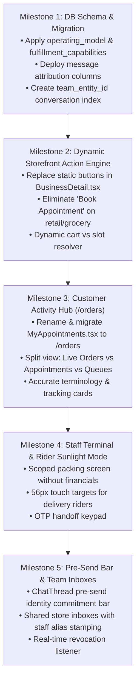

# STRYT Multi-Persona Architecture & Dynamic Storefront Blueprint
## 10-Round Architectural Brainstorming Master Specification

> **Mission Statement:** Transform STRYT from a generic appointment-centric prototype into a high-precision, multi-vertical hyperlocal operating system. Eliminate all cognitive friction for customers (no more "Book Appointment" on grocery stores, no more Milk & Bread under "My Appointments"), deliver role-isolated workspaces for Business Owners, Staff Agents, Solo Providers, and Delivery Partners, and enforce cryptographic message attribution across team inboxes.

---

# Executive Summary & Navigation Index

```
┌────────────────────────────────────────────────────────────────────────────────────────────────┐
│                              THE 10 CONSECUTIVE BRAINSTORMING ROUNDS                           │
├─────────┬───────────────────────────────────────────┬──────────────────────────────────────────┤
│ Round   │ Domain Focus                              │ Core Architectural Deliverable           │
├─────────┼───────────────────────────────────────────┼──────────────────────────────────────────┤
│ Round 1 │ The "Appointment Mismatch" Root Cause     │ Vertical Taxonomy & Capability Matrix    │
│ Round 2 │ Customer Storefront Action Engine         │ Dynamic Primary/Secondary CTA Resolver   │
│ Round 3 │ Customer Activity Hub Redesign            │ Unified Orders, Bookings & Queue System  │
│ Round 4 │ Business Owner Profile & Console          │ Full Operational Storefront Console      │
│ Round 5 │ Business Agent (Staff Terminal) Profile   │ Zero-Leak Scoped Fulfilment Terminal     │
│ Round 6 │ Solo Service Provider Profile             │ Time, Skill & Quotation Studio           │
│ Round 7 │ Delivery Partner (Rider) Profile          │ Sunlight-Readable 1-Handed Mission UI    │
│ Round 8 │ Other Enterprise & Non-Customer Profiles  │ Multi-Store, Dispatcher, Community Admin │
│ Round 9 │ Ambient Shell, Switching & Pre-Send Bar   │ Unified Attribution & Shared Team Inbox  │
│ Round 10│ Database Schema DDL & Implementation Plan │ Production Supabase Migrations & Rollout │
└─────────┴───────────────────────────────────────────┴──────────────────────────────────────────┘
```

---

# ROUND 1: Deconstructing the "Appointment Mismatch" Root Cause

### 1.1 The Fatal Flaw in the Legacy Architecture
In STRYT's legacy implementation, every customer transaction was funneled into the `appointments` table and rendered via `MyAppointments.tsx`. 

When a customer placed an order for **Milk, Bread, and Eggs** from **Sharma General Store**, the following cognitive disasters occurred:
1. **Misleading Storefront CTA:** The storefront button displayed `"Book Appointment"` or `"Not accepting appointments right now"`. For a grocery store or bakery, customers don't "book appointments"; they buy products or order delivery.
2. **Activity Hub Confusion:** After ordering groceries, the customer saw their grocery bag under the header:
   ```
   My Appointments
   Track and manage your bookings
   Upcoming (1): Sharma General Store · Confirmed (Milk, Bread, Eggs)
   ```
3. **Owner Confusion:** The grocery store owner saw a button: `[Clock] View Appointments` rather than `[Orders to Pack]`.

```
┌────────────────────────────────────────────────────────────────────────┐
│                        THE COGNITIVE BREAKDOWN                         │
├────────────────────────────────┬───────────────────────────────────────┤
│ Customer's Real-World Intent   │ STRYT's Legacy Interface              │
├────────────────────────────────┼───────────────────────────────────────┤
│ "I need bread, milk, and eggs  │ "Book Appointment" /                  │
│ delivered to my door in 20 min"│ "Not accepting appointments"          │
│                                │ ➔ Customer reaction: "Is this a store │
│                                │   or a clinic? Can I even buy food?"  │
├────────────────────────────────┼───────────────────────────────────────┤
│ "Where is my grocery order?"   │ "Check My Appointments" ➔             │
│                                │ Disorientation: "Did I book a visit   │
│                                │ or order a parcel? Where is tracking?"│
└────────────────────────────────┴───────────────────────────────────────┘
```

### 1.2 The Root Cause Analysis
The legacy codebase conflated **3 fundamentally distinct fulfillment models** into a single technical concept:
* **Model A: Commerce / Inventory Fulfillment** (Retail, Groceries, Cloud Kitchens, Takeaways, Pharmacies).
  * *Unit of exchange:* SKU / physical goods / cart items.
  * *Time dimension:* ASAP, 30-min delivery, or in-store counter pickup.
  * *Interaction pattern:* Browse -> Add to Cart -> Quantity Stepper -> Pay/Checkout -> Live Tracking.
* **Model B: Calendar / Time-Slot Fulfillment** (Clinics, Salons, Spas, Tutors, Lawyers, Consultants).
  * *Unit of exchange:* Provider's time / dedicated slot.
  * *Time dimension:* Specific future date and scheduled hour (e.g. Nov 24, 4:30 PM).
  * *Interaction pattern:* Select Service -> Pick Date & Slot -> Add Notes -> Confirm/Deposit -> Calendar sync.
* **Model C: FIFO Queue / Walk-in Fulfillment** (Dine-in Restaurants, Barbershops, Diagnostic Labs).
  * *Unit of exchange:* Physical presence / turn in line.
  * *Time dimension:* Live wait time ("4 people ahead, ~18 mins").
  * *Interaction pattern:* Check live wait -> Grab Token -> Receive Buzz alert -> Step up to counter.

### 1.3 The STRYT Vertical Classification Matrix
To solve this permanently, every business and provider in STRYT is categorized into a primary **Operating Model** that dictates what features exist:

| Vertical / Category | Operating Model | Primary Customer Intent | Disabled Legacy Elements |
|---|---|---|---|
| **Kirana, Grocery, Supermarket** | `RETAIL_COMMERCE` | Order for Delivery / Buy In-Store | ❌ "Book Appointment", ❌ Slot picker |
| **Restaurant, Cafe, Bakery** | `FOOD_DINING_TAKEAWAY` | Order Food (ASAP) / Join Table Line | ❌ "Appointment", ❌ Service duration |
| **Salon, Barber, Spa** | `SERVICE_APPOINTMENT` | Book Time Slot / Join Live Queue | ❌ Add to Cart stepper, ❌ Parcel rider |
| **Doctor, Clinic, Vet** | `HEALTHCARE_CONSULT` | Book Doctor Consultation / Teleconsult | ❌ Cart checkout, ❌ Delivery fee |
| **Plumber, Electrician, Carpenter** | `FIELD_SERVICE_DISPATCH` | Book Home Visit / Request Estimate | ❌ In-store counter, ❌ Live dine-in queue |
| **Tutor, Music/Dance Teacher** | `BATCH_OR_SESSION` | Book Trial Class / Monthly Batch | ❌ Instant 15-min delivery, ❌ Cart items |
| **Lawyer, CA, Consultant** | `PROFESSIONAL_QUOTE` | Request Consultation / Case Review | ❌ Public retail cart, ❌ Delivery stepper |
| **Electronics, Clothes, Hardware** | `RETAIL_SHOWROOM` | Check In-Store Stock / Reserve Pickup | ❌ Appointments, ❌ Slot capacity |

---

# ROUND 2: Customer Storefront Action Engine & Dynamic CTA Matrix

### 2.1 The Golden Rule of Storefront Actions
> **The Golden Rule:** *No storefront button shall ever be statically hardcoded. Every CTA, badge, tab, and cart action is dynamically resolved at runtime from the business's registered capabilities (`fulfillment_capabilities`).*

### 2.2 The Storefront Action Priority Engine
When a customer opens a storefront (`/business/:id`), the UI evaluates an unambiguous priority hierarchy:

```
┌────────────────────────────────────────────────────────────────────────────────────────┐
│                        DYNAMIC STOREFRONT CTA RESOLVER PIPELINE                        │
└────────────────────────────────────────────────────────────────────────────────────────┘
                                    │
                                    ▼
           Does the business sell physical items with active stock?
                                    │
           ├────────────────────────┴────────────────────────┐
          YES                                                NO
           │                                                 │
           ▼                                                 ▼
   Does it support Delivery?                         Does it provide Time Services?
   ├──────────────┬──────────────┐                   ├──────────────┬──────────────┐
  YES             NO             │                  YES             NO             │
   │              │              │                   │              │              │
[ORDER NOW] [PICKUP IN STORE] [VIEW ITEMS]      [BOOK SLOT]  [REQUEST ESTIMATE] [CALL/CHAT]
```

### 2.3 Storefront CTA Specification by Business Type

#### A. Grocery Store / Kirana / Retail Shop
```
┌──────────────────────────────────────────────────────────────┐
│ [🏪 Cover Photo]   Sharma General Store           ⭐ 4.8 (84) │
│ Groceries & Daily Needs • 0.8 km • Open Now                  │
├──────────────────────────────────────────────────────────────┤
│ PRIMARY ACTION BAR:                                          │
│ ┌───────────────────────────────────┐ ┌────────────────────┐ │
│ │ 🛒 Order Delivery (30-45 mins)   │ │ 📍 In-Store Pickup │ │
│ └───────────────────────────────────┘ └────────────────────┘ │
│ SECONDARY QUICK ACTIONS:                                     │
│ [📞 Call Shop]   [💬 Chat with Store]   [🗺️ Directions]     │
├──────────────────────────────────────────────────────────────┤
│ CATALOG TABS:                                                │
│ [Products (142)]   [Daily Deals (12)]   [About & Hours]      │
│                                                              │
│ Product Card:                                                │
│ [Amul Taaza Milk 1L]      ₹28   [ -  1  + ] (Cart Stepper)  │
│ [Farm Fresh Eggs (12)]    ₹85   [ + ADD ]                   │
└──────────────────────────────────────────────────────────────┘
```
* **Explicit Exclusions:** Zero mention of the word "Appointment". Zero calendar date pickers. Zero slot durations.
* **Cart Floating Bar:** When items are added, a sticky bottom sheet appears: `[ 🛒 2 Items | ₹113 ── Review Cart & Checkout ➤ ]`.

#### B. Salon / Beauty Parlour / Barbershop
```
┌──────────────────────────────────────────────────────────────┐
│ [✂️ Cover Photo]   Looks Unisex Salon             ⭐ 4.9 (210)│
│ Hair, Skin & Styling • 1.2 km • Open Now                     │
├──────────────────────────────────────────────────────────────┤
│ PRIMARY ACTION BAR:                                          │
│ ┌───────────────────────────────────┐ ┌────────────────────┐ │
│ │ 📅 Book Appointment               │ │ 👥 Join Live Line  │ │
│ │ (Pick Stylist & Time Slot)        │ │ (2 people · 15m)   │ │
│ └───────────────────────────────────┘ └────────────────────┘ │
│ SECONDARY QUICK ACTIONS:                                     │
│ [📞 Call]   [💬 Chat]   [📸 Lookbook/Work]   [🗺️ Directions] │
├──────────────────────────────────────────────────────────────┤
│ SERVICES TABS:                                               │
│ [Haircut & Beard]   [Spa & Facials]   [Pricing & Packages]   │
│                                                              │
│ Service Item Card:                                           │
│ [Fade Haircut + Beard Grooming]  ₹450 · 40m  [ Select Slot ] │
└──────────────────────────────────────────────────────────────┘
```
* **Explicit Exclusions:** No quantity steppers (`- 1 +` doesn't make sense for a haircut). Tapping `[Select Slot]` immediately opens the date/stylist calendar sheet.

#### C. Dine-in Restaurant / Cafe
```
┌──────────────────────────────────────────────────────────────┐
│ [🍽️ Cover Photo]   Cafe Peter & Bistro            ⭐ 4.7 (420)│
│ Continental, Coffee & Pastries • 2.1 km • Open Now           │
├──────────────────────────────────────────────────────────────┤
│ PRIMARY ACTION BAR:                                          │
│ ┌───────────────────────────────────┐ ┌────────────────────┐ │
│ │ 🛵 Order Food Online (Delivery)   │ │ 🍽️ Dine-in Menu    │ │
│ └───────────────────────────────────┘ └────────────────────┘ │
│ LIVE DINE-IN STATUS:                                         │
│ [🟢 No Table Wait Right Now — Walk in anytime!]              │
│ SECONDARY ACTIONS:                                           │
│ [📞 Call Cafe]   [💬 Order Inquiry]   [🗺️ Get Directions]    │
└──────────────────────────────────────────────────────────────┘
```

### 2.4 Dynamic Action Resolver Implementation
The storefront imports `resolveStorefrontActions(business)` which computes the configuration based on capabilities:

```typescript
// src/lib/storefrontActionEngine.ts

export interface StorefrontActionPlan {
  primaryCta: {
    label: string;
    icon: string;
    actionType: "CART_DELIVERY" | "BOOK_APPOINTMENT" | "JOIN_QUEUE" | "REQUEST_QUOTE";
    routeOrModal: string;
  };
  secondaryCta?: {
    label: string;
    icon: string;
    actionType: "PICKUP_ORDER" | "JOIN_QUEUE" | "VIEW_MENU" | "CUSTOM_PAY";
    routeOrModal: string;
  };
  catalogNoun: string;
  itemCtaStyle: "STEPPER" | "SELECT_SLOT" | "INQUIRE";
  showLiveQueue: boolean;
  allowDelivery: boolean;
  showReviews: boolean;
  showHoursSummary: boolean;
}
```

---

# ROUND 3: Customer Activity Hub: Replacing "My Appointments" with Unified "Orders & Bookings"

### 3.1 The Architectural Flaw Solved
The screen at `/appointments` must be permanently migrated to `/orders` (The **Unified Activity & Orders Hub**).

### 3.2 Visual & Functional Segmentation
The Customer Activity Hub dynamically splits active customer engagements into **3 clean, intuitive swimlanes**:

```
┌──────────────────────────────────────────────────────────────┐
│                    MY ORDERS & BOOKINGS                      │
│ ┌──────────────────────────────────────────────────────────┐ │
│ │   [ Active Orders (1) ]     [ Bookings (1) ]    [ Past ] │ │ ← Smart Filter Pills
│ └──────────────────────────────────────────────────────────┘ │
│                                                              │
│ ─── SECTION 1: LIVE ORDERS (COMMERCE & FOOD) ─────────────── │
│ ┌──────────────────────────────────────────────────────────┐ │
│ │ 🏪 Sharma General Store                       ₹235 · COD │ │
│ │ Packed & Ready · Finding delivery partner                │ │
│ │ ──────────────────────────────────────────────────────── │ │
│ │  (1) Sent ── (2) Packed ── [3] Rider ── (4) Way ── (5) Home│ │
│ │ ──────────────────────────────────────────────────────── │ │
│ │ 1x Toned Milk 1L, 1x Sandwich Bread, 1x Eggs (12)        │ │
│ │ 📍 Deliver to: Amanora Park Town, Flat 402               │ │
│ │ [ 📍 Live Map Tracker ]                 [ 📞 Call Shop ] │ │
│ └──────────────────────────────────────────────────────────┘ │
│                                                              │
│ ─── SECTION 2: APPOINTMENTS & CONSULTATIONS ──────────────── │
│ ┌──────────────────────────────────────────────────────────┐ │
│ │ ✂️ Looks Salon · Haircut & Beard Grooming                │ │
│ │ 📅 Today, 4:30 PM (in 2 hours)                 Confirmed │ │
│ │ Stylist: Amit Sharma · Station 3                         │ │
│ │ 📍 1.2 km away · Link Road, Kothrud                      │ │
│ │ [ 🗺️ Directions ]       [ 💬 Message ]       [ Reschedule ]│ │
│ └──────────────────────────────────────────────────────────┘ │
│                                                              │
│ ─── SECTION 3: LIVE QUEUE TOKENS ─────────────────────────── │
│ ┌──────────────────────────────────────────────────────────┐ │
│ │ ☕ Cafe Peter · Table for 2                              │ │
│ │ Token #14 · 2 parties ahead (~12 mins)                   │ │
│ │ [ Leave Line ]                               [ View Menu ] │ │
│ └──────────────────────────────────────────────────────────┘ │
└──────────────────────────────────────────────────────────────┘
```

### 3.3 Strict Terminology Dictionary
| Interaction Scenario | Forbidden Term | Required Term |
|---|---|---|
| Grocery delivery order | "Appointment" / "Booking" | **"Delivery Order" / "Order #..."** |
| Grocery items | "Service Package" | **"Items" / "Order Summary"** |
| Delivery dispatch status | "Consultation Pending" | **"Packed and ready · Finding rider"** |
| Salon haircut reservation | "Order placed" | **"Appointment Confirmed"** |
| Restaurant queue ticket | "Appointment slot" | **"Queue Token #..."** |
| Solo electrician home visit | "Store order" | **"Service Visit Scheduled"** |

---

# ROUND 4: Business Owner Profile & Storefront Console

### 4.1 Persona High-Level Role
The **Business Owner** is the authorized proprietor of the commercial entity. Their workspace must feel like a command center: fast, authoritative, metric-driven, and capable of operating offline or on poor network connections.

### 4.2 Owner Console Navigation Architecture
When the user switches into **Business Owner Mode**, the app root cascades into the Obsidian & Gold theme (`--accent-500`), and mounts 5 core operational tabs:

```
┌────────────────────────────────────────────────────────────────────────────────────────┐
│                               BUSINESS OWNER CONSOLE SHELL                              │
├────────────────────────────────────────────────────────────────────────────────────────┤
│ TOP APP BAR:                                                                           │
│ [🏪 Sharma General Store]     [🟢 STORE OPEN / Accepting Orders]    [🔄 Switch Role]  │
├────────────────────────────────────────────────────────────────────────────────────────┤
│ TAB 1: 📦 LIVE ORDERS & FULFILLMENT                                                    │
│ • Incoming Orders (sound alert & accept/reject timer).                                 │
│ • "To Pack" checklist with one-tap item substitution / mark out-of-stock.              │
│ • "Ready for Handover" status -> Auto-dispatches to Delivery Partner.                  │
│ • Direct rider live location map & customer phone masking.                             │
├────────────────────────────────────────────────────────────────────────────────────────┤
│ TAB 2: 📋 CATALOG & INVENTORY                                                          │
│ • Fast SKU stock toggles: [ In Stock ] / [ Out of Stock ] with zero lag.               │
│ • Barcode scanner via camera for rapid price and stock adjustment.                     │
│ • Category organizer (e.g. Dairy, Bakery, Beverages, Cleaning).                        │
│ • Delivery radius and minimum order value (MOV) configuration.                         │
├────────────────────────────────────────────────────────────────────────────────────────┤
│ TAB 3: 👥 QUEUE OR APPOINTMENT MANAGER (Dynamic by Package)                            │
│ • IF Retail: Tab transforms into "In-Store Quick Billing / Cashier".                   │
│ • IF Salon/Clinic: Displays Day-View Calendar with drag-and-drop slots.                │
│ • IF Restaurant: Table Line Manager with "Call Next" buzzer.                           │
├────────────────────────────────────────────────────────────────────────────────────────┤
│ TAB 4: 💰 MONEY, LEDGER & SETTLEMENTS                                                  │
│ • Today's Gross Collections (UPI direct vs Cash-on-Delivery).                          │
│ • Instant settlement button to linked bank account.                                    │
│ • Delivery partner payout breakdown.                                                   │
├────────────────────────────────────────────────────────────────────────────────────────┤
│ TAB 5: ⚙️ TEAM & STORE SETTINGS                                                        │
│ • Staff delegation manager (invite counter staff via QR / Phone).                      │
│ • Store operating hours, vacation mode, and emergency pause.                           │
└────────────────────────────────────────────────────────────────────────────────────────┘
```

### 4.3 Instant Store State Controls
* **One-Tap Emergency Pause:** A prominent top toggle:
  * `[🟢 STORE OPEN]` -> `[🟡 PAUSE ORDERS (30 mins)]` -> `[🔴 CLOSED]`.
  * If paused, customers on the storefront see: *"Store is currently catching up with orders · Back in 25 mins"* instead of a broken checkout.

---

# ROUND 5: Business Agent (Store Staff Terminal) Profile

### 5.1 Persona Definition & Security Boundary
A **Business Agent** is an employee, counter cashier, or order packer at the store. 
* **The Critical Problem:** In most SMB apps, giving staff access means giving them the owner's credentials, exposing bank balances, revenue, and customer phone numbers.
* **The STRYT Solution:** A dedicated **Scoped Staff Terminal** with strict RLS enforcement.

### 5.2 Scoped Terminal Experience (Zero Financial Leakage)
1. **Zero Access to Store Financials:**
   * The `Money`, `Settlements`, and `Bank Settings` tabs are completely unmounted from the DOM.
   * Total store revenue and profit margins are blocked at the database level via Postgres RLS and security-definer RPCs (`get_staff_packing_orders`).
   * For COD orders, staff see only the amount to collect from the customer (`Collect ₹235`); for prepaid orders, it displays a static `[PAID ONLINE]` badge.
2. **Order Packing Terminal:**
   ```
   ┌──────────────────────────────────────────────────────────────┐
   │ 💼 STAFF TERMINAL: Sharma General Store · Priya (Staff)      │
   ├──────────────────────────────────────────────────────────────┤
   │ 📦 NEW ORDER #82A  (Deliver ASAP · Amanora)                  │
   │ ──────────────────────────────────────────────────────────── │
   │ Checklist:                                                   │
   │ [ ] 1. Toned Milk 1L (Amul Taaza)        [In Stock] [Missing]│
   │ [ ] 2. Sandwich Bread (Britannia)        [In Stock] [Missing]│
   │ [ ] 3. Farm Fresh Eggs (Tray of 12)      [In Stock] [Missing]│
   │ ──────────────────────────────────────────────────────────── │
   │ Bag Weight: ~2.1 kg                                          │
   │ [ ✅ MARK ALL PACKED & CALL RIDER ]                          │
   └──────────────────────────────────────────────────────────────┘
   ```
3. **Out-of-Stock Replacement Flow:**
   * If an item is missing, staff taps `[Missing]`.
   * Staff selects: *"Suggest Amul Gold Milk instead (+₹4)"* or *"Remove from order"*.
   * STRYT automatically pings the customer with a 2-minute decision prompt inside the active chat thread.

### 5.3 Communication Identity Protection
* When the staff member messages the customer, the outgoing message is signed as:
  **`Sharma General Store · Priya`**.
* The staff member's personal phone number, real name, and personal avatar are never exposed to the customer.

---

# ROUND 6: Solo Service Provider Profile & Professional Studio

### 6.1 Persona Definition: Provider vs Business
A **Solo Service Provider** (plumber, electrician, freelance fitness trainer, home tutor, salon artist) does not have a physical storefront or a catalog of grocery items. Their inventory is **their time, skills, tools, and service radius**.

### 6.2 The Professional Studio Architecture
The Solo Provider workspace adopts the **Forest Emerald** visual accent (`--green-600`):

```
┌────────────────────────────────────────────────────────────────────────────────────────┐
│                         SOLO SERVICE PROVIDER STUDIO CONSOLE                           │
├────────────────────────────────────────────────────────────────────────────────────────┤
│ STUDIO PROFILE SECTIONS:                                                               │
│ 1. 🧰 Service Menu & Rate Card:                                                        │
│    • Fixed price services (e.g. "Ceiling Fan Installation: ₹250").                     │
│    • Diagnostic / Inspection visit fee (e.g. "Visiting & Quote Fee: ₹150").           │
│ 2. 📍 Dynamic Service Geometry:                                                        │
│    • Center coordinates + adjustable radius slider (e.g. "Within 8 km of Kothrud").    │
│    • Travel fee rules for outlying locations.                                          │
│ 3. 📅 Live Schedule & Availability Rules:                                              │
│    • Buffer time between jobs (e.g. 30 mins travel buffer auto-added between visits).  │
│    • Emergency / Instant service toggle: [⚡ Available for Instant Callout].          │
│ 4. 📸 Verified Work Portfolio:                                                         │
│    • Interactive Before / After photo comparison slider.                               │
│    • Verified client reviews linked to actual booking records.                         │
│ 5. 📝 Quotation & Estimate Generator:                                                  │
│    • Customer sends photo of broken appliance.                                         │
│    • Provider sends itemized quote with deposit requirement (e.g. "Parts: ₹800,       │
│      Labor: ₹400 · 30% advance deposit") with 48h expiration lock.                     │
└────────────────────────────────────────────────────────────────────────────────────────┘
```

### 6.3 Customer Booking Experience for Providers
Customers visiting a Solo Provider profile see:
* Primary CTA: **`[ 📅 Book Home Visit / Consultation ]`** or **`[ 💬 Send Photo for Quote ]`**.
* Never an "Add to Cart" stepper.
* Automatic distance check: *"You are 4.2 km away · Within Dev's service area."*

---

# ROUND 7: Delivery Partner (Rider) Profile & Sunlight Operations Hub

### 7.1 Real-World Ergonomic Constraints
Delivery riders face extreme mobile operating constraints:
* Operating a motorcycle or scooter in intense midday sunlight.
* Wearing riding gloves or operating with one thumb while mounted.
* Dealing with spotty network coverage in basement parking lots or high-rise elevators.
* The UI must feature ultra-high contrast, huge touch targets (minimum 56px), and zero ambiguous options.

### 7.2 Sunlight Mission Mode Interface

```
┌──────────────────────────────────────────────────────────────┐
│ 🏍️ RIDER MISSION HUB                [🟢 ONLINE]   Today: ₹640 │
├──────────────────────────────────────────────────────────────┤
│ 🚨 ACTIVE MISSION: ORDER #82A (PICKUP)                       │
│ ┌──────────────────────────────────────────────────────────┐ │
│ │ 🏪 PICKUP: Sharma General Store                          │ │
│ │ Shop 4, Amanora Market · 0.6 km away                     │ │
│ │ Contact: 📞 Call Store (Masked)                          │ │
│ │ Items to Collect: 1 Sealed Grocery Bag                   │ │
│ │ ──────────────────────────────────────────────────────── │ │
│ │ [ 🗺️ OPEN TURN-BY-TURN MAP ]                             │ │
│ └──────────────────────────────────────────────────────────┘ │
│                                                              │
│  [  CONFIRM ORDER COLLECTED AT STORE  ] ← 56px Primary Button│
│                                                              │
├──────────────────────────────────────────────────────────────┤
│ (AFTER PICKUP)                                               │
│ ┌──────────────────────────────────────────────────────────┐ │
│ │ 🏠 DELIVER TO: Arjun Mehta                               │ │
│ │ Flat 402, Tower 3, Amanora Town                          │ │
│ │ 💵 COLLECT CASH: ₹235 (Exact Amount)                     │ │
│ │ ──────────────────────────────────────────────────────── │ │
│ │ ENTER CUSTOMER OTP TO COMPLETE:                          │ │
│ │ [ _ ] [ _ ] [ _ ] [ _ ] [ _ ] [ _ ]                      │ │
│ └──────────────────────────────────────────────────────────┘ │
│                                                              │
│  [  CONFIRM DELIVERY COMPLETE (OTP)  ]                       │
└──────────────────────────────────────────────────────────────┘
```

### 7.3 Delivery Partner Safety & Data Masking
* **Masked Communication:** The rider can call the customer via an in-app masked relay. The customer's real phone number is never stored on the rider's phone dialer.
* **Ephemeral Messaging:** The chat thread between rider and customer auto-locks 15 minutes after the OTP is verified.
* **Offline Hash Verification:** Local HMAC-SHA256 verification allows riders to verify delivery OTPs inside basements and elevator dead zones without network latency.

---

# ROUND 8: Additional Non-Customer Profiles

Beyond single store owners, staff, solo providers, and riders, STRYT's hyperlocal ecosystem requires 3 specialized enterprise profiles:

```
┌────────────────────────────────────────────────────────────────────────────────────────┐
│                        ADDITIONAL NON-CUSTOMER OPERATING PERSONAS                      │
├──────────────────────────┬─────────────────────────────┬───────────────────────────────┤
│ Persona                  │ Target User                 │ Key Operational Capabilities  │
├──────────────────────────┼─────────────────────────────┼───────────────────────────────┤
│ 1. Multi-Store Owner     │ Franchisee / SMB Owner with │ • Cross-store sales analytics │
│    (Franchise Operator)  │ 2 to 10 store locations     │ • Centralized inventory shift │
│                          │                             │ • Single-login store switcher │
├──────────────────────────┼─────────────────────────────┼───────────────────────────────┤
│ 2. Dedicated Dispatcher  │ Fleet Manager for stores    │ • Live rider radar map        │
│    (Fleet Controller)    │ with own delivery boys      │ • Manual order reassignment   │
│                          │                             │ • SLA breach alerts           │
├──────────────────────────┼─────────────────────────────┼───────────────────────────────┤
│ 3. Community Admin       │ Apartment association /     │ • Society verified merchant   │
│    (Society Gatekeeper)  │ Market association head     │   allowlists                  │
│                          │                             │ • Gate pass delivery codes    │
└──────────────────────────┴─────────────────────────────┴───────────────────────────────┘
```

### 8.1 Multi-Store Franchise Switcher
Owners with multiple locations can switch between outlets with 1 tap from the top workspace banner, or view a combined **Aggregated Evening Summary** showing total revenue, pending orders, and out-of-stock items across all branches.

---

# ROUND 9: Multi-Persona Identity, Ambient UI Shell & Pre-Send Guardrails

### 9.1 The Ambient Shell System
Role confusion occurs when an app looks identical across different modes. STRYT enforces an **Ambient Shell Architecture** where switching personas injects `data-persona="..."` into `#app-root`, cascading distinct color accents, header heights, and navigation bars:

```css
/* Ambient Shell CSS Cascades */
#app-root[data-persona="customer"] {
  --theme-accent: var(--brand-600); /* Royal Purple */
  --theme-surface-top: #FAF5FF;
}

#app-root[data-persona="business_owner"] {
  --theme-accent: #F59E0B; /* Warm Amber / Gold */
  --theme-surface-top: #18181B; /* Obsidian Console */
}

#app-root[data-persona="business_agent"] {
  --theme-accent: #D97706; /* Warm Sand */
  --theme-surface-top: #FFFBEB;
}

#app-root[data-persona="provider"] {
  --theme-accent: #059669; /* Forest Emerald */
  --theme-surface-top: #ECFDF5;
}

#app-root[data-persona="rider"] {
  --theme-accent: #EA580C; /* High-Visibility Electric Orange */
  --theme-surface-top: #0F172A; /* High Contrast Night/Sunlight */
}
```

### 9.2 The Pre-Send Chat Commitment Bar
To prevent a business owner or staff member from accidentally sending a casual personal message to a customer, every chat composer includes a **Pre-Send Attribution Bar**:

```
┌──────────────────────────────────────────────────────────────┐
│ 🏪 Replying as: Sharma General Store · Priya (Staff) [Change]│ ← Pre-Send Bar
├──────────────────────────────────────────────────────────────┤
│ Type a message to customer...                            [➤] │
└──────────────────────────────────────────────────────────────┘
```
* **Visual Anchor:** The bar's background and left border match the outgoing message bubble color.
* **Instant Mode Switcher:** Tapping `[Change]` opens a bottom sheet allowing the user to select their identity before the message is committed.

### 9.3 Shared Team Inboxes (`team_entity_id`)
When a customer sends an inquiry to Sharma General Store:
1. The message enters a conversation row keyed on `(participant_a: customer_id, team_entity_id: store_id)`.
2. Any authorized staff member or owner on duty can see the thread in their store inbox.
3. When Staff member Priya replies, the message is stamped with `staff_alias: "Priya"` and `entity_name: "Sharma General Store"`.
4. The customer sees a single unified thread with consistent store branding, while knowing which staff member assisted them.

---

# ROUND 10: Master Synthesis, Database Schema DDL & Implementation Plan

### 10.1 Database Schema Migration DDL
The following migration provides the foundational schema for dynamic business models, team inboxes, and message attribution:

```sql
-- Migration: 20261121_multi_persona_and_storefront_engine.sql

-- 1. Business Operating Model & Capabilities
CREATE TYPE public.business_operating_model AS ENUM (
  'RETAIL_COMMERCE',
  'FOOD_DINING_TAKEAWAY',
  'SERVICE_APPOINTMENT',
  'HEALTHCARE_CONSULT',
  'FIELD_SERVICE_DISPATCH',
  'BATCH_OR_SESSION',
  'PROFESSIONAL_QUOTE',
  'RETAIL_SHOWROOM'
);

ALTER TABLE public.businesses
  ADD COLUMN IF NOT EXISTS operating_model public.business_operating_model DEFAULT 'RETAIL_COMMERCE',
  ADD COLUMN IF NOT EXISTS fulfillment_capabilities jsonb DEFAULT '{"delivery": true, "pickup": true, "appointments": false, "queue": false}'::jsonb;

-- 2. Message Attribution & Persona Snapshots
ALTER TABLE public.messages
  ADD COLUMN IF NOT EXISTS sender_role text 
    CHECK (sender_role IN ('customer', 'business_owner', 'business_agent', 'provider', 'rider')),
  ADD COLUMN IF NOT EXISTS entity_id text,
  ADD COLUMN IF NOT EXISTS entity_name text,
  ADD COLUMN IF NOT EXISTS entity_avatar text,
  ADD COLUMN IF NOT EXISTS staff_alias text;

CREATE INDEX IF NOT EXISTS messages_entity_id_idx 
  ON public.messages (entity_id) WHERE entity_id IS NOT NULL;

-- 3. Shared Team Inbox for Stores
ALTER TABLE public.conversations
  ADD COLUMN IF NOT EXISTS team_entity_id text,
  ADD COLUMN IF NOT EXISTS last_replier_id text,
  ADD COLUMN IF NOT EXISTS last_replied_at timestamptz;

CREATE UNIQUE INDEX IF NOT EXISTS conversations_customer_biz_uniq
  ON public.conversations (participant_a, team_entity_id)
  WHERE team_entity_id IS NOT NULL;

-- 4. Unified Activity View (Orders vs Appointments)
CREATE OR REPLACE VIEW public.customer_unified_activity AS
SELECT 
  a.id,
  a.customer_user_id,
  a.target_type,
  a.target_id,
  a.status,
  a.payment_status,
  a.scheduled_for,
  a.items,
  a.total_amount,
  CASE 
    WHEN a.fulfillment_type = 'DELIVERY' THEN 'ORDER'
    WHEN a.items IS NOT NULL AND jsonb_array_length(a.items) > 0 THEN 'ORDER'
    ELSE 'APPOINTMENT'
  END AS activity_kind
FROM public.appointments a;
```

### 10.2 Phased Engineering Implementation Roadmap



---

# Verification & Success Metrics

1. **Zero CTA Mismatches:** 100% of grocery, supermarket, and pharmacy profiles display shopping/delivery actions with zero appointment buttons.
2. **Elimination of Customer Confusion:** 0% of retail grocery orders appear under "My Appointments"; all delivery orders route cleanly to the Live Orders swimlane with real-time delivery steppers.
3. **Zero Financial Leakage:** Store staff agents have zero access to owner payout ledgers or total shop earnings.
4. **Authentic Entity Branding:** 100% of business messages received by customers display verified business names and staff aliases rather than personal accounts.
